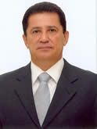

# Alfredo Nascimento

| Campo | Dado |
|---|---|
| Nome completo | Alfredo Pereira do Nascimento |
| Nascimento | 05/05/1952 — Martins/RN |
| Partidos (filiações) | PL (01/02/2007) |
| Página oficial | http://www25.senado.leg.br/web/senadores/senador/-/perfil/4527 |

## Trajetória eleitoral no AM (TSE, eleições gerais)

Identificador comum da plataforma: `pessoa_id 9fe1f93f9a`. Cargos municipais (prefeito, vereador) ficam no repositório dossieprefeitosAM.

| Ano | Turno | Cargo | Partido | Nº | Votos | % votos nominais | Resultado |
|---|---|---|---|---|---|---|---|
| 2006 | 1 | Senador | PL | 222 | 629.606 | 47,49% | ELEITO |
| 2010 | 1 | Governador | PR | 22 | 382.935 | 25,91% | NÃO ELEITO |
| 2014 | 1 | Deputado federal | PR | 2222 | 120.060 | 7,7% | ELEITO POR QP |
| 2018 | 1 | Senador | PR | 222 | 569.766 | 17,31% | NÃO ELEITO |
| 2022 | 1 | Deputado federal | PL | 2222 | 46.760 | 2,44% | SUPLENTE |
| 2026 | 1 | Deputado federal | PL | 2222 | 59.271 | 2,87% | ELEITO POR MÉDIA |

## Mandatos pelo AM

| Mandato | Condição | Titular | Suplentes | Exercícios |
|---|---|---|---|---|
| 01/02/2007 a 31/01/2015 | Titular | — | João Pedro (1º Suplente); Aluisio Augusto de Queiroz Braga (2º Suplente) | 08/07/2011 a 31/01/2015 (Término do mandato); 01/04/2010 a 31/12/2010 (Afastamento do exercício); 01/02/2007 a 29/03/2007 (Afastamento do exercício) |

## Indicadores por legislatura

| Indicador | 53ª (2007–2011) | 54ª (2011–2015) |
|---|---|---|
| Dias em exercício | 332 | 1304 |
| Matérias apresentadas (todos os tipos) | 4 | 123 |
| Projetos e PECs como 1º autor | 3 | 42 |
| Requerimentos | 0 | 20 |
| **Normas geradas – 1º autor** | **0** | **1** |
| Normas geradas – coautor | 0 | 0 |
| Votações nominais: presente | 110/114 (96,5%) | 428/428 (100,0%) |
| Ausência justificada (licença, missão, atividade parlamentar) | 4 | 0 |
| Não compareceu (sem justificativa) | 0 | 0 |
| Discursos | 6 | 93 |
| CEAPS (cota) | R$ 10.756,98 | R$ 817.442,49 |
| Emendas empenhadas | — | — |
| Emendas pagas | — | — |

## Normas geradas por matérias de sua autoria (2)

| Matéria | Norma | Data | Autoria | Ementa |
|---|---|---|---|---|
| [PLS 243/2010](https://www25.senado.leg.br/web/atividade/materias/-/materia/98112) | Lei nº 12.978 de 21/05/2014 | 21/05/2014 | 1º autor | Altera a Lei nº 8.072, de 25 de julho de 1990, para classificar como hediondo o crime de exploraçao sexual de criança ou adolescente. |
| [PEC 103/2011](https://www25.senado.leg.br/web/atividade/materias/-/materia/102933) | Emenda Constitucional nº 87 de 16/04/2015 | 16/04/2015 | coautor | Acrescenta o inciso VIII-A ao § 2º do art. 155 da Constituição Federal, para modificar a sistemática de cobrança do imposto sobre operações relativas à circulação de mercadorias e  |

## Produção por tipo (127 matérias)

| Tipo | Descrição | Total | Como 1º autor |
|---|---|---|---|
| PEC | Proposta de Emenda à Constituição | 62 | 4 |
| PLS | Projeto de Lei do Senado | 42 | 41 |
| RQS | Requerimento | 17 | 5 |
| RCT |  | 2 | 0 |
| PDS | Projeto de Decreto Legislativo (Senado) | 1 | 0 |
| PRS | Projeto de Resolução do Senado | 1 | 0 |
| OFS |  | 1 | 1 |
| R.S |  | 1 | 0 |

### Projetos e PECs como 1º autor (45)

| Matéria | Apresentação | Situação | Ementa |
|---|---|---|---|
| [PEC 25/2014](https://www25.senado.leg.br/web/atividade/materias/-/materia/118314) | 17/07/2014 | ARQUIVADA AO FINAL DA LEGISLATURA | Altera o art. 150 da Constituição Federal, para vedar a instituição de impostos e contribuições sociais sobre os medicamentos de uso humano. |
| [PEC 24/2014](https://www25.senado.leg.br/web/atividade/materias/-/materia/118292) | 17/07/2014 | ARQUIVADA AO FINAL DA LEGISLATURA | Altera o inciso VI do art. 150 da Constituição Federal para instituir imunidade dos impostos incidentes sobre materiais escolares. |
| [PLS 235/2014](https://www25.senado.leg.br/web/atividade/materias/-/materia/118272) | 16/07/2014 | ARQUIVADA AO FINAL DA LEGISLATURA | Altera a Lei nº 12.379, de 6 de janeiro de 2011, que dispõe sobre o Sistema Nacional de Viação – SNV, para determinar que os investimentos públicos em |
| [PLS 206/2014](https://www25.senado.leg.br/web/atividade/materias/-/materia/118089) | 10/06/2014 | ARQUIVADA AO FINAL DA LEGISLATURA | Acrescenta § 4º ao art. 123 do Código de Trânsito Brasileiro, para tornar gratuita a expedição, pelos órgãos de trânsito, dos novos documentos a serem |
| [PLS 207/2014](https://www25.senado.leg.br/web/atividade/materias/-/materia/118088) | 10/06/2014 | ARQUIVADA AO FINAL DA LEGISLATURA | Altera o art. 26 da Lei nº 9.250, de 26 de dezembro de 1995, para isentar do imposto de renda das pessoas físicas as bolsas de estudo e de pesquisa, q |
| [PLS 192/2014](https://www25.senado.leg.br/web/atividade/materias/-/materia/117877) | 27/05/2014 | ARQUIVADA AO FINAL DA LEGISLATURA | Altera a Lei nº 9.250, de 26 de dezembro de 1995, para afastar a aplicação de penalidades, salvo as de caráter moratório, no caso de lançamento de ofí |
| [PLS 147/2014](https://www25.senado.leg.br/web/atividade/materias/-/materia/117166) | 30/04/2014 | ARQUIVADA AO FINAL DA LEGISLATURA | Altera a Lei nº 9.249, de 26 de dezembro de 1995, para conceder beneficio fiscal, relativo ao Imposto de Renda das Pessoas Jurídicas e à Contribuição  |
| [PLS 148/2014](https://www25.senado.leg.br/web/atividade/materias/-/materia/117165) | 30/04/2014 | ARQUIVADA AO FINAL DA LEGISLATURA | Altera a Lei nº 8.112, de 11 de dezembro de 1990, para aperfeiçoar as regras referentes ao direito de petição do servidor público federal e ao prazo d |
| [PLS 134/2014](https://www25.senado.leg.br/web/atividade/materias/-/materia/116998) | 22/04/2014 | REMETIDA À CÂMARA DOS DEPUTADOS | Altera a Lei nº 9.615, de 24 de março de 1998, que institui normas gerais sobre desporto e dá outras providências, para obrigar as entidades de prátic |
| [PLS 136/2014](https://www25.senado.leg.br/web/atividade/materias/-/materia/116997) | 22/04/2014 | ARQUIVADA AO FINAL DA LEGISLATURA | Altera a Lei nº 7.802, de 11 de julho de 1989, para fixar prazo de validade de registro de agrotóxico no país e dá outras providências. |
| [PLS 135/2014](https://www25.senado.leg.br/web/atividade/materias/-/materia/116995) | 22/04/2014 | REJEITADA | Altera a Lei nº 9.782, de 26 de janeiro de 1996, para exigir que a Agência Nacional de Vigilância Sanitária - ANVISA avalie anualmente a presença e a  |
| [PLS 133/2014](https://www25.senado.leg.br/web/atividade/materias/-/materia/116996) | 22/04/2014 | ARQUIVADA AO FINAL DA LEGISLATURA | Altera a Lei nº 8.010, de 29 de março de 1990, que dispõe sobre importações de bens destinados à pesquisa científica e tecnológica, e dá outras provid |
| [PLS 124/2014](https://www25.senado.leg.br/web/atividade/materias/-/materia/116906) | 09/04/2014 | ARQUIVADA AO FINAL DA LEGISLATURA | Acrescenta parágrafo único ao art. 579 da Consolidação das Leis do Trabalho (CLT), aprovada pelo Decreto-Lei nº 5.452, de 1º de maio de 1943, para ise |
| [PLS 119/2014](https://www25.senado.leg.br/web/atividade/materias/-/materia/116876) | 08/04/2014 | REJEITADA | Estabelece regras para rotulagem de produto de origem animal embalado e dá outras providências. |
| [PLS 116/2014](https://www25.senado.leg.br/web/atividade/materias/-/materia/116831) | 03/04/2014 | ARQUIVADA AO FINAL DA LEGISLATURA | Altera a Lei nº 9.503, de 23 de setembro de 1997, que institui o Código de Trânsito Brasileiro, para regular a caracterização de infração de trânsito  |
| [PLS 109/2014](https://www25.senado.leg.br/web/atividade/materias/-/materia/116720) | 27/03/2014 | ARQUIVADA AO FINAL DA LEGISLATURA | Modifica o art. 28 da Lei nº 9.615, de 24 de março de 1998, para dispor sobre a dispensa por justa causa do atleta e a cláusula indenizatória desporti |
| [PLS 93/2014](https://www25.senado.leg.br/web/atividade/materias/-/materia/116493) | 18/03/2014 | ARQUIVADA AO FINAL DA LEGISLATURA | Altera as Leis nos 11.482, de 31 de maio de 2007 e 9.250, de 26 de dezembro de 1995, relativas ao imposto sobre a renda da pessoa física, para alterar |
| [PLS 33/2014](https://www25.senado.leg.br/web/atividade/materias/-/materia/116154) | 13/02/2014 | ARQUIVADA AO FINAL DA LEGISLATURA | Suspende as alíquotas da Contribuição para o PIS/PASEP e da COFINS incidentes sobre o óleo diesel utilizado no transporte fluvial de passageiros desen |
| [PLS 34/2014](https://www25.senado.leg.br/web/atividade/materias/-/materia/116151) | 13/02/2014 | ARQUIVADA AO FINAL DA LEGISLATURA | Reduz a zero as alíquotas da Contribuição para o PIS/PASEP e da Contribuição para o Financiamento da Seguridade Social (COFINS) incidentes sobre as re |
| [PLS 15/2014](https://www25.senado.leg.br/web/atividade/materias/-/materia/116037) | 04/02/2014 | ARQUIVADA AO FINAL DA LEGISLATURA | Suspende a exigência da Contribuição para o PIS/Pasep, da Contribuição para o PIS/Pasep-Importação, da Cofins e da Cofins-Importação, sobre a venda ou |
| [PLS 14/2014](https://www25.senado.leg.br/web/atividade/materias/-/materia/116038) | 04/02/2014 | ARQUIVADA AO FINAL DA LEGISLATURA | Altera o art. 5º da Lei nº 8.906, de 4 de julho de 1994, que dispõe sobre o Estatuto da Advocacia e a Ordem dos Advogados do Brasil (OAB), e os arts.  |
| [PLS 524/2013](https://www25.senado.leg.br/web/atividade/materias/-/materia/115758) | 11/12/2013 | REJEITADA A MATÉRIA (DECISÃO TERMINATIVA) | Dispõe sobre a obrigatoriedade de as instituições financeiras prestarem as informações que especifica aos seus clientes. |
| [PLS 522/2013](https://www25.senado.leg.br/web/atividade/materias/-/materia/115754) | 11/12/2013 | ARQUIVADA AO FINAL DA LEGISLATURA | Dispõe sobre as relações de trabalho do técnico ou treinador profissional de modalidade desportiva coletiva e revoga a Lei nº 8.650, de 20 de abril de |
| [PLS 503/2013](https://www25.senado.leg.br/web/atividade/materias/-/materia/115594) | 03/12/2013 | ARQUIVADA AO FINAL DA LEGISLATURA | Altera a Lei nº 10.893, de 13 de julho de 2004, que dispõe sobre o Adicional ao Frete para a Renovação da Marinha Mercante - AFRMM e o Fundo da Marinh |
| [PEC 65/2013](https://www25.senado.leg.br/web/atividade/materias/-/materia/115438) | 21/11/2013 | ARQUIVADA AO FINAL DA LEGISLATURA | Altera o art. 103 da Constituição Federal, para inserir o Prefeito no rol dos legitimados a propor ação direta de inconstitucionalidade e ação declara |
| [PLS 436/2013](https://www25.senado.leg.br/web/atividade/materias/-/materia/114911) | 22/10/2013 | ARQUIVADA AO FINAL DA LEGISLATURA | Altera a Lei nº 9.503, de 23 de setembro de 1997, que institui o Código de Trânsito Brasileiro, para determinar que haja integração para fins de trans |
| [PLS 428/2013](https://www25.senado.leg.br/web/atividade/materias/-/materia/114810) | 15/10/2013 | ARQUIVADA AO FINAL DA LEGISLATURA | Altera a Lei nº 9.503, de 23 de setembro de 1997 (Código de Trânsito Brasileiro), para facultar a aprendizagem à distância de conhecimentos teóricos p |
| [PLS 320/2013](https://www25.senado.leg.br/web/atividade/materias/-/materia/113867) | 07/08/2013 | ARQUIVADA AO FINAL DA LEGISLATURA | Dispõe sobre a celebração de convênios entre a União, os Estados, os Municípios e o Distrito Federal, em face da realização de eventos de grande reper |
| [PLS 267/2013](https://www25.senado.leg.br/web/atividade/materias/-/materia/113501) | 03/07/2013 | ARQUIVADA AO FINAL DA LEGISLATURA | Modifica a Lei nº 8.213, de 24 de julho de 1991, para conferir aposentadoria especial aos trabalhadores em atividades penosas e a estende aos motorist |
| [PLS 266/2013](https://www25.senado.leg.br/web/atividade/materias/-/materia/113489) | 03/07/2013 | ARQUIVADA AO FINAL DA LEGISLATURA | Altera a Consolidação das Leis do Trabalho, - adotada pelo Decreto-Lei nº 5.452, de 1º de maio de 1943, para estabelecer jornada de trabalho de 36 hor |
| [PEC 33/2013](https://www25.senado.leg.br/web/atividade/materias/-/materia/113456) | 02/07/2013 | ARQUIVADA AO FINAL DA LEGISLATURA | Modifica o art. 201, inciso IV, da Constituição Federal, para retirar o auxílio-reclusão do rol de garantias de cobertura do sistema de previdência so |
| [PLS 259/2013](https://www25.senado.leg.br/web/atividade/materias/-/materia/113422) | 27/06/2013 | PREJUDICADA | Insere dispositivo na Lei nº 10.753, de 30 de outubro de 2003, para estabelecer o conceito formal de bibliotecas públicas. |
| [PLS 239/2013](https://www25.senado.leg.br/web/atividade/materias/-/materia/113223) | 18/06/2013 | ARQUIVADA AO FINAL DA LEGISLATURA | Altera o Código de Defesa do Consumidor para estabelecer que não incidirão juros de mora ou quaisquer penalidades na hipótese de depósito judicial dos |
| [PLS 225/2013](https://www25.senado.leg.br/web/atividade/materias/-/materia/113117) | 11/06/2013 | REJEITADA | Dispõe sobre a obrigatoriedade de os estabelecimentos hospitalares disporem de unidades de terapia intensiva. |
| [PLS 215/2013](https://www25.senado.leg.br/web/atividade/materias/-/materia/113021) | 04/06/2013 | ARQUIVADA AO FINAL DA LEGISLATURA | Altera a Lei nº 8.078, de 11 de setembro de 1990 (Código de Defesa do Consumidor), para vedar à instituição financeira a realização de débito em conta |
| [PLS 207/2013](https://www25.senado.leg.br/web/atividade/materias/-/materia/112948) | 29/05/2013 | ARQUIVADA AO FINAL DA LEGISLATURA | Acrescenta os §§ 3º e 4º ao art. 37 da Lei nº 6.015, de 31 de dezembro de 1973 (Lei de Registros Públicos), para tornar obrigatória a exigência da apr |
| [PLS 192/2013](https://www25.senado.leg.br/web/atividade/materias/-/materia/112780) | 21/05/2013 | ARQUIVADA AO FINAL DA LEGISLATURA | Estabelece o direito à meia-entrada nas atividades culturais e artísticas para professores. |
| [PLS 179/2013](https://www25.senado.leg.br/web/atividade/materias/-/materia/112679) | 14/05/2013 | ARQUIVADA AO FINAL DA LEGISLATURA | Altera a Lei nº 12.587, de 3 de janeiro de 2012, que institui as diretrizes da Política Nacional de Mobilidade Urbana, para acrescentar como diretriz  |
| [PLS 156/2013](https://www25.senado.leg.br/web/atividade/materias/-/materia/112531) | 07/05/2013 | REMETIDA À CÂMARA DOS DEPUTADOS | Insere dispositivo na Lei nº 10.753, de 30 de outubro de 2003, para promover o acesso universal às bibliotecas públicas. |
| [PLS 148/2013](https://www25.senado.leg.br/web/atividade/materias/-/materia/112424) | 24/04/2013 | ARQUIVADA AO FINAL DA LEGISLATURA | Altera a Lei nº 10.233, de 5 de junho de 2001, que "dispõe sobre a reestruturação dos transportes aquaviário e terrestre, cria o Conselho Nacional de  |
| [PLS 126/2013](https://www25.senado.leg.br/web/atividade/materias/-/materia/112317) | 16/04/2013 | ARQUIVADA AO FINAL DA LEGISLATURA | Dispõe sobre a transição entre governos no âmbito da administração pública. |
| [PLS 203/2012](https://www25.senado.leg.br/web/atividade/materias/-/materia/106049) | 13/06/2012 | ARQUIVADA AO FINAL DA LEGISLATURA | Altera a Lei nº 9.394, de 20 de dezembro de 1996, que estabelece as diretrizes e bases da educação nacional, para instituir procedimentos relativos à  |
| [PLS 243/2010](https://www25.senado.leg.br/web/atividade/materias/-/materia/98112) | 06/10/2010 | TRANSFORMADA EM NORMA JURÍDICA | Altera a Lei nº 8.072, de 25 de julho de 1990, para classificar como hediondo o crime de exploraçao sexual de criança ou adolescente. |
| [PLS 213A/2010](https://www25.senado.leg.br/web/atividade/materias/-/materia/97951) | 04/08/2010 | ARQUIVADA AO FINAL DA LEGISLATURA | Acrescenta o inciso IX ao art. 73 da Lei nº 9.504, de 30 de setembro de 1997, que estabelece normas para as eleições, para limitar o repasse de recurs |
| [PLS 213/2010](https://www25.senado.leg.br/web/atividade/materias/-/materia/97786) | 04/08/2010 | ARQUIVADA AO FINAL DA LEGISLATURA | Altera a Lei nº 8.080, de 19 de setembro de 1990 (Lei Orgânica da Saúde), para tornar obrigatória a existência do Programa Saúde da Família em municíp |

## Registro nas votações nominais

| Registro | Quantidade |
|---|---|
| Votou | 213 |
| P-NRV | 160 |
| Sim | 134 |
| Não | 29 |
| AP | 3 |
| Abstenção | 2 |
| LS | 1 |

## Cota (CEAPS) por tipo de despesa — 2007 a 2015

Total reembolsado: **R$ 848.283,10**.

| Tipo de despesa | Valor | % |
|---|---|---|
| Passagens aéreas | R$ 539.002,35 | 63,5% |
| Aluguel de imóveis para escritório político | R$ 173.695,75 | 20,5% |
| Divulgação da atividade parlamentar | R$ 108.543,75 | 12,8% |
| Contratação de consultorias | R$ 26.381,25 | 3,1% |
| Aquisição de material de consumo para uso no escritório político | R$ 660,00 | 0,1% |

### Por ano

| Ano | Valor |
|---|---|
| 2007 | R$ 0,00 |
| 2008 | R$ 0,00 |
| 2009 | R$ 0,00 |
| 2010 | R$ 10.756,98 |
| 2011 | R$ 66.410,39 |
| 2012 | R$ 193.696,51 |
| 2013 | R$ 327.838,22 |
| 2014 | R$ 229.497,37 |
| 2015 | R$ 20.083,63 |

### Maiores fornecedores

| Fornecedor | CNPJ | Valor |
|---|---|---|
| TAM Linhas Aéreas | 02.012.862/0001-60 | R$ 317.286,68 |
| GOL Linhas Aéreas | 07.575.651/0001-59 | R$ 157.029,01 |
| Gilberto Assunção de Oliveira | (pessoa física) | R$ 120.050,00 |
| Saboy Comunicação Ltda. | 67.136.184/0001-92 | R$ 88.000,00 |
| TAM - Linhas Aéreas | 02.012.862/0001-60 | R$ 17.888,36 |
| NET | 00.108.786/0001-65 | R$ 17.301,06 |
| G. K. Noronha Design e Fotografia | 07.441.681/0001-72 | R$ 15.600,00 |
| G K Noronha Design e Fotografia | 07.441.681/0001-72 | R$ 14.262,50 |
| Tam Linhas Aéreas | 02.012.862/0001-60 | R$ 13.466,56 |
| Amazonas Energia | 02.341.467/0001-20 | R$ 8.005,33 |

## Emendas parlamentares individuais — 2007 a 2015

Empenhado: **R$ 7.500.150,60** · pago: **R$ 2.857.550,60**.

| Segmento (função) | Empenhado | Pago | % |
|---|---|---|---|
| Saúde | R$ 4.420.150,60 | R$ 1.857.550,60 | 58,9% |
| Educação | R$ 2.100.000,00 | R$ 1.000.000,00 | 28,0% |
| Defesa nacional | R$ 980.000,00 | R$ 0,00 | 13,1% |

### Por ano

| Ano | Emendas | Empenhado | Pago |
|---|---|---|---|
| 2007 | 0 | R$ 0,00 | R$ 0,00 |
| 2008 | 0 | R$ 0,00 | R$ 0,00 |
| 2009 | 0 | R$ 0,00 | R$ 0,00 |
| 2010 | 0 | R$ 0,00 | R$ 0,00 |
| 2011 | 0 | R$ 0,00 | R$ 0,00 |
| 2012 | 0 | R$ 0,00 | R$ 0,00 |
| 2013 | 0 | R$ 0,00 | R$ 0,00 |
| 2014 | 0 | R$ 0,00 | R$ 0,00 |
| 2015 | 8 | R$ 7.500.150,60 | R$ 2.857.550,60 |

### Principais destinos

| Localidade | Empenhado |
|---|---|
| CAREIRO DA VÁRZEA - AM | R$ 3.198.900,60 |
| ITACOATIARA - AM | R$ 1.171.000,00 |
| PARINTINS - AM | R$ 1.000.000,00 |
| AMAZONAS (UF) | R$ 980.000,00 |
| URUCURITUBA - AM | R$ 650.000,00 |
| SÃO GABRIEL DA CACHOEIRA - AM | R$ 500.250,00 |

## Cargos em comissões (1)

| Cargo | Comissão | Início | Fim |
|---|---|---|---|
| VICE-PRESIDENTE | Comissão de Ciência, Tecnologia, Inovação e Informática | 06/03/2013 | 30/01/2015 |

Foi titular de 35 comissões, entre elas: CAE, CAEECON, CAEM, CAS, CCT, CCTSTTR, CDR, CE, CI, CMA, CMEEMC69, CMO, CRA, RBPM, RELSETCMO, VET 13/2014, VET 19/2014, VET 2/2014, VET 24/2014, VET 25/2013, VET 29/2013, VET 29/2014, VET 34/2014, VET 35/2013, VET 41/2013, VET 48/2013, VET 54/2013, VET 7/2014, Vet 14/2013.

## Licenças e afastamentos (19)

| Tipo | Quantidade |
|---|---|
| Missão política ou cultural de interesse parlamentar | 17 |
| Licença Interesse Particular (até a 120 dias) | 1 |
| Licença Saúde (até a 120 dias) | 1 |

---
Fontes: Senado Federal (Dados Abertos: senador, mandatos, autorias, processo, votação, discursos; CEAPS), Portal da Transparência/CGU (emendas). Gerado em 15/10/2026 por `scripts/gerar.py`. Método e limites em [METODOLOGIA.md](../METODOLOGIA.md); verificação em [VERIFICACAO.md](../VERIFICACAO.md).
