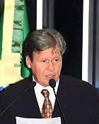

# Arthur Virgílio

| Campo | Dado |
|---|---|
| Nome completo | Arthur Virgílio do Carmo Ribeiro Neto |
| Nascimento | 15/11/1945 — Manaus/AM |
| Partidos (filiações) | PSDB (01/02/1999) |
| Página oficial | http://www25.senado.leg.br/web/senadores/senador/-/perfil/551 |

## Trajetória eleitoral no AM (TSE, eleições gerais)

Identificador comum da plataforma: `pessoa_id 18900a8ebf`. Cargos municipais (prefeito, vereador) ficam no repositório dossieprefeitosAM.

| Ano | Turno | Cargo | Partido | Nº | Votos | % votos nominais | Resultado |
|---|---|---|---|---|---|---|---|
| 1998 | 1 | Deputado federal | PSDB | 4545 | 73.783 | 9,65% | ELEITO |
| 2002 | 1 | Senador | PSDB | 451 | 608.762 | 29,41% | ELEITO |
| 2006 | 1 | Governador | PSDB | 45 | 74.900 | 5,51% | NÃO ELEITO |
| 2010 | 1 | Senador | PSDB | 451 | 644.340 | 21,91% | NÃO ELEITO |
| 2022 | 1 | Senador | PSDB | 451 | 179.886 | 9,56% | NÃO ELEITO |
| 2026 | 1 | Deputado federal | MDB | 1545 | 17.662 | 0,86% | SUPLENTE |

## Mandatos pelo AM

| Mandato | Condição | Titular | Suplentes | Exercícios |
|---|---|---|---|---|
| 01/02/2003 a 31/01/2011 | Titular | — | Frank Luiz (1º Suplente); Ana Virgínia Rego Gama (2º Suplente) | 01/02/2003 a 31/01/2011 (Término do mandato) |

## Indicadores por legislatura

| Indicador | 52ª (2003–2007) | 53ª (2007–2011) |
|---|---|---|
| Dias em exercício | 1461 | 1461 |
| Matérias apresentadas (todos os tipos) | 1603 | 1222 |
| Projetos e PECs como 1º autor | 36 | 38 |
| Requerimentos | 1554 | 1176 |
| **Normas geradas – 1º autor** | **0** | **3** |
| Normas geradas – coautor | 0 | 0 |
| Votações nominais: presente | 487/554 (87,9%) | 508/537 (94,6%) |
| Ausência justificada (licença, missão, atividade parlamentar) | 39 | 16 |
| Não compareceu (sem justificativa) | 28 | 13 |
| Discursos | 1209 | 766 |
| CEAPS (cota) | — | R$ 286.820,14 |
| Emendas empenhadas | — | — |
| Emendas pagas | — | — |

## Normas geradas por matérias de sua autoria (4)

| Matéria | Norma | Data | Autoria | Ementa |
|---|---|---|---|---|
| [PLS 386/2003](https://www25.senado.leg.br/web/atividade/materias/-/materia/61572) | Lei nº 11.675 de 19/05/2008 | 19/05/2008 | 1º autor | Designa o cupuaçu fruta nacional. |
| [PRS 42/2009](https://www25.senado.leg.br/web/atividade/materias/-/materia/92320) | Resolução do Senado Federal nº 17 de 20/07/2009 | 20/07/2009 | 1º autor | Autoriza o Estado do Amazonas a contratar operação de crédito externo, com garantia da União, com o Banco Interamericano de Desenvolvimento, no valor de até US$ 77,000,000.00 (sete |
| [PRS 44/2010](https://www25.senado.leg.br/web/atividade/materias/-/materia/97773) | Resolução do Senado Federal nº 45 de 31/08/2010 | 31/08/2010 | 1º autor | Altera dispositivo da Resolução nº 43, de 2001, do Senado Federal, no intuito de aprimorar procedimentos da instrução de operações de crédito e financiamento de infraestrutura para |
| [PLS 664/2007](https://www25.senado.leg.br/web/atividade/materias/-/materia/83274) | Lei nº 13.133 de 15/06/2015 | 15/06/2015 | 1º autor | Acrescenta dispositivo à Lei nº 7.565, de 19 de dezembro de 1986, Código Brasileiro de Aeronáutica, para explicitar a obrigatoriedade do uso e da manutenção de sinalizadores ou bal |

## Produção por tipo (2829 matérias)

| Tipo | Descrição | Total | Como 1º autor |
|---|---|---|---|
| RQS | Requerimento | 2698 | 2687 |
| PLS | Projeto de Lei do Senado | 52 | 52 |
| RRE |  | 28 | 20 |
| PEC | Proposta de Emenda à Constituição | 17 | 11 |
| PDS | Projeto de Decreto Legislativo (Senado) | 8 | 8 |
| PCE |  | 6 | 6 |
| INS | Indicação | 4 | 4 |
| RQR |  | 4 | 4 |
| PRS | Projeto de Resolução do Senado | 3 | 3 |
| PET |  | 3 | 3 |
| RAI |  | 2 | 2 |
| DEN |  | 1 | 1 |
| R.S |  | 1 | 1 |
| RQN |  | 1 | 1 |
| QSF |  | 1 | 1 |

### Projetos e PECs como 1º autor (74)

| Matéria | Apresentação | Situação | Ementa |
|---|---|---|---|
| [PLS 316/2010](https://www25.senado.leg.br/web/atividade/materias/-/materia/98676) | 14/12/2010 | REMETIDA À CÂMARA DOS DEPUTADOS | Altera a Lei nº 8.213, de 24 de julho de 1991, que dispõe sobre o Plano de Benefícios da Previdência Social e dá outras providências, para dispor sobr |
| [PLS 315/2010](https://www25.senado.leg.br/web/atividade/materias/-/materia/98677) | 14/12/2010 | ARQUIVADA AO FINAL DA LEGISLATURA | Altera a Lei nº 9.610, de 19 de fevereiro de 1998, que "altera, atualiza e consolida a legislação sobre direitos autorais e dá outras providências", p |
| [PEC 29/2010](https://www25.senado.leg.br/web/atividade/materias/-/materia/98441) | 24/11/2010 | ARQUIVADA AO FINAL DA LEGISLATURA | Acrescenta artigos ao Ato das Disposições Constitucionais Transitórias. |
| [PLS 287/2010](https://www25.senado.leg.br/web/atividade/materias/-/materia/98411) | 23/11/2010 | ARQUIVADO NA CÂMARA DOS DEPUTADOS | Dispõe sobre a concessão da aposentadoria por invalidez aos segurados acometidos pelas doenças ou afecções que especifica. |
| [PRS 44/2010](https://www25.senado.leg.br/web/atividade/materias/-/materia/97773) | 03/08/2010 | TRANSFORMADA EM NORMA JURÍDICA | Altera dispositivo da Resolução nº 43, de 2001, do Senado Federal, no intuito de aprimorar procedimentos da instrução de operações de crédito e financ |
| [PEC 22/2010](https://www25.senado.leg.br/web/atividade/materias/-/materia/97776) | 03/08/2010 | ARQUIVADA AO FINAL DA LEGISLATURA | Altera o art. 40 do Ato das Disposições Constitucionais Transitórias para estender os benefícios da Zona Franca de Manaus aos municípios vizinhos àque |
| [PLS 202/2010](https://www25.senado.leg.br/web/atividade/materias/-/materia/97590) | 06/07/2010 | REMETIDA À CÂMARA DOS DEPUTADOS | Dispõe sobre a inscrição do nome de Ajuricaba no Livro dos Heróis da Pátria. |
| [PDS 16/2010](https://www25.senado.leg.br/web/atividade/materias/-/materia/95543) | 10/02/2010 | ARQUIVADA AO FINAL DA LEGISLATURA | Susta a aplicação do Decreto no 7.037, de 21 de dezembro de 2009, que dispõe sobre o Programa Nacional de Direitos Humanos - PNDH-3. |
| [PLS 580/2009](https://www25.senado.leg.br/web/atividade/materias/-/materia/95205) | 17/12/2009 | ARQUIVADA AO FINAL DA LEGISLATURA | Estende os incentivos especiais de que trata a Lei nº 8.171, de 17 de janeiro de 1991, ao produtor rural que tem como atividade o cultivo de espécies  |
| [PRS 50/2009](https://www25.senado.leg.br/web/atividade/materias/-/materia/92605) | 13/08/2009 | ARQUIVADA AO FINAL DA LEGISLATURA | Dispõe sobre a composição do Conselho de Ética e Decoro Parlamentar. |
| [PRS 42/2009](https://www25.senado.leg.br/web/atividade/materias/-/materia/92320) | 16/07/2009 | TRANSFORMADA EM NORMA JURÍDICA | Autoriza o Estado do Amazonas a contratar operação de crédito externo, com garantia da União, com o Banco Interamericano de Desenvolvimento, no valor  |
| [PLS 176/2009](https://www25.senado.leg.br/web/atividade/materias/-/materia/90924) | 07/05/2009 | ARQUIVADA AO FINAL DA LEGISLATURA | Acrescenta o § 4º ao art. 146 do Código Penal e o § 4º ao art. 222 do Código Penal Militar, para tornar crime o trote vexatório. |
| [PLS 486/2008](https://www25.senado.leg.br/web/atividade/materias/-/materia/88802) | 17/12/2008 | TRAMITAÇÃO ENCERRADA | Unifica a hora legal no território brasileiro. |
| [PLS 460/2008](https://www25.senado.leg.br/web/atividade/materias/-/materia/88518) | 02/12/2008 | ARQUIVADA AO FINAL DA LEGISLATURA | Acrescenta dispositivo à Lei nº 9.605, de 12 de fevereiro de 1998, que "dispõe sobre as sanções penais e administrativas derivadas de condutas e ativi |
| [PLS 439/2008](https://www25.senado.leg.br/web/atividade/materias/-/materia/88302) | 18/11/2008 | REJEITADA | Acrescenta dispositivos à Lei n° 7.853, de 24 de outubro de 1989, que dispõe sobre o apoio às pessoas portadoras de deficiência, para incluir as defin |
| [PLS 438/2008](https://www25.senado.leg.br/web/atividade/materias/-/materia/88300) | 18/11/2008 | ARQUIVADA AO FINAL DA LEGISLATURA | Dispõe sobre o diagnóstico e o tratamento da dislexia na educação básica. |
| [PEC 37/2008](https://www25.senado.leg.br/web/atividade/materias/-/materia/86943) | 13/08/2008 | ARQUIVADA AO FINAL DA LEGISLATURA | Modifica a Constituição Federal para estender ao suplente de Senador as normas disciplinares relativas à ética e ao decoro parlamentar aplicáveis ao t |
| [PLS 290/2008](https://www25.senado.leg.br/web/atividade/materias/-/materia/86780) | 05/08/2008 | ARQUIVADA AO FINAL DA LEGISLATURA | Altera a Lei nº 4.320, de 17 de março de 1964, que Estatui Normas Gerais de Direito Financeiro para elaboração e controle dos orçamentos e balanços da |
| [PEC 17/2008](https://www25.senado.leg.br/web/atividade/materias/-/materia/85181) | 15/05/2008 | ARQUIVADO NA CÂMARA DOS DEPUTADOS | Acrescenta artigos ao Ato das Disposições Constitucionais Transitórias. (Dispõe sobre a prorrogação dos benefícios para a Zona Franca de Manaus). |
| [PLS 119/2008](https://www25.senado.leg.br/web/atividade/materias/-/materia/84441) | 03/04/2008 | REJEITADA | Altera a Lei nº 8.069 de 13 de julho de 1990 que "Dispõe sobre o Estatuto da Criança e do Adolescente, e dá outras providências". |
| [PEC 11/2008](https://www25.senado.leg.br/web/atividade/materias/-/materia/84363) | 26/03/2008 | ARQUIVADA AO FINAL DA LEGISLATURA | Revoga o inciso X do art. 52 da Constituição Federal.  (Suspensão e execução de lei declarada inconstitucionalidade por decisão definitiva do STF). |
| [PLS 734/2007](https://www25.senado.leg.br/web/atividade/materias/-/materia/83716) | 20/12/2007 | REMETIDA À CÂMARA DOS DEPUTADOS | Altera a Lei nº 10.883, de 16 de junho de 2004, para acrescentar atribuição ao Cargo de Fiscal Federal Agropecuário. |
| [PLS 706/2007](https://www25.senado.leg.br/web/atividade/materias/-/materia/83546) | 10/12/2007 | REMETIDA À CÂMARA DOS DEPUTADOS | Altera o art. 52 da Lei nº 9.394, de 20 de dezembro de 1996, que fixa as diretrizes e bases da educação nacional, para exigir, nas universidades, perc |
| [PLS 701/2007](https://www25.senado.leg.br/web/atividade/materias/-/materia/83519) | 06/12/2007 | ARQUIVADA AO FINAL DA LEGISLATURA | Altera o § 1º do art. 17 da Lei Complementar nº 123, de 14 de dezembro de 2006, para incluir a atividade de corretagem de seguros no Simples Nacional. |
| [PLS 664/2007](https://www25.senado.leg.br/web/atividade/materias/-/materia/83274) | 21/11/2007 | TRANSFORMADA EM NORMA JURÍDICA | Acrescenta dispositivo à Lei nº 7.565, de 19 de dezembro de 1986, Código Brasileiro de Aeronáutica, para explicitar a obrigatoriedade do uso e da manu |
| [PLS 661/2007](https://www25.senado.leg.br/web/atividade/materias/-/materia/83253) | 20/11/2007 | ARQUIVADA AO FINAL DA LEGISLATURA | Altera a Lei nº 9.250, de 26 de dezembro de 1995, para estabelecer a correção pela Taxa Selic dos valores retidos na fonte a título de Imposto de Rend |
| [PLS 647/2007](https://www25.senado.leg.br/web/atividade/materias/-/materia/83081) | 07/11/2007 | ARQUIVADO NA CÂMARA DOS DEPUTADOS | Autoriza o Poder Executivo a criar o Centro Federal de Educação Tecnológica de Manacapuru, no Estado do Amazonas. |
| [PLS 575/2007](https://www25.senado.leg.br/web/atividade/materias/-/materia/82668) | 02/10/2007 | ARQUIVADO NA CÂMARA DOS DEPUTADOS | Autoriza o Poder Executivo a criar a Escola Técnica Federal Naval do Município de Itacoatiara, no Estado do Amazonas. |
| [PLS 493/2007](https://www25.senado.leg.br/web/atividade/materias/-/materia/82213) | 22/08/2007 | REJEITADA | Altera a Lei nº 8.212, de 24 de julho de 1991, e a Lei nº 10.666, de 08 de maio de 2003, para vedar a incidência de penalidades no recolhimento a dest |
| [PEC 77/2007](https://www25.senado.leg.br/web/atividade/materias/-/materia/82187) | 21/08/2007 | ARQUIVADA AO FINAL DA LEGISLATURA | Altera o inciso XI do art. 52 da Constituição Federal para permitir ao Senado Federal a exoneração de agentes públicos em cujos mandatos tenham sido i |
| [PLS 458/2007](https://www25.senado.leg.br/web/atividade/materias/-/materia/82094) | 09/08/2007 | ARQUIVADO NA CÂMARA DOS DEPUTADOS | Dispõe sobre a criação de Zona de Processamento de Exportação (ZPE) no Município de Tabatinga, Estado do Amazonas. |
| [PLS 457/2007](https://www25.senado.leg.br/web/atividade/materias/-/materia/82093) | 09/08/2007 | ARQUIVADO NA CÂMARA DOS DEPUTADOS | Dispõe sobre a criação de Zona de Processamento de Exportação (ZPE) no Município de Itacoatiara, no Estado do Amazonas. |
| [PLS 369/2007](https://www25.senado.leg.br/web/atividade/materias/-/materia/81654) | 22/06/2007 | ARQUIVADA AO FINAL DA LEGISLATURA | Considera crime contra a administração pública a exigência de repasse, por ocupante de cargo de livre provimento e exoneração, a outrem, de percentual |
| [PDS 91/2007](https://www25.senado.leg.br/web/atividade/materias/-/materia/81053) | 24/05/2007 | PREJUDICADA | Susta a Portaria nº 264, de 9 de fevereiro de 2007, do Ministério da Justiça. (Dispõe sobre o processo de classificação indicativa de obras audiovisua |
| [PLS 102/2007](https://www25.senado.leg.br/web/atividade/materias/-/materia/80169) | 13/03/2007 | ARQUIVADA AO FINAL DA LEGISLATURA | Dispõe sobre o Sistema Financeiro Nacional e dá outras providências. |
| [PLS 72/2007](https://www25.senado.leg.br/web/atividade/materias/-/materia/80100) | 07/03/2007 | ARQUIVADA AO FINAL DA LEGISLATURA | Dispõe sobre a nomeação e demissão do Presidente e diretores do Banco Central do Brasil e sobre a organização de seu quadro funcional. |
| [PLS 43/2007](https://www25.senado.leg.br/web/atividade/materias/-/materia/79958) | 15/02/2007 | ARQUIVADA AO FINAL DA LEGISLATURA | Altera o art. 1º da Medida Provisória nº 2.199-14, de 24 de agosto de 2001, para prorrogar os incentivos fiscais de redução e restabelecer os de isenç |
| [PLS 20/2007](https://www25.senado.leg.br/web/atividade/materias/-/materia/79880) | 08/02/2007 | RETIRADA PELO AUTOR | Altera o art. 1º da Medida Provisória nº 2.199-14, de 24 de agosto de 2001, para prorrogar os incentivos fiscais de redução e restabelecer os de isenç |
| [PLS 222/2006](https://www25.senado.leg.br/web/atividade/materias/-/materia/78413) | 12/07/2006 | REMETIDA À CÂMARA DOS DEPUTADOS | Dispõe sobre prazo de filiação partidária e de domicílio eleitoral previstos nas Leis nºs 9.504, de 30 de setembro de 1997 e 9.096, de 19 de setembro  |
| [PEC 32/2006](https://www25.senado.leg.br/web/atividade/materias/-/materia/78412) | 12/07/2006 | ARQUIVADA AO FINAL DA LEGISLATURA | Altera os artigos 46, 56 e 79 da Constituição Federal. (Dispõe sobre a vacância do mandato de Presidente da República, Senador e Deputado). |
| [PLS 113/2006](https://www25.senado.leg.br/web/atividade/materias/-/materia/77539) | 27/04/2006 | ARQUIVADA AO FINAL DA LEGISLATURA | Altera a Lei nº 9.656, de 3 de junho de 1998, com a redação dada pela Medida Provisória nº 2.177-44, de 24 de agosto de 2001, para tornar obrigatória  |
| [PLS 110/2006](https://www25.senado.leg.br/web/atividade/materias/-/materia/77517) | 26/04/2006 | ARQUIVADA AO FINAL DA LEGISLATURA | Acresce e altera dispositivos da Lei nº 11.284, de 2 de março de 2006, para dispor sobre a aprovação do Plano Anual de Outorga Florestal (Paof), a rep |
| [PLS 106/2006](https://www25.senado.leg.br/web/atividade/materias/-/materia/77501) | 25/04/2006 | ARQUIVADA AO FINAL DA LEGISLATURA | Altera a Lei nº 9.250, de 26 de dezembro de 1995, para permitir ao contribuinte pessoa física abrangida pelo Estatuto do Idoso deduzir da base de cálc |
| [PDS 232/2006](https://www25.senado.leg.br/web/atividade/materias/-/materia/77357) | 12/04/2006 | ARQUIVADA AO FINAL DA LEGISLATURA | Susta parte do art. 4º do Decreto nº 5.748, de 6 de abril de 2006, da Presidência da República.  (Dispõe sobre a publicação mensal da execução dos orç |
| [PEC 59/2005](https://www25.senado.leg.br/web/atividade/materias/-/materia/75572) | 20/10/2005 | ARQUIVADA AO FINAL DA LEGISLATURA | Acrescenta o seguinte § 5º ao art. 239 da Constituição Federal, para permitir que os recursos do PASEP sejam aplicados diretamente pelos Estados e Mun |
| [PDS 125/2005](https://www25.senado.leg.br/web/atividade/materias/-/materia/72661) | 08/03/2005 | ARQUIVADA | Susta os artigos 6º, XVI, 7º, §§ 1º e 2º, 11, 15, 34, 35, 36, 37, parágrafo único, e 52 do Regulamento do Serviço de Retransmissão de Televisão e do S |
| [PLS 18/2005](https://www25.senado.leg.br/web/atividade/materias/-/materia/72490) | 21/02/2005 | ARQUIVADA AO FINAL DA LEGISLATURA | Determina medidas para esclarecer os consumidores acerca dos tributos que incidem sobre mercadorias e serviços, em conformidade com o disposto no § 5º |
| [PDS 23/2005](https://www25.senado.leg.br/web/atividade/materias/-/materia/72390) | 16/02/2005 | ARQUIVADA AO FINAL DA LEGISLATURA | Susta a Portaria nº 15, de 27 de janeiro de 2005, do Ministério do Planejamento, Orçamento e Gestão. |
| [PDS 22/2005](https://www25.senado.leg.br/web/atividade/materias/-/materia/72389) | 16/02/2005 | ARQUIVADA AO FINAL DA LEGISLATURA | Susta a Portaria nº 167, de 5 de setembro de 2003, do Ministério do Planejamento, Orçamento e Gestão. |
| [PDS 21/2005](https://www25.senado.leg.br/web/atividade/materias/-/materia/72388) | 16/02/2005 | ARQUIVADA AO FINAL DA LEGISLATURA | Susta a Portaria nº 467, de 7 de dezembro de 2004, do Ministério das Relações Exteriores, que estalebece normas para o concurso de admissão à carreira |
| [PLS 357/2004](https://www25.senado.leg.br/web/atividade/materias/-/materia/71632) | 08/12/2004 | ARQUIVADA AO FINAL DA LEGISLATURA | Acrescenta parágrafo ao art. 46 da Lei nº 6.015, de 31 de dezembro de 1973 - Lei de Registros Públicos, para tornar imprescritível a pretensão do dire |
| [PEC 59/2004](https://www25.senado.leg.br/web/atividade/materias/-/materia/71550) | 01/12/2004 | REMETIDA À CÂMARA DOS DEPUTADOS | Altera a denominação da Zona Franca de Manaus para Pólo Industrial da Amazônia Brasileira. |
| [PLS 339/2004](https://www25.senado.leg.br/web/atividade/materias/-/materia/71351) | 23/11/2004 | ARQUIVADA | Altera o artigo 62 da Lei nº 9.504, de 30 de setembro de 1997, que estabelece normas para as eleições, para autorizar o voto em trânsito no sistema el |
| [PLS 335/2004](https://www25.senado.leg.br/web/atividade/materias/-/materia/71210) | 17/11/2004 | REMETIDA À CÂMARA DOS DEPUTADOS | Dispõe sobre a dispensa de revista dos portadores de marca-passo ou aparelho similar por meio de portas magnéticas ou dispositivos de segurança semelh |
| [PLS 268/2004](https://www25.senado.leg.br/web/atividade/materias/-/materia/70200) | 16/09/2004 | PREJUDICADA | Dispõe sobre o recurso de embargos de declaração, altera o Código de Processo Civil e dá outras providências. |
| [PLS 240/2004](https://www25.senado.leg.br/web/atividade/materias/-/materia/69720) | 24/08/2004 | ARQUIVADA AO FINAL DA LEGISLATURA | Altera dispositivos da Lei nº 9.445, de 14 de março de 1997, para conceder subvenção econômica ao preço da gasolina consumida por embarcações pesqueir |
| [PLS 206/2004](https://www25.senado.leg.br/web/atividade/materias/-/materia/69008) | 05/07/2004 | PREJUDICADA | Altera a Lei nº 5.869, de 11 de janeiro de 1973 - Código de Processo Civil. (O Projeto determina que o incidente de argüição de inconstitucionalidade  |
| [PLS 120/2004](https://www25.senado.leg.br/web/atividade/materias/-/materia/67567) | 06/05/2004 | ARQUIVADA AO FINAL DA LEGISLATURA | Proíbe, em todo o território nacional, a exploração de jogos em máquinas eletrônicas, eletromecânicas ou mecânicas, independentemente dos nomes de fan |
| [PEC 10/2004](https://www25.senado.leg.br/web/atividade/materias/-/materia/66684) | 16/03/2004 | RETIRADA PELO AUTOR | Altera o artigo 57 d Constituição Federal, para reduzir o período de recesso do Congresso Nacional, e dá outras providências. |
| [PDS 372/2004](https://www25.senado.leg.br/web/atividade/materias/-/materia/66499) | 09/03/2004 | ARQUIVADA AO FINAL DA LEGISLATURA | Susta o Decreto nº 4.978, de 4 de fevereiro de 2004, da Presidência da República. |
| [PEC 6/2004](https://www25.senado.leg.br/web/atividade/materias/-/materia/66062) | 12/02/2004 | ARQUIVADA AO FINAL DA LEGISLATURA | Acrescenta parágrafos e incisos ao artigo 19 no Ato das Disposições Constitucionais Transitórias, dispondo sobre a situação funcional dos empregados p |
| [PLS 427/2003](https://www25.senado.leg.br/web/atividade/materias/-/materia/63094) | 16/10/2003 | ARQUIVADA AO FINAL DA LEGISLATURA | Veda a utilização de vidros escurecidos em veículos oficiais. |
| [PLS 386/2003](https://www25.senado.leg.br/web/atividade/materias/-/materia/61572) | 15/09/2003 | TRANSFORMADA EM NORMA JURÍDICA | Designa o cupuaçu fruta nacional. |
| [PLS 349/2003](https://www25.senado.leg.br/web/atividade/materias/-/materia/60609) | 19/08/2003 | ARQUIVADA AO FINAL DA LEGISLATURA | Institui o Sistema Nacional de Previdência Privada, cria o Conselho Nacional de Previdência Privada e a Superintendência de Previdência Privada, e reg |
| [PLS 350/2003](https://www25.senado.leg.br/web/atividade/materias/-/materia/60607) | 19/08/2003 | ARQUIVADA AO FINAL DA LEGISLATURA | Dispõe sobre o sistema de distribuição de valores mobiliários, conforme previsto no artigo 192 da Constituição Federal, e dá outras providências. |
| [PLS 340/2003](https://www25.senado.leg.br/web/atividade/materias/-/materia/60606) | 19/08/2003 | RETIRADA PELO AUTOR | Dispõe sobre a nomeação e demissão do Presidente e diretores do Banco Central do Brasil e sobre a organização de seu quadro funcional. |
| [PLS 342/2003](https://www25.senado.leg.br/web/atividade/materias/-/materia/60600) | 19/08/2003 | RETIRADA PELO AUTOR | Dispõe sobre o Sistema Financeiro Nacional e dá outras providências. |
| [PLS 339/2003](https://www25.senado.leg.br/web/atividade/materias/-/materia/60601) | 19/08/2003 | ARQUIVADA AO FINAL DA LEGISLATURA | Dispõe sobre a autorização e a participação do capital estrangeiro nas instituições financeiras, estabelecimento de seguro, resseguro, previdência e c |
| [PLS 341/2003](https://www25.senado.leg.br/web/atividade/materias/-/materia/60599) | 19/08/2003 | ARQUIVADA AO FINAL DA LEGISLATURA | Dispõe sobre o mercado de seguros privados, resseguros e capitalização, e sua entidade de supervisão e fiscalização, regulamentando, parcialmente, o a |
| [PLS 336/2003](https://www25.senado.leg.br/web/atividade/materias/-/materia/60557) | 18/08/2003 | REJEITADA | Dispõe sobre as cooperativas de crédito, como previsto no artigo 192 da Constituição Federal. |
| [PLS 270/2003](https://www25.senado.leg.br/web/atividade/materias/-/materia/59384) | 08/07/2003 | ARQUIVADA | Altera o § 6º do artigo 2º da Lei nº 10690, de 16 de junho de 2003 (Isenção de IPI na compra de veículos especiais para pessoas portadoras de deficiên |
| [PLS 260/2003](https://www25.senado.leg.br/web/atividade/materias/-/materia/59240) | 01/07/2003 | ARQUIVADA AO FINAL DA LEGISLATURA | Altera artigo 13 da Lei nº 8620, de 5 de janeiro de 1993, para regular a solidariedade de sócios minoritários relativamente a débitos junto à Segurida |
| [PLS 218/2003](https://www25.senado.leg.br/web/atividade/materias/-/materia/58274) | 29/05/2003 | RETIRADA PELO AUTOR | Altera a Lei nº 3173, de 6 de junho de 1957, para mudar a denominação da Zona Franca de Manaus para Pólo Industrial de Manaus. |
| [PLS 38/2003](https://www25.senado.leg.br/web/atividade/materias/-/materia/55044) | 26/02/2003 | REMETIDA À CÂMARA DOS DEPUTADOS | Altera a Lei nº 9986, de 18 de julho de 2000, que "dispõe sobre a gestão de recursos humanos das Agências Reguladoras e dá outras providências", insti |

## Registro nas votações nominais

| Registro | Quantidade |
|---|---|
| Votou | 463 |
| Sim | 259 |
| P-NRV | 189 |
| Não | 81 |
| NCom | 41 |
| AP | 22 |
| LS | 21 |
| LP | 8 |
| MIS | 4 |
| Abstenção | 3 |

## Cota (CEAPS) por tipo de despesa — 2003 a 2010

Total reembolsado: **R$ 286.820,14**.

| Tipo de despesa | Valor | % |
|---|---|---|
| Locomoção | R$ 259.295,18 | 90,4% |
| Aluguel de imóveis para escritório político | R$ 26.474,36 | 9,2% |
| Aquisição de material de consumo para uso no escritório político | R$ 1.050,60 | 0,4% |

### Por ano

| Ano | Valor |
|---|---|
| 2003 | R$ 0,00 |
| 2004 | R$ 0,00 |
| 2005 | R$ 0,00 |
| 2006 | R$ 0,00 |
| 2007 | R$ 0,00 |
| 2008 | R$ 15.696,94 |
| 2009 | R$ 180.000,00 |
| 2010 | R$ 91.123,20 |

### Maiores fornecedores

| Fornecedor | CNPJ | Valor |
|---|---|---|
| MANAUS AEROTAXI LTDA | 02.324.940/0001-61 | R$ 152.380,00 |
|  | (pessoa física) | R$ 43.316,94 |
| MANAUS AEROTAXI LTDA. | 02.324.940/0001-61 | R$ 30.000,00 |
| JOAQUIM GERSON DE ALMEIDA BARBOSA | (pessoa física) | R$ 28.000,00 |
| MARIA DAS GRAÇAS LEITE GUEDES | (pessoa física) | R$ 24.500,00 |
| RESTAURANTE SHINSUZURAN | 07.800.611/0001-63 | R$ 2.098,30 |
| AMAZONAS ENERGIA | 02.341.467/0001-20 | R$ 908,85 |
| CHURRASCARIA GAUCHO'S | 01.625.205/0001-25 | R$ 770,00 |
| ÁGUAS DO AMAZONAS | 03.264.927/0001-27 | R$ 744,03 |
| COMAL COMBUSTÍVEIS AUTOMOTIVOS LTDA | 00.715.375/0002-19 | R$ 449,10 |

## Emendas parlamentares individuais — 2003 a 2010

Empenhado: **R$ 0,00** · pago: **R$ 0,00**.

| Segmento (função) | Empenhado | Pago | % |
|---|---|---|---|

### Por ano

| Ano | Emendas | Empenhado | Pago |
|---|---|---|---|
| 2003 | 0 | R$ 0,00 | R$ 0,00 |
| 2004 | 0 | R$ 0,00 | R$ 0,00 |
| 2005 | 0 | R$ 0,00 | R$ 0,00 |
| 2006 | 0 | R$ 0,00 | R$ 0,00 |
| 2007 | 0 | R$ 0,00 | R$ 0,00 |
| 2008 | 0 | R$ 0,00 | R$ 0,00 |
| 2009 | 0 | R$ 0,00 | R$ 0,00 |
| 2010 | 0 | R$ 0,00 | R$ 0,00 |

### Principais destinos

| Localidade | Empenhado |
|---|---|

## Cargos em comissões (1)

| Cargo | Comissão | Início | Fim |
|---|---|---|---|
| RELATOR | CPI - ONGs - 2007 | 28/05/2009 | 14/10/2009 |

Foi titular de 30 comissões, entre elas: ANOMULHER, CAE, CCAI, CCJ, CDH, CECAC, CEDP, CESPRO, CI, CMA, CMEMC, COCN, CPIONGs, CPMI Ambulâncias, CRA, CRE, CREPA, CTENORT, EMC45, PRIVA.

## Licenças e afastamentos (33)

| Tipo | Quantidade |
|---|---|
| Licença Saúde (até a 120 dias) | 19 |
| Missão política ou cultural de interesse parlamentar | 9 |
| Licença Interesse Particular (até a 120 dias) | 5 |

---
Fontes: Senado Federal (Dados Abertos: senador, mandatos, autorias, processo, votação, discursos; CEAPS), Portal da Transparência/CGU (emendas). Gerado em 16/10/2026 por `scripts/gerar.py`. Método e limites em [METODOLOGIA.md](../METODOLOGIA.md); verificação em [VERIFICACAO.md](../VERIFICACAO.md).
