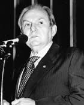

# Bernardo Cabral

| Campo | Dado |
|---|---|
| Nome completo | José Bernardo Cabral |
| Nascimento | 27/03/1932 — Manaus/AM |
| Partidos (filiações) | PFL (26/03/1996 a 01/08/2007), S/Partido (26/10/1995 a 25/03/1996), PP (01/02/1995 a 25/10/1995) |
| Página oficial | http://www25.senado.leg.br/web/senadores/senador/-/perfil/9 |

## Trajetória eleitoral no AM (TSE, eleições gerais)

Identificador comum da plataforma: `pessoa_id 7a559dfaf7`. Cargos municipais (prefeito, vereador) ficam no repositório dossieprefeitosAM.

| Ano | Turno | Cargo | Partido | Nº | Votos | % votos nominais | Resultado |
|---|---|---|---|---|---|---|---|
| 2002 | 1 | Senador | PFL | 252 | 484.617 | 23,42% | NÃO ELEITO |

## Mandatos pelo AM

| Mandato | Condição | Titular | Suplentes | Exercícios |
|---|---|---|---|---|
| 01/02/1995 a 31/01/2003 | Titular | — | Leopoldo Peres (1º Suplente) | 01/02/1995 a 31/01/2003 (Término do mandato) |

## Indicadores por legislatura

| Indicador | 51ª (1999–2003) |
|---|---|
| Dias em exercício | 1461 |
| Matérias apresentadas (todos os tipos) | 25 |
| Projetos e PECs como 1º autor | 9 |
| Requerimentos | 15 |
| **Normas geradas – 1º autor** | **1** |
| Normas geradas – coautor | 0 |
| Votações nominais: presente | 292/335 (87,2%) |
| Ausência justificada (licença, missão, atividade parlamentar) | 24 |
| Não compareceu (sem justificativa) | 19 |
| Discursos | 142 |
| CEAPS (cota) | — |
| Emendas empenhadas | — |
| Emendas pagas | — |

## Normas geradas por matérias de sua autoria (2)

| Matéria | Norma | Data | Autoria | Ementa |
|---|---|---|---|---|
| [PLS 5/2001](https://www25.senado.leg.br/web/atividade/materias/-/materia/46504) | Lei nº 10.468 de 20/06/2002 | 20/06/2002 | 1º autor | Altera o artigo 3º da Lei nº 4069-A, de 12 de junho de 1962, a fim de imprimir nova denominação à Universidade do Amazonas. |
| [PEC 4/2002](https://www25.senado.leg.br/web/atividade/materias/-/materia/49557) | Emenda Constitucional nº 52 de 08/03/2006 | 08/03/2006 | 1º autor | Dá nova redação ao parágrafo 1º do artigo 17 da Constituição Federal. (Dispõe sobre a organização e funcionamento dos partidos políticos). |

## Produção por tipo (66 matérias)

| Tipo | Descrição | Total | Como 1º autor |
|---|---|---|---|
| RQS | Requerimento | 35 | 35 |
| PLS | Projeto de Lei do Senado | 16 | 16 |
| PEC | Proposta de Emenda à Constituição | 6 | 6 |
| PRS | Projeto de Resolução do Senado | 3 | 3 |
| DIV |  | 2 | 2 |
| INS | Indicação | 2 | 2 |
| RQM |  | 2 | 2 |

### Projetos e PECs como 1º autor (25)

| Matéria | Apresentação | Situação | Ementa |
|---|---|---|---|
| [PLS 194/2002](https://www25.senado.leg.br/web/atividade/materias/-/materia/51142) | 05/08/2002 | ARQUIVADA | Altera a Lei nº 8899, de 29 de junho de 1994, que concede passe livre às pessoas portadoras de deficiência no sistema de transporte coletivo interesta |
| [PEC 4/2002](https://www25.senado.leg.br/web/atividade/materias/-/materia/49557) | 27/02/2002 | TRANSFORMADA EM NORMA JURÍDICA | Dá nova redação ao parágrafo 1º do artigo 17 da Constituição Federal. (Dispõe sobre a organização e funcionamento dos partidos políticos). |
| [PEC 48/2001](https://www25.senado.leg.br/web/atividade/materias/-/materia/48869) | 06/11/2001 | ARQUIVADA AO FINAL DA LEGISLATURA | Altera o "caput" do artigo 27 da Constituição Federal.  (Dispõe sobre a representação nas Assembléias Legislativas).                              |
| [PLS 227/2001](https://www25.senado.leg.br/web/atividade/materias/-/materia/48693) | 25/10/2001 | ARQUIVADO NA CÂMARA DOS DEPUTADOS | Autoriza a União a transferir ao Aeroclube do Amazonas o domínio do bem imóvel a que se refere o Decreto nº 78511, de 30 de setembro de 1976. |
| [PLS 184/2001](https://www25.senado.leg.br/web/atividade/materias/-/materia/48456) | 26/09/2001 | ARQUIVADA AO FINAL DA LEGISLATURA | Altera a Lei nº 9504, de 30 de setembro de 1997 (Lei Eleitoral), para modificar os critérios relativos a pesquisas eleitorais. |
| [PLS 5/2001](https://www25.senado.leg.br/web/atividade/materias/-/materia/46504) | 16/02/2001 | TRANSFORMADA EM NORMA JURÍDICA | Altera o artigo 3º da Lei nº 4069-A, de 12 de junho de 1962, a fim de imprimir nova denominação à Universidade do Amazonas. |
| [PEC 11/2000](https://www25.senado.leg.br/web/atividade/materias/-/materia/43492) | 14/03/2000 | AGUARDANDO DECISÃO DA CÂMARA DOS DEPUTADOS | Dá nova redação ao inciso I do § 1º do artigo 73 da Constituição Federal. (estabelecendo condição de nomeação (promoção) de Auditor para o cargo de Mi |
| [PRS 6/2000](https://www25.senado.leg.br/web/atividade/materias/-/materia/43149) | 26/01/2000 | ARQUIVADA AO FINAL DA LEGISLATURA | Regulamenta a Lei nº 9709, de 18 de novembro de 1998, no âmbito do Senado Federal, dá outras providências, e altera dispositivos do Regimento Interno  |
| [PLS 27/1999](https://www25.senado.leg.br/web/atividade/materias/-/materia/1137) | 23/02/1999 | TRAMITAÇÃO ENCERRADA | ALTERA OS ARTIGOS 338, 340, 342 E 344 DA LEI 3071, DE 1º DE JANEIRO    DE 1916 (CODIGO CIVIL), REFERENTES A INVESTIGAÇÕES DE PATERNIDADE.      |
| [PLS 178/1998](https://www25.senado.leg.br/web/atividade/materias/-/materia/29063) | 16/11/1998 | ARQUIVADA AO FINAL DA LEGISLATURA | CRIA O FUNDO NACIONAL PARA A PRESERVAÇÃO E CONSERVAÇÃO DE MANANCIAIS   DE ABASTECIMENTO DE AGUA (FUNDAGUA) E DA OUTRAS PROVIDENCIAS.           |
| [PLS 160/1998](https://www25.senado.leg.br/web/atividade/materias/-/materia/1482) | 07/10/1998 | ARQUIVADA AO FINAL DA LEGISLATURA | DA NOVA REDAÇÃO AO PARAGRAFO 6º (SEXTO) DO ARTIGO 7º (SETIMO) DO       DECRETO-LEI 288, DE 28 DE FEVEREIRO DE 1967, ALTERADO PELA             LEI 8387 |
| [PEC 13/1998](https://www25.senado.leg.br/web/atividade/materias/-/materia/18193) | 18/03/1998 | PREJUDICADA | DA NOVA REDAÇÃO AOS PARAGRAFOS SEGUNDO E TERCEIRO DO ARTIGO            55 DA CONSTITUIÇÃO FEDERAL E DA OUTRAS PROVIDENCIAS.                    |
| [PEC 12/1998](https://www25.senado.leg.br/web/atividade/materias/-/materia/18176) | 18/03/1998 | PREJUDICADA | ACRESCENTA PARAGRAFOS AO ARTIGO 53 DA CONSTITUIÇÃO FEDERAL E DA        OUTRAS PROVIDENCIAS.                                                    |
| [PLS 20/1998](https://www25.senado.leg.br/web/atividade/materias/-/materia/24579) | 28/01/1998 | ARQUIVADA AO FINAL DA LEGISLATURA | ALTERA A COMPETENCIA FUNCIONAL DOS JUIZADOS ESPECIAIS CIVEIS           REGULADA NO ARTIGO TERCEIRO DA LEI 9099, DE 26 DE SETEMBRO DE          1995, QU |
| [PLS 210/1997](https://www25.senado.leg.br/web/atividade/materias/-/materia/29621) | 06/10/1997 | ARQUIVADA AO FINAL DA LEGISLATURA | DISPÕE SOBRE PRAZOS DE APURAÇÃO E DE PAGAMENTO DE TRIBUTOS FEDERAIS.    |
| [PRS 41/1997](https://www25.senado.leg.br/web/atividade/materias/-/materia/32298) | 24/03/1997 | PREJUDICADA | ACRESCENTA DISPOSITIVO A RESOLUÇÃO DO SENADO FEDERAL 000069 DE 1995,   QUE DISPÕE SOBRE AS OPERAÇÕES DE CREDITO INTERNO E EXTERNO DOS         ESTADOS, |
| [PLS 203/1996](https://www25.senado.leg.br/web/atividade/materias/-/materia/29505) | 17/09/1996 | ARQUIVADA AO FINAL DA LEGISLATURA | DISPÕE SOBRE ACRESCIMOS MORATORIOS INCIDENTES SOBRE OS TRIBUTOS E      AS CONTRIBUIÇÕES SOCIAIS, QUANDO PAGOS EM ATRASO.  COMPLEMENTAR.        |
| [PLS 126/1996](https://www25.senado.leg.br/web/atividade/materias/-/materia/27952) | 11/06/1996 | TRAMITAÇÃO ENCERRADA | DA NOVA REDAÇÃO AO INCISO II DO PARAGRAFO PRIMEIRO, DO ARTIGO 13,      DA LEI 9100, DE 29 DE SETEMBRO DE 1995, QUE 'ESBELECE NORMAS PARA      AS ELEIÇ |
| [PLS 99/1996](https://www25.senado.leg.br/web/atividade/materias/-/materia/27307) | 15/05/1996 | TRAMITAÇÃO ENCERRADA | REVOGA O ARTIGO 75 DA LEI 9100, DE 29 DE SETEMBRO DE 1995, QUE         ESTABELECE NORMAS PARA A REALIZAÇÃO DAS ELEIÇÕES MUNICIPAIS DE 03      DE OUTUB |
| [PLS 68/1996](https://www25.senado.leg.br/web/atividade/materias/-/materia/1234) | 16/04/1996 | AGUARDANDO DECISÃO DA CÂMARA DOS DEPUTADOS | DENOMINA A REFINARIA DE MANAUS - REMAN COMO REFINARIA ISAAC            BENAYON SABBA - RIBEN.                                                  |
| [PRS 28/1996](https://www25.senado.leg.br/web/atividade/materias/-/materia/32124) | 14/03/1996 | ARQUIVADA AO FINAL DA LEGISLATURA | ALTERA O REGIMENTO INTERNO, ACRESCENTANDO PARAGRAFO UNICO AO           ARTIGO 78.                                                              |
| [PEC 2/1996](https://www25.senado.leg.br/web/atividade/materias/-/materia/17977) | 16/01/1996 | PREJUDICADA | ALTERA O PARAGRAFO QUARTO DO ARTIGO 18 DA CONSTITUIÇÃO FEDERAL, E      ACRESCENTA DOIS PARAGRAFOS AO MESMO ARTIGO.                             |
| [PLS 324/1995](https://www25.senado.leg.br/web/atividade/materias/-/materia/31126) | 08/12/1995 | ARQUIVADA AO FINAL DA LEGISLATURA | PROIBE A COMERCIALIZAÇÃO, O CONSUMO E QUALQUER TIPO DE PUBLICIDADE     DE PRODUTOS DERIVADOS DO TABACO, NO AMBITO DOS ESTABELECIMENTOS DE     ENSINO D |
| [PLS 238/1995](https://www25.senado.leg.br/web/atividade/materias/-/materia/30087) | 21/08/1995 | ARQUIVADA AO FINAL DA LEGISLATURA | DA NOVA REDAÇÃO AO PARAGRAFO SEGUNDO DO ARTIGO 51 DA LEI 8069, DE 13   DE JULHO DE 1990 - ESTATUTO DA CRIANÇA E DO ADOLESCENTE, E             ACRESCEN |
| [PLS 155/1995](https://www25.senado.leg.br/web/atividade/materias/-/materia/28592) | 12/05/1995 | ARQUIVADA AO FINAL DA LEGISLATURA | ESTABELECE PROCEDIMENTO PARA DESAPROPRIAÇÕES E DETERMINA OUTRAS        PROVIDENCIAS.                                                           |

## Registro nas votações nominais

| Registro | Quantidade |
|---|---|
| Sim | 173 |
| Votou | 49 |
| Não | 29 |
| P-NRV | 27 |
| AP | 22 |
| NCom | 19 |
| Abstenção | 14 |
| LP | 1 |
| LS | 1 |

## Cota (CEAPS) por tipo de despesa — 1999 a 2002

Total reembolsado: **R$ 0,00**.

| Tipo de despesa | Valor | % |
|---|---|---|

### Por ano

| Ano | Valor |
|---|---|
| 1999 | R$ 0,00 |
| 2000 | R$ 0,00 |
| 2001 | R$ 0,00 |
| 2002 | R$ 0,00 |

### Maiores fornecedores

| Fornecedor | CNPJ | Valor |
|---|---|---|

## Emendas parlamentares individuais — 1999 a 2002

Empenhado: **R$ 0,00** · pago: **R$ 0,00**.

| Segmento (função) | Empenhado | Pago | % |
|---|---|---|---|

### Por ano

| Ano | Emendas | Empenhado | Pago |
|---|---|---|---|
| 1999 | 0 | R$ 0,00 | R$ 0,00 |
| 2000 | 0 | R$ 0,00 | R$ 0,00 |
| 2001 | 0 | R$ 0,00 | R$ 0,00 |
| 2002 | 0 | R$ 0,00 | R$ 0,00 |

### Principais destinos

| Localidade | Empenhado |
|---|---|

## Cargos em comissões (3)

| Cargo | Comissão | Início | Fim |
|---|---|---|---|
| PRESIDENTE | Comissão de Constituição, Justiça e Cidadania | 21/03/2001 | 31/01/2003 |
| RELATOR | CESP - Elaboração dos Projetos de Lei Reguladores do Texto Constitucional (Emen nºs: 5,a 9) - 1995 | 16/04/1996 | 30/06/1996 |
| PRESIDENTE | CPI - Títulos Públicos - 1996 | 04/12/1996 | 26/08/1997 |

Foi titular de 13 comissões, entre elas: CCJ, CESPAM, CODCIVIL, CRE, FUTEBOL, ONGS, REGCF, SEGPUB, TITULOSPUB.

## Licenças e afastamentos (82)

| Tipo | Quantidade |
|---|---|
| Missão política ou cultural de interesse parlamentar | 71 |
| Licença Interesse Particular (até a 120 dias) | 7 |
| Licença Saúde (até a 120 dias) | 4 |

---
Fontes: Senado Federal (Dados Abertos: senador, mandatos, autorias, processo, votação, discursos; CEAPS), Portal da Transparência/CGU (emendas). Gerado em 16/10/2026 por `scripts/gerar.py`. Método e limites em [METODOLOGIA.md](../METODOLOGIA.md); verificação em [VERIFICACAO.md](../VERIFICACAO.md).
