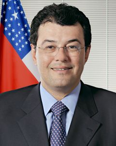

# Eduardo Braga

| Campo | Dado |
|---|---|
| Nome completo | Carlos Eduardo de Souza Braga |
| Nascimento | 06/12/1960 — Belém/PA |
| Partidos (filiações) | MDB (28/01/2011) |
| Página oficial | http://www25.senado.leg.br/web/senadores/senador/-/perfil/4994 |

## Trajetória eleitoral no AM (TSE, eleições gerais)

Identificador comum da plataforma: `pessoa_id 17786586b1`. Cargos municipais (prefeito, vereador) ficam no repositório dossieprefeitosAM.

| Ano | Turno | Cargo | Partido | Nº | Votos | % votos nominais | Resultado |
|---|---|---|---|---|---|---|---|
| 1998 | 1 | Governador | PSL | 17 | 390.214 | 47,69% | NÃO ELEITO |
| 2002 | 1 | Governador | PPS | 23 | 568.111 | 52,37% | ELEITO |
| 2006 | 1 | Governador | PMDB | 15 | 687.912 | 50,63% | ELEITO |
| 2010 | 1 | Senador | PMDB | 155 | 1.236.970 | 42,07% | ELEITO |
| 2014 | 1 | Governador | PMDB | 15 | 377.680 | 12,06% | 2º TURNO |
| 2014 | 1 | Governador | PMDB | 15 | 709.058 | 22,64% | 2º TURNO |
| 2014 | 2 | Governador | PMDB | 15 | 539.318 | 18,67% | NÃO ELEITO |
| 2014 | 2 | Governador | PMDB | 15 | 696.465 | 24,11% | NÃO ELEITO |
| 2018 | 1 | Senador | MDB | 155 | 607.286 | 18,45% | ELEITO |
| 2022 | 1 | Governador | MDB | 15 | 401.817 | 21,01% | 2º TURNO |
| 2022 | 2 | Governador | MDB | 15 | 795.098 | 43,35% | NÃO ELEITO |
| 2026 | 1 | Senador | MDB | 155 | 1.240.471 | 32,29% | ELEITO |

## Mandatos pelo AM

| Mandato | Condição | Titular | Suplentes | Exercícios |
|---|---|---|---|---|
| 01/02/2019 a 31/01/2027 | Titular | — | Sandra Braga (1º Suplente); Miguel Biango (2º Suplente) | 01/02/2019 a atual |
| 01/02/2011 a 31/01/2019 | Titular | — | Sandra Braga (1º Suplente); Lirio Albino Parisotto (2º Suplente) | 22/04/2016 a 31/01/2019 (Término do mandato); 01/02/2011 a 01/01/2015 (Afastamento do exercício) |

## Indicadores por legislatura

| Indicador | 54ª (2011–2015) | 55ª (2015–2019) | 56ª (2019–2023) | 57ª (2023–2027) |
|---|---|---|---|---|
| Dias em exercício | 1431 | 1015 | 1461 | 1354 |
| Matérias apresentadas (todos os tipos) | 274 | 107 | 565 | 188 |
| Projetos e PECs como 1º autor | 24 | 14 | 39 | 29 |
| Requerimentos | 195 | 67 | 452 | 142 |
| **Normas geradas – 1º autor** | **12** | **1** | **1** | **2** |
| Normas geradas – coautor | 1 | 0 | 6 | 2 |
| Votações nominais: presente | 480/513 (93,6%) | 191/254 (75,2%) | 604/719 (84,0%) | 375/425 (88,2%) |
| Ausência justificada (licença, missão, atividade parlamentar) | 32 | 63 | 115 | 48 |
| Não compareceu (sem justificativa) | 1 | 0 | 0 | 2 |
| Discursos | 213 | 59 | 183 | 174 |
| CEAPS (cota) | R$ 983.572,07 | R$ 1.314.171,23 | R$ 1.683.525,68 | R$ 1.894.783,55 |
| Emendas empenhadas | — | R$ 32.252.524,22 | R$ 65.711.638,17 | R$ 270.494.442,91 |
| Emendas pagas | — | R$ 28.390.068,13 | R$ 63.685.468,53 | R$ 270.330.380,28 |

## Normas geradas por matérias de sua autoria (25)

| Matéria | Norma | Data | Autoria | Ementa |
|---|---|---|---|---|
| [PRS 23/2012](https://www25.senado.leg.br/web/atividade/materias/-/materia/106364) | Resolução do Senado Federal nº 21 de 18/07/2012 | 18/07/2012 | 1º autor | Altera dispositivos da Resolução nº 43, de 2001, do Senado Federal, no intuito de aprimorar procedimentos da instrução de operações de crédito e concessão de garantias. |
| [PEC 122/2011](https://www25.senado.leg.br/web/atividade/materias/-/materia/103765) | Emenda Constitucional nº 77 de 11/02/2014 | 11/02/2014 | coautor | Altera a redação do inciso VIII do § 3º do art. 142, da Constituição Federal, para estender aos profissionais de saúde das Forças Armadas a possibilidade de cumulação de cargo a qu |
| [PRS 51/2014](https://www25.senado.leg.br/web/atividade/materias/-/materia/118559) | Resolução do Senado Federal nº 31 de 03/09/2014 | 03/09/2014 | 1º autor | Autoriza o Estado do Amazonas a contratar operação de crédito externo, com garantia da República Federativa do Brasil, no valor de até US$ 216.000.000,00 (duzentos e dezesseis milh |
| [PRS 50/2014](https://www25.senado.leg.br/web/atividade/materias/-/materia/118558) | Resolução do Senado Federal nº 30 de 03/09/2014 | 03/09/2014 | 1º autor | Autoriza o Estado do Amazonas a contratar operação de crédito externo, com garantia da República Federativa do Brasil, com a Corporação Andina de Fomento (CAF), no valor total de a |
| [PRS 49/2014](https://www25.senado.leg.br/web/atividade/materias/-/materia/118556) | Resolução do Senado Federal nº 28 de 03/09/2014 | 03/09/2014 | 1º autor | Autoriza o Estado de São Paulo a contratar operação de crédito externo, com garantia da República Federativa do Brasil, no valor de US$ 300.000.000,00 (trezentos milhões de dólares |
| [PRS 48/2014](https://www25.senado.leg.br/web/atividade/materias/-/materia/118555) | Resolução do Senado Federal nº 26 de 03/09/2014 | 03/09/2014 | 1º autor | Autoriza o Governo do Estado de São Paulo a contratar operação de crédito externo, com garantia da União, com o Banco Europeu de Investimentos – BEI, no valor de até Euro 200,000,0 |
| [PRS 47/2014](https://www25.senado.leg.br/web/atividade/materias/-/materia/118554) | Resolução do Senado Federal nº 25 de 03/09/2014 | 03/09/2014 | 1º autor | Autoriza o Governo do Estado de São Paulo a contratar operação de crédito externo, com garantia da União, com o Banco Interamericano de Desenvolvimento – BID, no valor de até USD 4 |
| [PRS 46/2014](https://www25.senado.leg.br/web/atividade/materias/-/materia/118552) | Resolução do Senado Federal nº 27 de 03/09/2014 | 03/09/2014 | 1º autor | Autoriza o Município de São Luís (MA) a contratar operação de crédito externo, com garantia da União, com o Banco Interamericano de Desenvolvimento - BID, no valor de até USD 13,59 |
| [PRS 45/2014](https://www25.senado.leg.br/web/atividade/materias/-/materia/118551) | Resolução do Senado Federal nº 24 de 03/09/2014 | 03/09/2014 | 1º autor | Autoriza a Companhia de Saneamento Ambiental do Distrito Federal (CAESB) a contratar operação de crédito externo, com garantia da União, com o Banco Interamericano de Desenvolvimen |
| [PRS 44/2014](https://www25.senado.leg.br/web/atividade/materias/-/materia/118550) | Resolução do Senado Federal nº 33 de 03/09/2014 | 03/09/2014 | 1º autor | Autoriza o Distrito Federal a contratar operação de crédito externo, com garantia da República Federativa do Brasil, com o Banco Interamericano de Desenvolvimento (BID), no valor d |
| [PRS 43/2014](https://www25.senado.leg.br/web/atividade/materias/-/materia/118549) | Resolução do Senado Federal nº 29 de 03/09/2014 | 03/09/2014 | 1º autor | Autoriza o Estado do Pará a contratar operação de crédito externo, com garantia da República Federativa do Brasil, com o Banco Interamericano de Desenvolvimento (BID), no valor de  |
| [PRS 42/2014](https://www25.senado.leg.br/web/atividade/materias/-/materia/118548) | Resolução do Senado Federal nº 23 de 03/09/2014 | 03/09/2014 | 1º autor | Autoriza o Estado do Espírito Santo a contratar operação de crédito externo, com garantia da União, com o Banco Internacional para Reconstrução e Desenvolvimento (Bird), no valor d |
| [PRS 41/2014](https://www25.senado.leg.br/web/atividade/materias/-/materia/118547) | Resolução do Senado Federal nº 32 de 03/09/2014 | 03/09/2014 | 1º autor | Autoriza o Estado da Paraíba a contratar operação de crédito externo, com garantia da União, com o Banco Interamericano de Desenvolvimento (BID), no valor de até US$ 23.000.000,00  |
| [PRS 19/2017](https://www25.senado.leg.br/web/atividade/materias/-/materia/129267) | Resolução do Senado Federal nº 8 de 31/05/2017 | 31/05/2017 | 1º autor | Altera a Resolução do Senado Federal nº 7, de 2017, para flexibilizar o cronograma de liberação e a contrapartida dos recursos de que trata a autorização de contratação de crédito  |
| [PRS 48/2019](https://www25.senado.leg.br/web/atividade/materias/-/materia/136896) | Resolução do Senado Federal nº 9 de 28/05/2019 | 28/05/2019 | coautor | Institui a Frente Parlamentar dos Senadores dos Estados do Norte e do Nordeste. |
| [PRS 95/2019](https://www25.senado.leg.br/web/atividade/materias/-/materia/139039) | Resolução do Senado Federal nº 43 de 17/12/2019 | 17/12/2019 | coautor | Institui, no âmbito do Senado Federal, a Frente Parlamentar de apoio ao Mercado de Varejo e E-commerce |
| [PEC 186/2019](https://www25.senado.leg.br/web/atividade/materias/-/materia/139702) | Emenda Constitucional nº 109 de 15/03/2021 | 15/03/2021 | coautor | Altera o texto permanente da Constituição e o Ato das Disposições Constitucionais Transitórias, dispondo sobre medidas permanentes e emergenciais de controle do crescimento das des |
| [PLS 506/2013](https://www25.senado.leg.br/web/atividade/materias/-/materia/115631) | Lei nº 14.248 de 25/11/2021 | 25/11/2021 | 1º autor | Dispõe sobre a criação do Programa Nacional do Bioquerosene como incentivo à sustentabilidade ambiental da aviação brasileira e dá outras providências. |
| [PEC 17/2019](https://www25.senado.leg.br/web/atividade/materias/-/materia/135594) | Emenda Constitucional nº 115 de 10/02/2022 | 10/02/2022 | coautor | Acrescenta o inciso XII-A, ao art. 5º, e o inciso XXX, ao art. 22, da Constituição Federal para incluir a proteção de dados pessoais entre os direitos fundamentais do cidadão e fix |
| [PEC 15/2022](https://www25.senado.leg.br/web/atividade/materias/-/materia/153518) | Emenda Constitucional nº 123 de 14/07/2022 | 14/07/2022 | coautor | Altera o art. 225 da Constituição Federal para estabelecer diferencial de competitividade para os biocombustíveis. |
| [PEC 32/2022](https://www25.senado.leg.br/web/atividade/materias/-/materia/155248) | Emenda Constitucional nº 126 de 21/12/2022 | 21/12/2022 | coautor | Altera o Ato das Disposições Constitucionais Transitórias para permitir a implementação do Programa Bolsa Família e definir regras para a transição da Presidência da República apli |
| [PL 2012/2022](https://www25.senado.leg.br/web/atividade/materias/-/materia/154143) | Lei nº 14.750 de 12/12/2023 | 12/12/2023 | 1º autor | Altera as Leis nºs 12.608, de 10 de abril de 2012, e 12.340, de 1º de dezembro de 2010, para aprimorar os instrumentos de prevenção de desastres e recuperação de áreas atingidas, a |
| [PLS 505/2013](https://www25.senado.leg.br/web/atividade/materias/-/materia/115630) | Lei nº 14.898 de 13/06/2024 | 13/06/2024 | 1º autor | Cria a Tarifa Social de Água e Esgoto e dá outras Providências. |
| [PEC 66/2023](https://www25.senado.leg.br/web/atividade/materias/-/materia/161307) | Emenda Constitucional nº 136 de 09/09/2025 | 09/09/2025 | coautor | Abre novo prazo de parcelamento especial de débitos dos municípios com seus Regimes Próprios de Previdência Social dos Servidores Públicos e com o Regime Geral de Previdência Socia |
| [PDL 995/2026](https://www25.senado.leg.br/web/atividade/materias/-/materia/175624) | Decreto Legislativo nº 386 de 03/09/2026 | 03/09/2026 | coautor | Escolhe o Senhor Rodrigo Otavio Soares Pacheco para o cargo de Ministro do Tribunal de Contas da União, nos termos do inciso II do § 2º do art. 73 da Constituição Federal, do incis |

## Produção por tipo (1134 matérias)

| Tipo | Descrição | Total | Como 1º autor |
|---|---|---|---|
| RQS | Requerimento | 576 | 405 |
| PEC | Proposta de Emenda à Constituição | 155 | 5 |
| REQ | Requerimento | 129 | 128 |
| PL | Projeto de Lei | 53 | 53 |
| RCT |  | 51 | 41 |
| PLS | Projeto de Lei do Senado | 24 | 22 |
| PRS | Projeto de Resolução do Senado | 22 | 17 |
| RQI | Requerimento de informações | 21 | 15 |
| RMA |  | 19 | 5 |
| RQE |  | 16 | 11 |
| R.S |  | 12 | 4 |
| RRA |  | 11 | 3 |
| RQJ |  | 8 | 7 |
| RQN |  | 8 | 8 |
| PDL | Projeto de Decreto Legislativo | 7 | 3 |
| OFS |  | 6 | 1 |
| PLP | Projeto de Lei Complementar | 5 | 5 |
| PDS | Projeto de Decreto Legislativo (Senado) | 4 | 1 |
| RAS |  | 2 | 2 |
| RDR |  | 2 | 2 |
| INS | Indicação | 2 | 2 |
| RRE |  | 1 | 0 |

### Projetos e PECs como 1º autor (106)

| Matéria | Apresentação | Situação | Ementa |
|---|---|---|---|
| [PL 3624/2026](https://www25.senado.leg.br/web/atividade/materias/-/materia/175118) | 09/07/2026 | AGUARDANDO DESPACHO | Altera a Lei nº 6.932, de 7 de julho de 1981, que dispõe sobre as atividades do médico residente e dá outras providências, para atualizar o valor da b |
| [PLP 205/2026](https://www25.senado.leg.br/web/atividade/materias/-/materia/175121) | 09/07/2026 | AGUARDANDO DESPACHO | Dispõe sobre incentivos não financeiros à capilarização da atuação da Defensoria Pública e da advocacia dativa. |
| [PL 3572/2026](https://www25.senado.leg.br/web/atividade/materias/-/materia/175052) | 08/07/2026 | AGUARDANDO DESPACHO | Estabelece normas gerais para a atuação de fintechs e para a regulação proporcional de serviços financeiros digitais, e dá outras providências. |
| [PL 3573/2026](https://www25.senado.leg.br/web/atividade/materias/-/materia/175054) | 08/07/2026 | AGUARDANDO DESPACHO | Altera o Decreto-Lei n° 3.689, de 3 de outubro de 1941 (Código de Processo Penal), para dispor sobre a assistência jurídica qualificada à mulher vítim |
| [PL 3579/2026](https://www25.senado.leg.br/web/atividade/materias/-/materia/175065) | 08/07/2026 | AGUARDANDO DESPACHO | Altera a Lei nº 11.340, de 7 de agosto de 2006, para prever mecanismos de promoção da autonomia econômica de mulheres em situação de violência domésti |
| [PDL 767/2026](https://www25.senado.leg.br/web/atividade/materias/-/materia/174977) | 07/07/2026 | AGUARDANDO DESPACHO | Susta os efeitos da inclusão da espécie Colossoma macropomum no Anexo I da Portaria GM/MMA nº 1.667, de 27 de abril de 2026, do Ministério do Meio Amb |
| [PL 3530/2026](https://www25.senado.leg.br/web/atividade/materias/-/materia/174988) | 07/07/2026 | AGUARDANDO DESPACHO | Altera a Lei nº 8.069, de 13 de julho de 1990, para prever o acolhimento institucional conjunto de crianças e adolescentes gestantes ou mães e seus fi |
| [PL 3532/2026](https://www25.senado.leg.br/web/atividade/materias/-/materia/174990) | 07/07/2026 | AGUARDANDO DESPACHO | Institui deveres mínimos de comunicação tempestiva de eventos críticos de integridade informacional no âmbito do Sistema Financeiro Nacional e do merc |
| [PEC 11/2026](https://www25.senado.leg.br/web/atividade/materias/-/materia/174242) | 20/05/2026 | AGUARDANDO DESPACHO | Modifica a Constituição Federal, para dispor sobre o código de conduta dos agentes públicos. |
| [PL 2267/2026](https://www25.senado.leg.br/web/atividade/materias/-/materia/174055) | 07/05/2026 | AGUARDANDO DESPACHO | Institui a Lei de Transparência das Organizações de Influência Pública (LTOIP); dispõe sobre o regime de publicidade ativa, auditoria independente e r |
| [PL 2107/2026](https://www25.senado.leg.br/web/atividade/materias/-/materia/173825) | 30/04/2026 | PRONTA PARA A PAUTA NA COMISSÃO | Dispõe sobre diretrizes para a adoção de mecanismos e instrumentos de segurança do paciente pediátrico nos serviços de saúde e para a prestação de aco |
| [PL 1839/2026](https://www25.senado.leg.br/web/atividade/materias/-/materia/173634) | 15/04/2026 | AGUARDANDO DESPACHO | Denomina “Rodovia Phelippe Daou” a rodovia BR-319. |
| [PL 1614/2026](https://www25.senado.leg.br/web/atividade/materias/-/materia/173516) | 07/04/2026 | AGUARDANDO DESPACHO | Dispõe sobre a identificação, avaliação e eventual aproveitamento de estruturas remanescentes de atividades de mineração, estabelece critérios para a  |
| [PL 896/2026](https://www25.senado.leg.br/web/atividade/materias/-/materia/172867) | 03/03/2026 | AGUARDANDO DESIGNAÇÃO DO RELATOR | Altera a Lei nº 8.036, de 11 de maio de 1990, e a Lei nº 11.445, de 5 de janeiro de 2007, para alinhar a aplicação dos recursos do Fundo de Garantia d |
| [PL 750/2026](https://www25.senado.leg.br/web/atividade/materias/-/materia/172783) | 25/02/2026 | REMETIDA À CÂMARA DOS DEPUTADOS | Institui o Programa Nacional de Monitoramento de Agressores com Uso de Tecnologia por Inteligência Artificial (PNM-IA), com a finalidade de prevenir a |
| [PL 5932/2025](https://www25.senado.leg.br/web/atividade/materias/-/materia/171717) | 24/11/2025 | AGUARDANDO DESPACHO | Altera a Lei nº 9.427, de 26 de dezembro de 1996, para determinar que a Agência Nacional de Energia Elétrica – ANEEL considere, no cálculo do custo de |
| [PL 5933/2025](https://www25.senado.leg.br/web/atividade/materias/-/materia/171718) | 24/11/2025 | AGUARDANDO DESIGNAÇÃO DO RELATOR | Altera a Lei nº 12.783, de 11 de janeiro de 2013, para dispor de ampliações da garantia física e da potência de usinas hidrelétricas sob o regime de c |
| [PL 2041/2025](https://www25.senado.leg.br/web/atividade/materias/-/materia/168368) | 05/05/2025 | REMETIDA À CÂMARA DOS DEPUTADOS | Altera a Lei nº 14.995, de 10 de outubro de 2024, que institui o Programa Acredita no Primeiro Passo e o Programa de Mobilização de Capital Privado Ex |
| [PL 1117/2025](https://www25.senado.leg.br/web/atividade/materias/-/materia/167641) | 19/03/2025 | REMETIDA À CÂMARA DOS DEPUTADOS | Revoga o inciso III do art. 25 e dá nova redação ao inciso VI do art. 26, ambos da Lei nº 8.213, de 24 de julho de 1991, para que independa de carênci |
| [PL 4908/2024](https://www25.senado.leg.br/web/atividade/materias/-/materia/166711) | 16/12/2024 | AGUARDANDO DESIGNAÇÃO DO RELATOR | Cria o Selo de Segurança Digital e estabelece requisitos para a transparência e qualidade das informações veiculadas nos anúncios digitais. |
| [PL 4909/2024](https://www25.senado.leg.br/web/atividade/materias/-/materia/166712) | 16/12/2024 | AGUARDANDO DESIGNAÇÃO DO RELATOR | Acrescenta o Capítulo I-A no Título V da Lei nº 9.279, de 14 de maio de 1996, para dispor sobre o crime de violação de segredo de negócio. |
| [PL 1749/2023](https://www25.senado.leg.br/web/atividade/materias/-/materia/156786) | 11/04/2023 | AGUARDANDO DESIGNAÇÃO DO RELATOR | Altera o Código Penal (Decreto-Lei nº 2.848, de 7 de dezembro de 1940) para dispor sobre a responsabilidade daquele que defende, estimula, induz ou in |
| [PL 1751/2023](https://www25.senado.leg.br/web/atividade/materias/-/materia/156787) | 11/04/2023 | REMETIDA À CÂMARA DOS DEPUTADOS | Altera a Lei nº 11.947, de 16 de junho de 2009, que trata da alimentação escolar na educação básica, para determinar que o cálculo do valor per capita |
| [PL 1752/2023](https://www25.senado.leg.br/web/atividade/materias/-/materia/156789) | 11/04/2023 | MATÉRIA COM A RELATORIA | Aumenta as penas previstas nos arts. 299, 300 e 301 da Lei nº 4.737, de 15 de julho de 1965 – Código Eleitoral. |
| [PL 1753/2023](https://www25.senado.leg.br/web/atividade/materias/-/materia/156790) | 11/04/2023 | AGUARDANDO DESIGNAÇÃO DO RELATOR | Altera os arts. 121 e 129 do Decreto-Lei nº 2.848, de 7 de dezembro de 1940 (Código Penal), para qualificar o crime de homicídio e estabelecer causa d |
| [PL 1754/2023](https://www25.senado.leg.br/web/atividade/materias/-/materia/156791) | 11/04/2023 | AGUARDANDO DESIGNAÇÃO DO RELATOR | Altera a Lei nº 10.826, de 22 de dezembro de 2003, para suspender a posse e o porte de arma de fogo dos indiciados em inquérito policial, dos réus em  |
| [PL 1755/2023](https://www25.senado.leg.br/web/atividade/materias/-/materia/156792) | 11/04/2023 | PRONTA PARA A PAUTA NA COMISSÃO | Altera o art. 163 do Decreto-Lei nº 2.848, de 7 de dezembro de 1940 – Código Penal, para qualificar o crime de dano quando a conduta recair sobre bem  |
| [PL 1756/2023](https://www25.senado.leg.br/web/atividade/materias/-/materia/156793) | 11/04/2023 | MATÉRIA COM A RELATORIA | Dispõe sobre o combate ao assédio eleitoral nas relações laborais. |
| [PL 1757/2023](https://www25.senado.leg.br/web/atividade/materias/-/materia/156794) | 11/04/2023 | MATÉRIA COM A RELATORIA | Altera a Lei nº 6.259, de 30 de outubro de 1975, que dispõe sobre a organização das ações de Vigilância Epidemiológica, sobre o Programa Nacional de I |
| [PL 2109/2022](https://www25.senado.leg.br/web/atividade/materias/-/materia/154255) | 02/08/2022 | MATÉRIA COM A RELATORIA | Acrescenta o art. 27-A à Lei nº 12.587, de 3 de janeiro de 2012, para instituir o Cadastro Nacional de Motoristas de Aplicativos Digitais. |
| [PL 2110/2022](https://www25.senado.leg.br/web/atividade/materias/-/materia/154256) | 02/08/2022 | PREJUDICADA | Institui o auxílio emergencial para os motoristas e motociclistas autônomos de transporte de passageiros e mercadorias acionado por aplicativos digita |
| [PL 2011/2022](https://www25.senado.leg.br/web/atividade/materias/-/materia/154142) | 13/07/2022 | REMETIDA À CÂMARA DOS DEPUTADOS | Altera a Lei nº 7.713, de 22 de dezembro de 1988, para isentar do Imposto sobre a Renda das Pessoas Físicas os valores decorrentes do Direito de Famíl |
| [PL 2012/2022](https://www25.senado.leg.br/web/atividade/materias/-/materia/154143) | 13/07/2022 | REMETIDA À CÂMARA DOS DEPUTADOS | Altera as Leis nºs 12.608, de 10 de abril de 2012, e 12.340, de 1º de dezembro de 2010, para aprimorar os instrumentos de prevenção de desastres e rec |
| [PL 2013/2022](https://www25.senado.leg.br/web/atividade/materias/-/materia/154144) | 13/07/2022 | MATÉRIA COM A RELATORIA | Cria incentivos para a contratação de jovens com idade entre 18 e 24 anos de idade, e dá outras providências. |
| [PL 1807/2022](https://www25.senado.leg.br/web/atividade/materias/-/materia/153857) | 29/06/2022 | MATÉRIA COM A RELATORIA | Altera a Lei nº 12.587, de 3 de janeiro de 2012, para definir a remuneração das plataformas de intermediação de transporte remunerado individual de pa |
| [PL 1558/2022](https://www25.senado.leg.br/web/atividade/materias/-/materia/153500) | 08/06/2022 | PRONTA PARA A PAUTA NA COMISSÃO | Esta Lei dispõe sobre o uso do Cadastro Positivo para concessão de descontos e benefícios pecuniários para os cidadãos que são adimplentes em seus fin |
| [PDL 1120/2021](https://www25.senado.leg.br/web/atividade/materias/-/materia/151259) | 13/12/2021 | REJEITADA | Escolhe o Sr. Fernando Bezerra de Souza Coelho para o cargo de Ministro do Tribunal de Contas da União, nos termos do art. 73, § 2º, inciso II, da Con |
| [PL 4260/2021](https://www25.senado.leg.br/web/atividade/materias/-/materia/151103) | 02/12/2021 | AGUARDANDO DESIGNAÇÃO DO RELATOR | Altera a Lei nº 13.105, de 16 de março de 2015 (Código de Processo Civil), a fim de tornar impenhorável o benefício de prestação continuada de previdê |
| [PL 4261/2021](https://www25.senado.leg.br/web/atividade/materias/-/materia/151104) | 02/12/2021 | MATÉRIA COM A RELATORIA | Altera a Lei nº 9.656, de 3 de junho de 1998, que dispõe sobre os planos e seguros privados de assistência à saúde, para garantir o direito do consumi |
| [PL 4262/2021](https://www25.senado.leg.br/web/atividade/materias/-/materia/151105) | 02/12/2021 | AGUARDANDO DESIGNAÇÃO DO RELATOR | Institui a Política Nacional de Qualidade do Ar, cria o Sistema Nacional de Informações sobre Qualidade do Ar e altera a Lei nº 10.257, de 7 de julho  |
| [PL 3717/2021](https://www25.senado.leg.br/web/atividade/materias/-/materia/150427) | 22/10/2021 | REMETIDA À CÂMARA DOS DEPUTADOS | Institui a Lei dos Direitos da Mãe Solo. |
| [PL 3709/2021](https://www25.senado.leg.br/web/atividade/materias/-/materia/150412) | 21/10/2021 | MATÉRIA COM A RELATORIA | Altera a Lei nº 14.113, de 25 de dezembro de 2020, para dispor sobre os profissionais da educação básica. |
| [PL 3707/2021](https://www25.senado.leg.br/web/atividade/materias/-/materia/150411) | 21/10/2021 | AGUARDANDO DESIGNAÇÃO DO RELATOR | Altera os arts. 4º e 8º da Lei nº 8.935, de 18 de novembro de 1994 (Lei dos Cartórios), para dispor sobre a prestação dos serviços notariais e registr |
| [PL 3706/2021](https://www25.senado.leg.br/web/atividade/materias/-/materia/150410) | 21/10/2021 | AGUARDANDO DESIGNAÇÃO DO RELATOR | Acrescenta os arts. 24-A e 24-B na Lei nº 7.492, de 16 de junho de 1986, para tipificar a constituição de pirâmide financeira e a intermediação ou a n |
| [PL 3704/2021](https://www25.senado.leg.br/web/atividade/materias/-/materia/150408) | 21/10/2021 | AGUARDANDO DESIGNAÇÃO DO RELATOR | Altera o art. 16 da Lei nº 14.010, de 10 de junho de 2020, para prorrogar o prazo de instauração e encerramento do processo judicial de inventário e d |
| [PEC 35/2021](https://www25.senado.leg.br/web/atividade/materias/-/materia/150391) | 13/10/2021 | AGUARDANDO DESIGNAÇÃO DO RELATOR | Altera o § 4º e acrescenta o § 7º no art. 155 da Constituição Federal, para modificar a sistemática do imposto sobre operações relativas à circulação  |
| [PL 2805/2021](https://www25.senado.leg.br/web/atividade/materias/-/materia/149363) | 11/08/2021 | REMETIDA À CÂMARA DOS DEPUTADOS | Dispõe sobre a dispensa de justificativa sobre ausência em edição anterior para fins de isenção da taxa de inscrição do Exame Nacional do Ensino Médio |
| [PEC 26/2021](https://www25.senado.leg.br/web/atividade/materias/-/materia/149695) | 12/07/2021 | AGUARDANDO DESIGNAÇÃO DO RELATOR | Altera o art. 196 da Constituição Federal, para determinar a gratuidade e o embasamento científico das ações e serviços públicos de saúde. |
| [PL 2350/2021](https://www25.senado.leg.br/web/atividade/materias/-/materia/148915) | 28/06/2021 | PREJUDICADA | Cria o Programa Gás para os Brasileiros e altera a Lei nº 10.336, de 19 de dezembro de 2001, que institui a Contribuição de Intervenção no Domínio Eco |
| [PDL 87/2021](https://www25.senado.leg.br/web/atividade/materias/-/materia/146715) | 23/02/2021 | AGUARDANDO DESIGNAÇÃO DO RELATOR | Susta a Resolução nº 159, de 17 de fevereiro de 2021, do Comitê-Executivo de Gestão da Câmara de Comércio Exterior – GECEX, que altera o Anexo II da R |
| [PLP 276/2020](https://www25.senado.leg.br/web/atividade/materias/-/materia/145849) | 11/12/2020 | MATÉRIA COM A RELATORIA | Altera a Lei Complementar nº 101, de 4 de maio de 2000, que estabelece normas de finanças públicas voltadas para a responsabilidade na gestão fiscal e |
| [PL 5305/2020](https://www25.senado.leg.br/web/atividade/materias/-/materia/145617) | 01/12/2020 | AGUARDANDO DESIGNAÇÃO DO RELATOR | Altera o art. 316 do Decreto-Lei nº 3.689, de 3 de outubro de 1941- Código de Processo Penal, para excepcionar a regra relativa à revisão da prisão pr |
| [PL 5306/2020](https://www25.senado.leg.br/web/atividade/materias/-/materia/145618) | 01/12/2020 | REMETIDA À CÂMARA DOS DEPUTADOS | Altera as Leis nºs 7.827, de 27 de setembro de 1989, que institui os Fundos Constitucionais de Financiamento do Norte, do Nordeste e do Centro-Oeste;  |
| [PL 5217/2020](https://www25.senado.leg.br/web/atividade/materias/-/materia/145490) | 19/11/2020 | REMETIDA À CÂMARA DOS DEPUTADOS | Altera a Lei nº 6.259, de 30 de outubro de 1975, que dispõe sobre a organização das ações de Vigilância Epidemiológica, sobre o Programa Nacional de I |
| [PEC 29/2020](https://www25.senado.leg.br/web/atividade/materias/-/materia/144067) | 31/07/2020 | REMETIDA À CÂMARA DOS DEPUTADOS | Introduz a renda básica como direito social. |
| [PL 3241/2020](https://www25.senado.leg.br/web/atividade/materias/-/materia/142455) | 10/06/2020 | AGUARDANDO DESIGNAÇÃO DO RELATOR | Institui renda básica permanente no valor de até R$ 600,00 por família. |
| [PL 3190/2020](https://www25.senado.leg.br/web/atividade/materias/-/materia/142400) | 08/06/2020 | RETIRADA PELO AUTOR | Institui renda básica permanente no valor de até R$ 600,00 por família. |
| [PL 1542/2020](https://www25.senado.leg.br/web/atividade/materias/-/materia/141436) | 06/04/2020 | REMETIDA À CÂMARA DOS DEPUTADOS | Dispõe sobre a suspensão, pelo prazo que menciona, do ajuste anual dos preços de medicamentos e dos planos e seguros privados de assistência à saúde. |
| [PL 944/2020](https://www25.senado.leg.br/web/atividade/materias/-/materia/141200) | 25/03/2020 | PREJUDICADA | Dispõe sobre o fornecimento de álcool em gel pelo Sistema Único de Saúde durante a pandemia de Covid-19. |
| [PLP 46/2020](https://www25.senado.leg.br/web/atividade/materias/-/materia/141208) | 25/03/2020 | PREJUDICADA | Dispõe sobre a antecipação do repasse de 1% do Fundo de Participação dos Municípios – FPM, nos termos da alínea e do inciso I do art. 159 da Constitui |
| [PRS 121/2019](https://www25.senado.leg.br/web/atividade/materias/-/materia/140310) | 17/12/2019 | AGUARDANDO DESIGNAÇÃO DO RELATOR | Estabelece alíquota para cobrança do Imposto sobre Operações Relativas à Circulação de Mercadorias e sobre Prestações de Serviços de Transporte Intere |
| [PLP 245/2019](https://www25.senado.leg.br/web/atividade/materias/-/materia/139697) | 05/11/2019 | REMETIDA À CÂMARA DOS DEPUTADOS | Regulamenta o inciso II do § 1º do art. 201 da Constituição Federal, que dispõe sobre a concessão de aposentadoria especial aos segurados do Regime Ge |
| [PL 3137/2019](https://www25.senado.leg.br/web/atividade/materias/-/materia/136976) | 28/05/2019 | AGUARDANDO DESIGNAÇÃO DO RELATOR | Dispõe sobre a política de valorização do salário mínimo e dos benefícios pagos pelo Regime Geral da Previdência Social (RGPS) para o período de 2020  |
| [PRS 50/2019](https://www25.senado.leg.br/web/atividade/materias/-/materia/136960) | 23/05/2019 | AGUARDANDO DESIGNAÇÃO DO RELATOR | Dispõe sobre a formalização e funcionamento dos grupos parlamentares internacionais e das frentes parlamentares no âmbito do Senado Federal. |
| [PEC 41/2019](https://www25.senado.leg.br/web/atividade/materias/-/materia/136153) | 03/04/2019 | NÃO ADMISSÃO DOS PRESSUPOSTOS CONSTITUCIONAIS | Modifica o art. 37 da Constituição Federal, para dispor sobre a edição de lei complementar para disciplinar as relações jurídicas dos entes de coopera |
| [PL 1952/2019](https://www25.senado.leg.br/web/atividade/materias/-/materia/136117) | 02/04/2019 | MATÉRIA COM A RELATORIA | Altera as Leis nos 11.482, de 31 de maio de 2007, e 9.249, de 26 de dezembro de 1995, e revoga dispositivos da Lei Complementar nº 123, de 14 de dezem |
| [PLP 91/2019](https://www25.senado.leg.br/web/atividade/materias/-/materia/136079) | 01/04/2019 | PEDIDO DE VISTA CONCEDIDO | Altera a Lei nº 5.172, de 25 de outubro de 1966, que dispõe sobre o Sistema Tributário Nacional e institui normas gerais de direito tributário aplicáv |
| [PL 1330/2019](https://www25.senado.leg.br/web/atividade/materias/-/materia/135595) | 01/03/2019 | AGUARDANDO DESIGNAÇÃO DO RELATOR | Dispõe sobre o recolhimento e a substituição de sacolas plásticas que em sua composição química tenham como base o polietileno, o propileno e o polipr |
| [PLS 413/2018](https://www25.senado.leg.br/web/atividade/materias/-/materia/134361) | 17/10/2018 | ARQUIVADA AO FINAL DA LEGISLATURA | Regulamenta as atividades de marketing multinível no Brasil. |
| [PLS 387/2018](https://www25.senado.leg.br/web/atividade/materias/-/materia/134212) | 04/09/2018 | ARQUIVADA AO FINAL DA LEGISLATURA | Altera a Lei 11.494, de 20 de junho de 2007, que regulamenta o Fundo de Manutenção e Desenvolvimento da Educação Básica e de Valorização dos Profissio |
| [PLS 384/2018](https://www25.senado.leg.br/web/atividade/materias/-/materia/134207) | 04/09/2018 | ARQUIVADA AO FINAL DA LEGISLATURA | Aumenta a pena dos crimes definidos nos arts. 218, 218-A, 218-B, 227 e 230, do Decreto-Lei nº 2.848, de 7 de dezembro de 1940 – Código Penal, e 244-A  |
| [PLS 385/2018](https://www25.senado.leg.br/web/atividade/materias/-/materia/134203) | 04/09/2018 | MATÉRIA COM A RELATORIA | Altera a Lei nº 8.069, de 13 de julho de 1990 (Estatuto da Criança e do Adolescente), para dispor sobre a atenção à saúde da criança com malformação c |
| [PLS 386/2018](https://www25.senado.leg.br/web/atividade/materias/-/materia/134206) | 04/09/2018 | RETIRADA PELO AUTOR | Altera a Lei nº 8.069, de 13 de julho de 1990 (Estatuto da Criança e do Adolescente), para dispor sobre o conselho tutelar. |
| [PDS 59/2018](https://www25.senado.leg.br/web/atividade/materias/-/materia/133518) | 05/06/2018 | PREJUDICADA | Susta o Decreto nº 9.394, de 30 de maio de 2018, que altera a Tabela de Incidência do Imposto sobre Produtos Industrializados - TIPI, aprovada pelo De |
| [PLS 63/2018](https://www25.senado.leg.br/web/atividade/materias/-/materia/132355) | 22/02/2018 | REMETIDA À CÂMARA DOS DEPUTADOS | Dispõe sobre a construção de colônias agrícolas, industriais ou similares nos municípios com mais de 500.000 (quinhentos mil) habitantes, exclusivamen |
| [PLS 413/2017](https://www25.senado.leg.br/web/atividade/materias/-/materia/131368) | 26/10/2017 | — | Altera a Lei nº 9.504, de 30 de setembro de 1997, que estabelece normas para as eleições, para definir como crime a oferta, a contratação ou a utiliza |
| [PRS 37/2017](https://www25.senado.leg.br/web/atividade/materias/-/materia/130959) | 25/09/2017 | — | Altera a Resolução nº 93, de 1970, para incluir no Regimento Interno do Senado Federal o procedimento de suspensão da tramitação de proposição para av |
| [PLS 356/2017](https://www25.senado.leg.br/web/atividade/materias/-/materia/130960) | 25/09/2017 | — | Altera as Leis nº 9.427, de 26 de dezembro de 1996, e nº 9.991, de 24 de julho de 2000, para incentivar a modernização das instalações do serviço públ |
| [PLS 353/2017](https://www25.senado.leg.br/web/atividade/materias/-/materia/130955) | 25/09/2017 | — | Estabelece normas gerais sobre agricultura urbana sustentável. |
| [PLS 357/2017](https://www25.senado.leg.br/web/atividade/materias/-/materia/130964) | 25/09/2017 | — | Altera o art. 224 da Lei nº 4.737, de 15 de julho de 1965, que institui o Código Eleitoral, para prever o ressarcimento da Justiça Eleitoral nos casos |
| [PRS 38/2017](https://www25.senado.leg.br/web/atividade/materias/-/materia/130963) | 25/09/2017 | — | Cria a Instituição de Pesquisas Sociais Independente (IPSI) no âmbito do Senado Federal. |
| [PRS 19/2017](https://www25.senado.leg.br/web/atividade/materias/-/materia/129267) | 23/05/2017 | TRANSFORMADA EM NORMA JURÍDICA | Altera a Resolução do Senado Federal nº 7, de 2017, para flexibilizar o cronograma de liberação e a contrapartida dos recursos de que trata a autoriza |
| [PRS 51/2014](https://www25.senado.leg.br/web/atividade/materias/-/materia/118559) | 02/09/2014 | TRANSFORMADA EM NORMA JURÍDICA | Autoriza o Estado do Amazonas a contratar operação de crédito externo, com garantia da República Federativa do Brasil, no valor de até US$ 216.000.000 |
| [PRS 50/2014](https://www25.senado.leg.br/web/atividade/materias/-/materia/118558) | 02/09/2014 | TRANSFORMADA EM NORMA JURÍDICA | Autoriza o Estado do Amazonas a contratar operação de crédito externo, com garantia da República Federativa do Brasil, com a Corporação Andina de Fome |
| [PRS 49/2014](https://www25.senado.leg.br/web/atividade/materias/-/materia/118556) | 02/09/2014 | TRANSFORMADA EM NORMA JURÍDICA | Autoriza o Estado de São Paulo a contratar operação de crédito externo, com garantia da República Federativa do Brasil, no valor de US$ 300.000.000,00 |
| [PRS 48/2014](https://www25.senado.leg.br/web/atividade/materias/-/materia/118555) | 02/09/2014 | TRANSFORMADA EM NORMA JURÍDICA | Autoriza o Governo do Estado de São Paulo a contratar operação de crédito externo, com garantia da União, com o Banco Europeu de Investimentos – BEI,  |
| [PRS 47/2014](https://www25.senado.leg.br/web/atividade/materias/-/materia/118554) | 02/09/2014 | TRANSFORMADA EM NORMA JURÍDICA | Autoriza o Governo do Estado de São Paulo a contratar operação de crédito externo, com garantia da União, com o Banco Interamericano de Desenvolviment |
| [PRS 46/2014](https://www25.senado.leg.br/web/atividade/materias/-/materia/118552) | 02/09/2014 | TRANSFORMADA EM NORMA JURÍDICA | Autoriza o Município de São Luís (MA) a contratar operação de crédito externo, com garantia da União, com o Banco Interamericano de Desenvolvimento -  |
| [PRS 45/2014](https://www25.senado.leg.br/web/atividade/materias/-/materia/118551) | 02/09/2014 | TRANSFORMADA EM NORMA JURÍDICA | Autoriza a Companhia de Saneamento Ambiental do Distrito Federal (CAESB) a contratar operação de crédito externo, com garantia da União, com o Banco I |
| [PRS 44/2014](https://www25.senado.leg.br/web/atividade/materias/-/materia/118550) | 02/09/2014 | TRANSFORMADA EM NORMA JURÍDICA | Autoriza o Distrito Federal a contratar operação de crédito externo, com garantia da República Federativa do Brasil, com o Banco Interamericano de Des |
| [PRS 43/2014](https://www25.senado.leg.br/web/atividade/materias/-/materia/118549) | 02/09/2014 | TRANSFORMADA EM NORMA JURÍDICA | Autoriza o Estado do Pará a contratar operação de crédito externo, com garantia da República Federativa do Brasil, com o Banco Interamericano de Desen |
| [PRS 42/2014](https://www25.senado.leg.br/web/atividade/materias/-/materia/118548) | 02/09/2014 | TRANSFORMADA EM NORMA JURÍDICA | Autoriza o Estado do Espírito Santo a contratar operação de crédito externo, com garantia da União, com o Banco Internacional para Reconstrução e Dese |
| [PRS 41/2014](https://www25.senado.leg.br/web/atividade/materias/-/materia/118547) | 02/09/2014 | TRANSFORMADA EM NORMA JURÍDICA | Autoriza o Estado da Paraíba a contratar operação de crédito externo, com garantia da União, com o Banco Interamericano de Desenvolvimento (BID), no v |
| [PLS 173/2014](https://www25.senado.leg.br/web/atividade/materias/-/materia/117582) | 13/05/2014 | ARQUIVADA AO FINAL DA LEGISLATURA | Altera a Lei nº 12.462, de 4 de agosto de 2011, que institui o Regime Diferenciado de Contratações Públicas - RDC; altera a Lei nº 10.683, de 28 de ma |
| [PLS 174/2014](https://www25.senado.leg.br/web/atividade/materias/-/materia/117572) | 13/05/2014 | ARQUIVADA AO FINAL DA LEGISLATURA | Concede isenção do Imposto sobre Produtos Industrializados (IPI) incidente sobre a fabricação de automóveis elétricos ou híbridos a etanol e dá outras |
| [PLS 13/2014](https://www25.senado.leg.br/web/atividade/materias/-/materia/116009) | 04/02/2014 | ARQUIVADA AO FINAL DA LEGISLATURA | Altera as Leis nº 9.503, de 23 de setembro de 1997, que institui o Código de Trânsito Brasileiro, e nº 12.587, de 3 de janeiro de 2012, que institui a |
| [PLS 506/2013](https://www25.senado.leg.br/web/atividade/materias/-/materia/115631) | 04/12/2013 | TRANSFORMADA EM NORMA JURÍDICA | Dispõe sobre a criação do Programa Nacional do Bioquerosene como incentivo à sustentabilidade ambiental da aviação brasileira e dá outras providências |
| [PLS 505/2013](https://www25.senado.leg.br/web/atividade/materias/-/materia/115630) | 04/12/2013 | REMETIDA À CÂMARA DOS DEPUTADOS | Cria a Tarifa Social de Água e Esgoto e dá outras Providências. |
| [PLS 489/2013](https://www25.senado.leg.br/web/atividade/materias/-/materia/115478) | 26/11/2013 | ARQUIVADA AO FINAL DA LEGISLATURA | Altera a Lei nº 8.989, de 24 de fevereiro de 1995, para ampliar a respectiva isenção de IPI a automóveis equipados com motores de até três mil centíme |
| [PRS 23/2012](https://www25.senado.leg.br/web/atividade/materias/-/materia/106364) | 04/07/2012 | TRANSFORMADA EM NORMA JURÍDICA | Altera dispositivos da Resolução nº 43, de 2001, do Senado Federal, no intuito de aprimorar procedimentos da instrução de operações de crédito e conce |
| [PLS 619/2011](https://www25.senado.leg.br/web/atividade/materias/-/materia/102690) | 04/10/2011 | PREJUDICADA | Institui o Código Nacional de Ciência, Tecnologia e Inovação. |
| [PLS 334/2011](https://www25.senado.leg.br/web/atividade/materias/-/materia/100738) | 15/06/2011 | ARQUIVADA AO FINAL DA LEGISLATURA | Dá nova redação aos incisos I e II do art. 3º da Lei nº 9.496, de 11 de setembro de 1997 e aos incisos II e III do art. 2º da Medida Provisória nº 2.1 |
| [PLS 333/2011](https://www25.senado.leg.br/web/atividade/materias/-/materia/100732) | 14/06/2011 | RETIRADA PELO AUTOR | Dá nova redação ao inciso II do art. 3º da Lei nº 9.496, de 11 de setembro de 1997 e ao inciso III do art. 2º da Medida Provisória nº 2.185-35, de 24  |
| [PLS 322/2011](https://www25.senado.leg.br/web/atividade/materias/-/materia/100634) | 09/06/2011 | ARQUIVADA AO FINAL DA LEGISLATURA | Proíbe a utilização, a fabricação, a importação, a comercialização e a distribuição de sacolas plásticas que em sua composição química tenham como bas |
| [PLS 212/2011](https://www25.senado.leg.br/web/atividade/materias/-/materia/100082) | 03/05/2011 | ARQUIVADA AO FINAL DA LEGISLATURA | Institui o sistema nacional de redução de emissões por desmatamento e degradação, conservação, manejo florestal sustentável, manutenção e aumento dos  |
| [PLS 170/2011](https://www25.senado.leg.br/web/atividade/materias/-/materia/99927) | 14/04/2011 | ARQUIVADA AO FINAL DA LEGISLATURA | Altera o caput do art. 32 da Lei nº 11.196, de 21 de novembro de 2005 e dá outras providências. |

## Registro nas votações nominais

| Registro | Quantidade |
|---|---|
| Votou | 609 |
| Sim | 549 |
| P-NRV | 364 |
| AP | 195 |
| Não | 124 |
| LS | 41 |
| LP | 11 |
| MIS | 11 |
| Abstenção | 3 |
| NCom | 3 |
| Presidente (art. 51 RISF) | 1 |

## Cota (CEAPS) por tipo de despesa — 2011 a 2026

Total reembolsado: **R$ 5.876.052,53**.

| Tipo de despesa | Valor | % |
|---|---|---|
| Contratação de consultorias | R$ 3.082.983,72 | 52,5% |
| Passagens aéreas | R$ 1.683.275,13 | 28,6% |
| Divulgação da atividade parlamentar | R$ 744.051,66 | 12,7% |
| Aluguel de imóveis para escritório político | R$ 303.259,00 | 5,2% |
| Locomoção | R$ 58.623,02 | 1,0% |
|  | R$ 3.500,00 | 0,1% |
| Aquisição de material de consumo para uso no escritório político | R$ 360,00 | 0,0% |

### Por ano

| Ano | Valor |
|---|---|
| 2011 | R$ 49.702,57 |
| 2012 | R$ 358.824,29 |
| 2013 | R$ 377.163,69 |
| 2014 | R$ 197.881,52 |
| 2015 | R$ 0,00 |
| 2016 | R$ 293.426,22 |
| 2017 | R$ 491.145,83 |
| 2018 | R$ 529.599,18 |
| 2019 | R$ 519.561,65 |
| 2020 | R$ 341.383,17 |
| 2021 | R$ 391.082,53 |
| 2022 | R$ 431.498,33 |
| 2023 | R$ 419.662,70 |
| 2024 | R$ 515.622,23 |
| 2025 | R$ 566.140,19 |
| 2026 | R$ 393.358,43 |

### Maiores fornecedores

| Fornecedor | CNPJ | Valor |
|---|---|---|
| L COELHO SERRA | 33.055.400/0001-53 | R$ 1.305.000,00 |
| JL DE B BRITO PRODUÇÕES - EPP | 16.605.335/0001-73 | R$ 787.500,00 |
| MARUAGA AGENCIA DE TURISMO E EVENTOS LTDA | 11.244.915/0001-69 | R$ 692.472,39 |
| TAM | 02.012.862/0001-60 | R$ 542.590,92 |
| MARCELLO SANTOS DA SILVA - ME | 12.374.387/0001-25 | R$ 376.574,62 |
| TINGA PRODUÇÕES | 12.819.071/0001-08 | R$ 347.255,86 |
| RBL PARTICIPAÇÕES OPERACIONAL LTDA. | 40.687.161/0001-10 | R$ 312.259,00 |
| VM PRODUÇÃO MULTIMIDIA LTDA | 04.702.688/0001-02 | R$ 265.328,00 |
| LATAM | 33.937.681/0001-78 | R$ 148.497,64 |
| GOL | 07.575.651/0001-59 | R$ 137.928,28 |

## Emendas parlamentares individuais — 2011 a 2026

Empenhado: **R$ 368.458.605,30** · pago: **R$ 362.405.916,94**.

| Segmento (função) | Empenhado | Pago | % |
|---|---|---|---|
| Saúde | R$ 308.216.054,28 | R$ 307.865.794,43 | 83,7% |
| Transporte | R$ 29.514.413,00 | R$ 29.514.413,00 | 8,0% |
| Defesa nacional | R$ 20.891.432,80 | R$ 17.100.053,59 | 5,7% |
| Educação | R$ 4.572.684,14 | R$ 4.365.464,38 | 1,2% |
| Desporto e lazer | R$ 1.995.950,00 | R$ 1.995.950,00 | 0,5% |
| Comércio e serviços | R$ 1.300.000,00 | R$ 113.415,80 | 0,4% |
| Segurança pública | R$ 845.000,00 | R$ 843.434,74 | 0,2% |
| Assistência social | R$ 523.530,00 | R$ 523.530,00 | 0,1% |
| Cultura | R$ 500.000,00 | R$ 0,00 | 0,1% |
| Direitos da cidadania | R$ 99.541,08 | R$ 83.861,00 | 0,0% |

### Por ano

| Ano | Emendas | Empenhado | Pago |
|---|---|---|---|
| 2011 | 0 | R$ 0,00 | R$ 0,00 |
| 2012 | 0 | R$ 0,00 | R$ 0,00 |
| 2013 | 0 | R$ 0,00 | R$ 0,00 |
| 2014 | 0 | R$ 0,00 | R$ 0,00 |
| 2015 | 2 | R$ 6.494.300,19 | R$ 4.367.900,19 |
| 2016 | 0 | R$ 0,00 | R$ 0,00 |
| 2017 | 6 | R$ 11.068.048,80 | R$ 9.430.149,84 |
| 2018 | 4 | R$ 14.690.175,23 | R$ 14.592.018,10 |
| 2019 | 4 | R$ 15.390.239,00 | R$ 15.082.471,75 |
| 2020 | 6 | R$ 15.639.940,17 | R$ 13.923.103,04 |
| 2021 | 1 | R$ 16.279.986,00 | R$ 16.279.986,00 |
| 2022 | 5 | R$ 18.401.473,00 | R$ 18.399.907,74 |
| 2023 | 2 | R$ 59.028.835,00 | R$ 59.028.835,00 |
| 2024 | 2 | R$ 69.634.537,91 | R$ 69.470.475,28 |
| 2025 | 1 | R$ 68.539.715,00 | R$ 68.539.715,00 |
| 2026 | 2 | R$ 73.291.355,00 | R$ 73.291.355,00 |

### Principais destinos

| Localidade | Empenhado |
|---|---|
| MÚLTIPLO | R$ 307.476.109,19 |
| AMAZONAS (UF) | R$ 53.378.816,10 |
| Nacional | R$ 4.068.047,88 |
| COARI - AM | R$ 1.995.950,00 |
| BENJAMIN CONSTANT - AM | R$ 999.737,04 |
| Norte | R$ 439.945,09 |
| SÃO PAULO - SP | R$ 100.000,00 |

## Cargos em comissões (16)

| Cargo | Comissão | Início | Fim |
|---|---|---|---|
| PRESIDENTE | Comissão de Ciência, Tecnologia, Inovação e Informática | 02/03/2011 | 01/02/2013 |
| RELATOR | Subcomissão Permanente de Segurança Pública | 19/10/2011 | 01/02/2013 |
| RELATOR | Subcomissão Temporária sobre a Aviação Civil | 29/02/2012 | 27/03/2012 |
| RELATOR | Comissão Mista da Medida Provisória n° 568, de 2012 | 22/05/2012 | — |
| PRESIDENTE | CTEX -  Segurança Pública - 2011 | 05/07/2011 | — |
| RELATOR | Comissão Mista da Medida Provisória nº 595, de 2012 | 20/02/2013 | — |
| PRESIDENTE | Comissão de Serviços de Infraestrutura | 15/03/2017 | 21/12/2018 |
| PRESIDENTE | Comissão Externa para investigar empresas brasileiras no Paraguai | 23/05/2018 | — |
| RELATOR | Comissão Mista da Medida Provisória n° 879, de 2019 | 27/06/2019 | 20/10/2019 |
| PRESIDENTE | Comissão Mista da Medida Provisória nº 814, de 2017 | 06/03/2018 | 14/08/2018 |
| Relator do Projeto de Lei Orçamentária Anual | Comissão Mista de Planos, Orçamentos Públicos e Fiscalização | 17/06/2016 | 28/03/2017 |
| VICE-PRESIDENTE | Conselho de Ética e Decoro Parlamentar | 28/03/2023 | — |
| PRESIDENTE | Comissão Mista da Medida Provisória n° 1162, de 2023 | 11/04/2023 | — |
| RELATOR | Comissão Mista da Medida Provisória n° 1304, de 2025 | 27/08/2025 | — |
| RELATOR REVISOR | Comissão Mista da Medida Provisória n° 1376, de 2026 | 12/08/2026 | — |
| PRESIDENTE | Comissão Mista da Medida Provisória n° 1300, de 2025 | 26/08/2025 | — |

Foi titular de 113 comissões, entre elas: CAE, CAESTN, CAS, CCAI, CCJ, CCJSSP, CCT, CDBL, CDH, CDR, CE, CEDN, CEDP, CEPREV, CFIS, CI, CICCX, CISTAC, CM-ReformaTributária, CMA, CMACOPOLIM, CMARIO20, CMARIO20P, CMDG, CMMC, CMMIR, CMO, CNMS, COCN, CPIPANDEMIA, CPMI - Fake News, CPMI - INSS, CRA, CRCN, CSAN, CSDP, CSP, CTCPC, CTDEFESACIVIL, CTECRHE.

## Licenças e afastamentos (196)

| Tipo | Quantidade |
|---|---|
| Missão política ou cultural de interesse parlamentar | 172 |
| Licença Interesse Particular (até a 120 dias) | 16 |
| Licença Saúde (até a 120 dias) | 8 |

---
Fontes: Senado Federal (Dados Abertos: senador, mandatos, autorias, processo, votação, discursos; CEAPS), Portal da Transparência/CGU (emendas). Gerado em 16/10/2026 por `scripts/gerar.py`. Método e limites em [METODOLOGIA.md](../METODOLOGIA.md); verificação em [VERIFICACAO.md](../VERIFICACAO.md).
