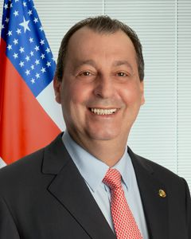

# Omar Aziz

| Campo | Dado |
|---|---|
| Nome completo | Omar José Abdel Aziz |
| Nascimento | 13/08/1958 — Garça/SP |
| Partidos (filiações) | PSD (01/02/2015) |
| Página oficial | http://www25.senado.leg.br/web/senadores/senador/-/perfil/5525 |

## Trajetória eleitoral no AM (TSE, eleições gerais)

Identificador comum da plataforma: `pessoa_id 2ee227c57a`. Cargos municipais (prefeito, vereador) ficam no repositório dossieprefeitosAM.

| Ano | Turno | Cargo | Partido | Nº | Votos | % votos nominais | Resultado |
|---|---|---|---|---|---|---|---|
| 2002 | 1 | Vice-governador | PFL | 23 | — | — | ELEITO (chapa de EDUARDO BRAGA) |
| 2006 | 1 | Vice-governador | PMN | 15 | — | — | ELEITO (chapa de EDUARDO BRAGA) |
| 2010 | 1 | Governador | PMN | 33 | 943.955 | 63,87% | ELEITO |
| 2014 | 1 | Senador | PSD | 555 | 933.996 | 58,51% | ELEITO |
| 2018 | 1 | Governador | PSD | 55 | 142.804 | 8,07% | NÃO ELEITO |
| 2022 | 1 | Senador | PSD | 555 | 784.007 | 41,65% | ELEITO |
| 2026 | 1 | Governador | PSD | 55 | 841.846 | 40,63% | 2º TURNO |
| 2026 | 2 | Governador | PSD | 55 | — | — | — |

## Mandatos pelo AM

| Mandato | Condição | Titular | Suplentes | Exercícios |
|---|---|---|---|---|
| 01/02/2023 a 31/01/2031 | Titular | — | Cheila Moreira (1º Suplente); João Pedro (2º Suplente) | 01/02/2023 a atual |
| 01/02/2015 a 31/01/2023 | Titular | — | Dr. Helder Cavalcante (1º Suplente); Luis Mitoso (2º Suplente) | 01/02/2015 a 31/01/2023 (Término do mandato) |

## Indicadores por legislatura

| Indicador | 55ª (2015–2019) | 56ª (2019–2023) | 57ª (2023–2027) |
|---|---|---|---|
| Dias em exercício | 1461 | 1461 | 1353 |
| Matérias apresentadas (todos os tipos) | 207 | 165 | 172 |
| Projetos e PECs como 1º autor | 9 | 7 | 3 |
| Requerimentos | 108 | 85 | 148 |
| **Normas geradas – 1º autor** | **1** | **1** | **0** |
| Normas geradas – coautor | 1 | 8 | 2 |
| Votações nominais: presente | 205/254 (80,7%) | 684/718 (95,3%) | 398/425 (93,6%) |
| Ausência justificada (licença, missão, atividade parlamentar) | 45 | 33 | 27 |
| Não compareceu (sem justificativa) | 4 | 1 | 0 |
| Discursos | 43 | 69 | 155 |
| CEAPS (cota) | R$ 1.739.668,94 | R$ 1.628.325,53 | R$ 2.168.140,08 |
| Emendas empenhadas | R$ 37.383.639,82 | R$ 64.689.087,00 | R$ 264.567.104,48 |
| Emendas pagas | R$ 32.579.946,23 | R$ 60.995.284,65 | R$ 253.278.464,40 |

## Normas geradas por matérias de sua autoria (13)

| Matéria | Norma | Data | Autoria | Ementa |
|---|---|---|---|---|
| [PEC 36/2016](https://www25.senado.leg.br/web/atividade/materias/-/materia/126473) | Emenda Constitucional nº 97 de 04/10/2017 | 04/10/2017 | coautor | Altera os §§ 1º, 2º e 3º, do art. 17 da Constituição Federal e a ele acrescenta os §§ 5º, 6º, 7º e 8º, para autorizar distinções entre partidos políticos, para fins de funcionament |
| [PLS 539/2015](https://www25.senado.leg.br/web/atividade/materias/-/materia/122730) | Lei nº 13.571 de 21/12/2017 | 21/12/2017 | 1º autor | Confere ao Município de Parintins, no Estado do Amazonas, o título de Capital Nacional do Boi Bumbá. |
| [PRS 48/2019](https://www25.senado.leg.br/web/atividade/materias/-/materia/136896) | Resolução do Senado Federal nº 9 de 28/05/2019 | 28/05/2019 | coautor | Institui a Frente Parlamentar dos Senadores dos Estados do Norte e do Nordeste. |
| [PRS 25/2020](https://www25.senado.leg.br/web/atividade/materias/-/materia/142512) | Resolução do Senado Federal nº 5 de 16/06/2020 | 16/06/2020 | 1º autor | Disciplina o tratamento a ser dispensado às operações realizadas de acordo com os §§ 1º, 2º e 3º do art. 65 da Lei Complementar nº 101, de 4 de maio de 2000, e art. 4º da Lei Compl |
| [PEC 186/2019](https://www25.senado.leg.br/web/atividade/materias/-/materia/139702) | Emenda Constitucional nº 109 de 15/03/2021 | 15/03/2021 | coautor | Altera o texto permanente da Constituição e o Ato das Disposições Constitucionais Transitórias, dispondo sobre medidas permanentes e emergenciais de controle do crescimento das des |
| [PEC 48/2015](https://www25.senado.leg.br/web/atividade/materias/-/materia/120742) | Emenda Constitucional nº 110 de 12/07/2021 | 12/07/2021 | coautor | Acrescenta o § 13 ao art. 37 da Constituição Federal para dispor sobre a convalidação de atos administrativos. |
| [PRS 53/2021](https://www25.senado.leg.br/web/atividade/materias/-/materia/150246) | Resolução do Senado Federal nº 31 de 05/11/2021 | 05/11/2021 | coautor | Institui a Frente Parlamentar Observatório da Pandemia de Covid-19. |
| [PEC 18/2021](https://www25.senado.leg.br/web/atividade/materias/-/materia/148962) | Emenda Constitucional nº 117 de 05/04/2022 | 05/04/2022 | coautor | Altera a Constituição Federal para acrescentar os §§ 6º e 7º ao art. 17 da Constituição, bem como acrescentar os arts. 6º-A e 6º-B ao Ato da Disposições Constitucionais Transitória |
| [PEC 11/2022](https://www25.senado.leg.br/web/atividade/materias/-/materia/152936) | Emenda Constitucional nº 124 de 14/07/2022 | 14/07/2022 | coautor | Institui o piso salarial nacional do Enfermeiro, do Técnico de Enfermagem, do Auxiliar de Enfermagem e da Parteira. |
| [PEC 32/2022](https://www25.senado.leg.br/web/atividade/materias/-/materia/155248) | Emenda Constitucional nº 126 de 21/12/2022 | 21/12/2022 | coautor | Altera o Ato das Disposições Constitucionais Transitórias para permitir a implementação do Programa Bolsa Família e definir regras para a transição da Presidência da República apli |
| [PEC 84/2015](https://www25.senado.leg.br/web/atividade/materias/-/materia/122031) | Emenda Constitucional nº 128 de 22/12/2022 | 22/12/2022 | coautor | Acrescenta o § 6º ao art. 167 da Constituição Federal, para proibir a criação, por lei, de encargo financeiro aos Estados, ao Distrito Federal e aos Municípios, decorrente da prest |
| [PRS 48/2024](https://www25.senado.leg.br/web/atividade/materias/-/materia/165981) | Resolução do Senado Federal nº 55 de 19/12/2024 | 19/12/2024 | coautor | Institui a Frente Parlamentar de Apoio à Cibersegurança e à Defesa Cibernética. |
| [PDL 995/2026](https://www25.senado.leg.br/web/atividade/materias/-/materia/175624) | Decreto Legislativo nº 386 de 03/09/2026 | 03/09/2026 | coautor | Escolhe o Senhor Rodrigo Otavio Soares Pacheco para o cargo de Ministro do Tribunal de Contas da União, nos termos do inciso II do § 2º do art. 73 da Constituição Federal, do incis |

## Produção por tipo (544 matérias)

| Tipo | Descrição | Total | Como 1º autor |
|---|---|---|---|
| RQS | Requerimento | 264 | 99 |
| PEC | Proposta de Emenda à Constituição | 162 | 1 |
| REQ | Requerimento | 59 | 56 |
| PLS | Projeto de Lei do Senado | 9 | 9 |
| RCT |  | 8 | 4 |
| PRS | Projeto de Resolução do Senado | 8 | 1 |
| PL | Projeto de Lei | 8 | 8 |
| OFS |  | 7 | 4 |
| PDL | Projeto de Decreto Legislativo | 6 | 0 |
| R.S |  | 5 | 0 |
| RQE |  | 3 | 2 |
| PDS | Projeto de Decreto Legislativo (Senado) | 2 | 0 |
| RQJ |  | 2 | 0 |
| INS | Indicação | 1 | 1 |

### Projetos e PECs como 1º autor (19)

| Matéria | Apresentação | Situação | Ementa |
|---|---|---|---|
| [PL 1611/2026](https://www25.senado.leg.br/web/atividade/materias/-/materia/173488) | 06/04/2026 | AGUARDANDO DESPACHO | Autoriza a Superintendência da Zona Franca de Manaus (Suframa) a doar, com encargos, imóvel ao Instituto Nacional de Pesquisas da Amazônia (Inpa). |
| [PL 1314/2024](https://www25.senado.leg.br/web/atividade/materias/-/materia/163124) | 17/04/2024 | AGUARDANDO DESIGNAÇÃO DO RELATOR | Altera a Lei nº 8.078, de 11 de setembro de 1990 (Código de Defesa do Consumidor), para reforçar a responsabilidade do fornecedor de serviço financeir |
| [PEC 12/2023](https://www25.senado.leg.br/web/atividade/materias/-/materia/156571) | 15/03/2023 | AGUARDANDO DESIGNAÇÃO DO RELATOR | Altera o art. 144 da Constituição Federal para identificar a Polícia Hidroviária Federal como órgão do sistema de segurança pública. |
| [PL 4321/2021](https://www25.senado.leg.br/web/atividade/materias/-/materia/151171) | 07/12/2021 | MATÉRIA COM A RELATORIA | Altera as Leis nº 9.782, de 26 de janeiro de 1999, que define o Sistema Nacional de Vigilância Sanitária, cria a Agência Nacional de Vigilância Sanitá |
| [PL 1912/2021](https://www25.senado.leg.br/web/atividade/materias/-/materia/148535) | 21/05/2021 | RETIRADA PELO AUTOR | Altera o Decreto-Lei nº 2.848, de 7 de dezembro de 1940 (Código Penal), para tipificar o crime de prescrição de produto destinado a fins terapêuticos  |
| [PRS 25/2020](https://www25.senado.leg.br/web/atividade/materias/-/materia/142512) | 16/06/2020 | TRANSFORMADA EM NORMA JURÍDICA | Disciplina o tratamento a ser dispensado às operações realizadas de acordo com os §§ 1º, 2º e 3º do art. 65 da Lei Complementar nº 101, de 4 de maio d |
| [PL 2303/2020](https://www25.senado.leg.br/web/atividade/materias/-/materia/141747) | 29/04/2020 | PREJUDICADA | Insere disposição transitória na Lei nº 9.492, de 10 de setembro de 1997, para suspender o exame dos protestos de títulos e outros documentos de dívid |
| [PL 1128/2020](https://www25.senado.leg.br/web/atividade/materias/-/materia/141281) | 30/03/2020 | PREJUDICADA | Dispõe sobre a concessão de empréstimos para empresas do setor privado, com juros subsidiados e carência e prazos facilitados, para quitação da folha  |
| [PL 1059/2020](https://www25.senado.leg.br/web/atividade/materias/-/materia/141258) | 27/03/2020 | RETIRADA PELO AUTOR | Dispõe sobre a concessão de garantias pelo Tesouro Nacional em empréstimos para empresas do setor privado, em resposta ao estado de calamidade pública |
| [PL 3136/2019](https://www25.senado.leg.br/web/atividade/materias/-/materia/136977) | 28/05/2019 | AGUARDANDO DESIGNAÇÃO DO RELATOR | Altera o art. 39 da Lei 8.078, de 11 de setembro de 1990 (Código de Defesa do Consumidor), para vedar a oferta telefônica de produto ou serviço sem o  |
| [PLS 247/2016](https://www25.senado.leg.br/web/atividade/materias/-/materia/126135) | 14/06/2016 | REMETIDA À CÂMARA DOS DEPUTADOS | Altera a Lei Complementar nº 101, de 4 de maio de 2000, para excetuar ações de segurança pública da aplicação das sanções de suspensão de transferênci |
| [PLS 246/2016](https://www25.senado.leg.br/web/atividade/materias/-/materia/126134) | 14/06/2016 | — | Institui o art. 302-A na Lei nº 9.503, de 23 de setembro de 1997 – Código de Trânsito Brasileiro, para tipificar o crime de homicídio doloso na direçã |
| [PLS 566/2015](https://www25.senado.leg.br/web/atividade/materias/-/materia/122856) | 27/08/2015 | REMETIDA À CÂMARA DOS DEPUTADOS | Altera a Lei nº 9.394, de 20 de dezembro de 1996, que estabelece as diretrizes e bases da educação nacional, para incluir a possibilidade de matrícula |
| [PLS 539/2015](https://www25.senado.leg.br/web/atividade/materias/-/materia/122730) | 18/08/2015 | TRANSFORMADA EM NORMA JURÍDICA | Confere ao Município de Parintins, no Estado do Amazonas, o título de Capital Nacional do Boi Bumbá. |
| [PLS 501/2015](https://www25.senado.leg.br/web/atividade/materias/-/materia/122524) | 04/08/2015 | AGUARDANDO DESIGNAÇÃO DO RELATOR | Altera a Lei nº 9.394, de 20 de dezembro de 1996, que estabelece as diretrizes e bases da educação nacional para incluir o tema do envelhecimento nos  |
| [PLS 455/2015](https://www25.senado.leg.br/web/atividade/materias/-/materia/122257) | 09/07/2015 | — | Altera a Lei nº 7.102, de 20 de junho de 1983, para incluir as agências dos Correios que atuem como Banco Postal e as unidades lotéricas entre os esta |
| [PLS 456/2015](https://www25.senado.leg.br/web/atividade/materias/-/materia/122252) | 09/07/2015 | AGUARDANDO DESIGNAÇÃO DO RELATOR | Dispõe sobre o fornecimento, pelas prestadoras de serviços de telecomunicações, mediante ordem judicial e sob segredo de Justiça, de dados que permita |
| [PLS 417/2015](https://www25.senado.leg.br/web/atividade/materias/-/materia/122075) | 01/07/2015 | AGUARDANDO DESIGNAÇÃO DO RELATOR | Cria o banco nacional de impressões digitais. |
| [PLS 409/2015](https://www25.senado.leg.br/web/atividade/materias/-/materia/122037) | 30/06/2015 | REMETIDA À CÂMARA DOS DEPUTADOS | Dispõe sobre a realização de concursos públicos para a Carreira Policial Federal e o Plano Especial de Cargos do Departamento de Polícia Federal. |

## Registro nas votações nominais

| Registro | Quantidade |
|---|---|
| Sim | 476 |
| Votou | 427 |
| P-NRV | 292 |
| Não | 90 |
| AP | 84 |
| LS | 21 |
| NCom | 5 |
| Presidente (art. 51 RISF) | 2 |

## Cota (CEAPS) por tipo de despesa — 2015 a 2026

Total reembolsado: **R$ 5.536.134,55**.

| Tipo de despesa | Valor | % |
|---|---|---|
| Contratação de consultorias | R$ 3.678.200,00 | 66,4% |
| Passagens aéreas | R$ 1.533.948,43 | 27,7% |
| Divulgação da atividade parlamentar | R$ 230.314,00 | 4,2% |
| Locomoção | R$ 76.272,12 | 1,4% |
| Aluguel de imóveis para escritório político | R$ 17.400,00 | 0,3% |

### Por ano

| Ano | Valor |
|---|---|
| 2015 | R$ 384.293,08 |
| 2016 | R$ 390.372,08 |
| 2017 | R$ 480.859,80 |
| 2018 | R$ 484.143,98 |
| 2019 | R$ 531.315,99 |
| 2020 | R$ 74.958,90 |
| 2021 | R$ 527.681,31 |
| 2022 | R$ 494.369,33 |
| 2023 | R$ 560.388,62 |
| 2024 | R$ 543.456,52 |
| 2025 | R$ 595.082,74 |
| 2026 | R$ 469.212,20 |

### Maiores fornecedores

| Fornecedor | CNPJ | Valor |
|---|---|---|
| Jefferson L R Coronel - Me | 22.793.293/0001-44 | R$ 1.520.200,00 |
| UPLINK Assessoria e Consultoria Empresarial Eireli -ME | 15.183.160/0001-90 | R$ 1.410.000,00 |
| LATAM | 33.937.681/0001-78 | R$ 896.677,71 |
| BLACKUP LTDA | 57.508.728/0001-46 | R$ 570.000,00 |
| GOL | 07.575.651/0001-59 | R$ 286.823,16 |
| Amazon Receptive | 05.437.528/0001-46 | R$ 284.278,50 |
| JOBGRAF - Serviços Gráficos EIRELI-ME | 24.930.645/0001-91 | R$ 181.414,00 |
| Caravelas Consultoria e Comunicação LTDA | 20.390.376/0001-67 | R$ 90.000,00 |
| Larissa de Oliveira Moraes | (pessoa física) | R$ 74.000,00 |
| Fermento Desenvolvimento de Software Ltda - ME | 17.679.575/0001-85 | R$ 58.000,00 |

## Emendas parlamentares individuais — 2015 a 2026

Empenhado: **R$ 366.639.831,30** · pago: **R$ 346.853.695,28**.

| Segmento (função) | Empenhado | Pago | % |
|---|---|---|---|
| Saúde | R$ 228.467.461,34 | R$ 224.423.753,40 | 62,3% |
| Encargos especiais | R$ 94.824.744,00 | R$ 89.224.794,43 | 25,9% |
| Defesa nacional | R$ 14.459.555,00 | R$ 9.379.019,00 | 3,9% |
| Assistência social | R$ 8.631.422,58 | R$ 8.000.619,59 | 2,4% |
| Urbanismo | R$ 6.000.000,00 | R$ 5.976.034,94 | 1,6% |
| Educação | R$ 5.346.239,44 | R$ 2.853.034,55 | 1,5% |
| Agricultura | R$ 2.486.219,12 | R$ 2.118.399,29 | 0,7% |
| Segurança pública | R$ 2.094.189,84 | R$ 2.094.189,84 | 0,6% |
| Comércio e serviços | R$ 1.049.999,98 | R$ 517.249,98 | 0,3% |
| Ciência e Tecnologia | R$ 1.000.000,00 | R$ 500.000,00 | 0,3% |
| Transporte | R$ 980.000,00 | R$ 966.600,26 | 0,3% |
| Desporto e lazer | R$ 500.000,00 | R$ 500.000,00 | 0,1% |
| Cultura | R$ 500.000,00 | R$ 0,00 | 0,1% |
| Direitos da cidadania | R$ 300.000,00 | R$ 300.000,00 | 0,1% |

### Por ano

| Ano | Emendas | Empenhado | Pago |
|---|---|---|---|
| 2015 | 0 | R$ 0,00 | R$ 0,00 |
| 2016 | 6 | R$ 10.791.302,58 | R$ 9.466.766,58 |
| 2017 | 17 | R$ 11.877.510,53 | R$ 9.169.428,34 |
| 2018 | 16 | R$ 14.714.826,71 | R$ 13.943.751,31 |
| 2019 | 12 | R$ 15.420.773,60 | R$ 14.028.769,72 |
| 2020 | 10 | R$ 15.939.440,40 | R$ 15.435.840,40 |
| 2021 | 8 | R$ 14.927.402,00 | R$ 13.129.203,53 |
| 2022 | 6 | R$ 18.401.471,00 | R$ 18.401.471,00 |
| 2023 | 6 | R$ 59.028.833,00 | R$ 59.009.671,71 |
| 2024 | 11 | R$ 69.581.089,44 | R$ 67.264.920,22 |
| 2025 | 7 | R$ 67.094.315,00 | R$ 67.019.215,00 |
| 2026 | 12 | R$ 68.862.867,04 | R$ 59.984.657,47 |

### Principais destinos

| Localidade | Empenhado |
|---|---|
| MÚLTIPLO | R$ 293.422.783,00 |
| AMAZONAS (UF) | R$ 28.335.819,13 |
| MANACAPURU - AM | R$ 12.673.762,00 |
| Nacional | R$ 9.709.941,52 |
| MANAUS - AM | R$ 5.156.549,73 |
| PARINTINS - AM | R$ 3.850.000,00 |
| TEFÉ - AM | R$ 2.480.000,00 |
| Norte | R$ 2.149.052,34 |
| COARI - AM | R$ 1.336.936,58 |
| PRESIDENTE FIGUEIREDO - AM | R$ 1.246.800,00 |

## Cargos em comissões (7)

| Cargo | Comissão | Início | Fim |
|---|---|---|---|
| PRESIDENTE | Frente Parlamentar Observatório da Pandemia Covid-19 | 14/12/2021 | 31/01/2023 |
| PRESIDENTE | Comissão de Transparência, Governança, Fiscalização e Controle e Defesa do Consumidor | 08/03/2023 | 01/02/2025 |
| PRESIDENTE | Comissão de Assuntos Econômicos | 13/02/2019 | 01/02/2021 |
| PRESIDENTE | CPI da Pandemia | 27/04/2021 | — |
| PRESIDENTE | Comissão de Segurança Pública | 24/03/2021 | 10/03/2022 |
| PRESIDENTE | Comissão de Segurança Pública | 10/03/2022 | 31/01/2023 |
| PRESIDENTE | CPI DA BRASKEM | 13/12/2023 | — |

Foi titular de 57 comissões, entre elas: CAE, CCC, CCJ, CCT, CDBL, CDH, CDR, CE, CEAPF, CEDP, CICCX, CM-ReformaTributária, CMA, CMDG, CNMS, CPIBETS, CPIBRASKEM, CPICRIME, CPIDFDQ, CPIPANDEMIA, CPMI - 8 de Janeiro, CPMI - INSS, CSAN, CSDP, CSF, CSP, CTFC, FPCIBERSEG, FPOPC, FPSENN, GPMARROCOS, GPPARABES, PAT, PJRM, PTS, VET 3/2015, VET 36/2014.

## Licenças e afastamentos (89)

| Tipo | Quantidade |
|---|---|
| Missão política ou cultural de interesse parlamentar | 76 |
| Licença Saúde (até a 120 dias) | 13 |

---
Fontes: Senado Federal (Dados Abertos: senador, mandatos, autorias, processo, votação, discursos; CEAPS), Portal da Transparência/CGU (emendas). Gerado em 15/10/2026 por `scripts/gerar.py`. Método e limites em [METODOLOGIA.md](../METODOLOGIA.md); verificação em [VERIFICACAO.md](../VERIFICACAO.md).
