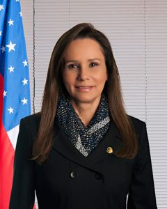

# Sandra Braga

| Campo | Dado |
|---|---|
| Nome completo | Sandra Backsmann Braga |
| Nascimento | 27/07/1959 — Manaus/AM |
| Partidos (filiações) | MDB (03/02/2011) |
| Página oficial | http://www25.senado.leg.br/web/senadores/senador/-/perfil/5038 |

## Trajetória eleitoral no AM (TSE, eleições gerais)

Identificador comum da plataforma: `pessoa_id 88311017a9`. Cargos municipais (prefeito, vereador) ficam no repositório dossieprefeitosAM.

| Ano | Turno | Cargo | Partido | Nº | Votos | % votos nominais | Resultado |
|---|---|---|---|---|---|---|---|
| 2010 | 1 | Suplente de senador | PMDB | 155 | — | — | ELEITO (chapa de EDUARDO BRAGA) |
| 2018 | 1 | Suplente de senador | MDB | 155 | — | — | ELEITO |
| 2026 | 1 | Suplente de senador | MDB | 155 | — | — | ELEITO |

## Mandatos pelo AM

| Mandato | Condição | Titular | Suplentes | Exercícios |
|---|---|---|---|---|
| 01/02/2019 a 31/01/2027 | 1º Suplente | Eduardo Braga | Miguel Biango (2º Suplente) | não exerceu |
| 01/02/2011 a 31/01/2019 | 1º Suplente | Eduardo Braga | Lirio Albino Parisotto (2º Suplente) | 01/01/2015 a 22/04/2016 (Retorno do titular) |

## Indicadores por legislatura

| Indicador | 54ª (2011–2015) | 55ª (2015–2019) |
|---|---|---|
| Dias em exercício | 31 | 447 |
| Matérias apresentadas (todos os tipos) | 0 | 79 |
| Projetos e PECs como 1º autor | 0 | 5 |
| Requerimentos | 0 | 42 |
| **Normas geradas – 1º autor** | **0** | **1** |
| Normas geradas – coautor | 0 | 0 |
| Votações nominais: presente | sem dado | sem dado |
| Ausência justificada (licença, missão, atividade parlamentar) | 0 | 0 |
| Não compareceu (sem justificativa) | 0 | 0 |
| Discursos | 0 | 20 |
| CEAPS (cota) | — | R$ 478.785,09 |
| Emendas empenhadas | — | R$ 8.768.259,00 |
| Emendas pagas | — | R$ 7.386.391,00 |

## Normas geradas por matérias de sua autoria (2)

| Matéria | Norma | Data | Autoria | Ementa |
|---|---|---|---|---|
| [PLS 504/2015](https://www25.senado.leg.br/web/atividade/materias/-/materia/122531) | Lei nº 13.638 de 22/03/2018 | 22/03/2018 | 1º autor | Altera a Lei nº 8.686, de 20 de julho de 1993, para estabelecer novo valor à pensão especial devida aos deficientes físicos portadores da Síndrome de Talidomida, instituída pela Le |
| [PEC 48/2015](https://www25.senado.leg.br/web/atividade/materias/-/materia/120742) | Emenda Constitucional nº 110 de 12/07/2021 | 12/07/2021 | coautor | Acrescenta o § 13 ao art. 37 da Constituição Federal para dispor sobre a convalidação de atos administrativos. |

## Produção por tipo (79 matérias)

| Tipo | Descrição | Total | Como 1º autor |
|---|---|---|---|
| RQS | Requerimento | 36 | 10 |
| PEC | Proposta de Emenda à Constituição | 29 | 0 |
| PLS | Projeto de Lei do Senado | 6 | 5 |
| PRS | Projeto de Resolução do Senado | 2 | 0 |
| RCT |  | 2 | 2 |
| RQI | Requerimento de informações | 2 | 0 |
| RMC |  | 1 | 1 |
| R.S |  | 1 | 0 |

### Projetos e PECs como 1º autor (5)

| Matéria | Apresentação | Situação | Ementa |
|---|---|---|---|
| [PLS 670/2015](https://www25.senado.leg.br/web/atividade/materias/-/materia/123498) | 06/10/2015 | — | Obriga os estabelecimentos comerciais a indenizarem os consumidores quando o preço do produto exposto para venda for diferente do preço efetivamente c |
| [PLS 567/2015](https://www25.senado.leg.br/web/atividade/materias/-/materia/122887) | 27/08/2015 | REMETIDA À CÂMARA DOS DEPUTADOS | Altera a Lei nº 9.503, de 23 de setembro de 1997, que institui o Código de Trânsito Brasileiro, para dispor sobre a obrigatoriedade da divulgação dos  |
| [PLS 503/2015](https://www25.senado.leg.br/web/atividade/materias/-/materia/122533) | 04/08/2015 | — | Institui estímulos a doações de produtos alimentícios, altera a Lei n° 8.078, de 11 de setembro de 1990, que dispõe sobre a proteção do consumidor e d |
| [PLS 505/2015](https://www25.senado.leg.br/web/atividade/materias/-/materia/122532) | 04/08/2015 | ARQUIVADO NA CÂMARA DOS DEPUTADOS | Dispõe sobre os reservatórios de acumulação de recursos hídricos em rios de domínio dos Estados e da União. |
| [PLS 504/2015](https://www25.senado.leg.br/web/atividade/materias/-/materia/122531) | 04/08/2015 | TRANSFORMADA EM NORMA JURÍDICA | Altera a Lei nº 8.686, de 20 de julho de 1993, para estabelecer novo valor à pensão especial devida aos deficientes físicos portadores da Síndrome de  |

## Cota (CEAPS) por tipo de despesa — 2011 a 2018

Total reembolsado: **R$ 478.785,09**.

| Tipo de despesa | Valor | % |
|---|---|---|
| Divulgação da atividade parlamentar | R$ 249.724,00 | 52,2% |
| Passagens aéreas | R$ 182.527,19 | 38,1% |
| Contratação de consultorias | R$ 28.084,00 | 5,9% |
| Locomoção | R$ 12.449,90 | 2,6% |
| Aquisição de material de consumo para uso no escritório político | R$ 6.000,00 | 1,3% |

### Por ano

| Ano | Valor |
|---|---|
| 2011 | R$ 0,00 |
| 2012 | R$ 0,00 |
| 2013 | R$ 0,00 |
| 2014 | R$ 0,00 |
| 2015 | R$ 361.677,94 |
| 2016 | R$ 117.107,15 |
| 2017 | R$ 0,00 |
| 2018 | R$ 0,00 |

### Maiores fornecedores

| Fornecedor | CNPJ | Valor |
|---|---|---|
| TINGA PRODUÇÕES | 12.819.071/0001-08 | R$ 126.320,00 |
| VM PRODUÇÃO MULTIMIDIA LTDA | 04.702.688/0001-02 | R$ 112.308,00 |
| TAM Linhas Aéreas S/A | 02.012.862/0001-60 | R$ 107.479,06 |
| GOL Linhas Aéreas Inteligentes | 07.575.651/0001-59 | R$ 47.820,54 |
| FLUIR PUBLICIDADE LTDA | 63.689.566/0001-92 | R$ 24.000,00 |
| AZUL Linas Aéras Brasileiras S/A | 09.296.295/0001-60 | R$ 13.137,87 |
| AVIANCA | 02.575.829/0001-48 | R$ 10.251,82 |
| CONDE & DELLM ARINGA - DESENVOLVIMENTO DE SOFTWARES LTDA EPP | 09.613.772/0001-73 | R$ 8.080,00 |
| H PLUS ADMINISTRAÇÃO E HOTELARIA LTDA | 05.217.384/0005-46 | R$ 7.006,10 |
| CARACOL EDITORA LTDA ME | 14.710.058/0001-33 | R$ 5.000,00 |

## Emendas parlamentares individuais — 2011 a 2018

Empenhado: **R$ 8.768.259,00** · pago: **R$ 7.386.391,00**.

| Segmento (função) | Empenhado | Pago | % |
|---|---|---|---|
| Defesa nacional | R$ 5.709.123,00 | R$ 4.838.240,00 | 65,1% |
| Saúde | R$ 2.495.775,00 | R$ 1.984.790,00 | 28,5% |
| Educação | R$ 563.361,00 | R$ 563.361,00 | 6,4% |

### Por ano

| Ano | Emendas | Empenhado | Pago |
|---|---|---|---|
| 2011 | 0 | R$ 0,00 | R$ 0,00 |
| 2012 | 0 | R$ 0,00 | R$ 0,00 |
| 2013 | 0 | R$ 0,00 | R$ 0,00 |
| 2014 | 0 | R$ 0,00 | R$ 0,00 |
| 2015 | 0 | R$ 0,00 | R$ 0,00 |
| 2016 | 5 | R$ 8.768.259,00 | R$ 7.386.391,00 |
| 2017 | 0 | R$ 0,00 | R$ 0,00 |
| 2018 | 0 | R$ 0,00 | R$ 0,00 |

### Principais destinos

| Localidade | Empenhado |
|---|---|
| AMAZONAS (UF) | R$ 6.272.484,00 |
| MÚLTIPLO | R$ 2.242.870,00 |
| PARINTINS - AM | R$ 252.905,00 |

Foi titular de 9 comissões, entre elas: CAE, CE, CI, CMA, CMAGUA, CMCVM, CMMC, CPIFundos, CTREFORMA.

## Licenças e afastamentos (21)

| Tipo | Quantidade |
|---|---|
| Missão política ou cultural de interesse parlamentar | 21 |

---
Fontes: Senado Federal (Dados Abertos: senador, mandatos, autorias, processo, votação, discursos; CEAPS), Portal da Transparência/CGU (emendas). Gerado em 15/10/2026 por `scripts/gerar.py`. Método e limites em [METODOLOGIA.md](../METODOLOGIA.md); verificação em [VERIFICACAO.md](../VERIFICACAO.md).
