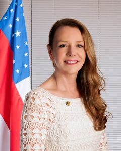

# Vanessa Grazziotin

| Campo | Dado |
|---|---|
| Nome completo | Vanessa Grazziotin |
| Nascimento | 29/06/1961 — Videira/SC |
| Partidos (filiações) | PCdoB (01/02/1999) |
| Página oficial | http://www25.senado.leg.br/web/senadores/senador/-/perfil/558 |

## Trajetória eleitoral no AM (TSE, eleições gerais)

Identificador comum da plataforma: `pessoa_id 0fca387a24`. Cargos municipais (prefeito, vereador) ficam no repositório dossieprefeitosAM.

| Ano | Turno | Cargo | Partido | Nº | Votos | % votos nominais | Resultado |
|---|---|---|---|---|---|---|---|
| 1998 | 1 | Deputado federal | PC do B | 6565 | 64.407 | 8,42% | ELEITO |
| 2002 | 1 | Deputado federal | PC do B | 6565 | 197.419 | 18,63% | ELEITO |
| 2006 | 1 | Deputado federal | PC do B | 6565 | 95.950 | 7,44% | ELEITO |
| 2010 | 1 | Senador | PC do B | 656 | 672.920 | 22,89% | ELEITO |
| 2018 | 1 | Senador | PC do B | 656 | 373.948 | 11,36% | NÃO ELEITO |
| 2022 | 1 | Deputado federal | PC do B | 6513 | 36.816 | 1,92% | NÃO ELEITO |

## Mandatos pelo AM

| Mandato | Condição | Titular | Suplentes | Exercícios |
|---|---|---|---|---|
| 01/02/2011 a 31/01/2019 | Titular | — | Francisco Garcia (1º Suplente); Alzira Ferreira Barros (2º Suplente) | 01/02/2011 a 31/01/2019 (Término do mandato) |

## Indicadores por legislatura

| Indicador | 54ª (2011–2015) | 55ª (2015–2019) |
|---|---|---|
| Dias em exercício | 1461 | 1461 |
| Matérias apresentadas (todos os tipos) | 1100 | 880 |
| Projetos e PECs como 1º autor | 124 | 75 |
| Requerimentos | 864 | 683 |
| **Normas geradas – 1º autor** | **3** | **5** |
| Normas geradas – coautor | 1 | 3 |
| Votações nominais: presente | 471/513 (91,8%) | 230/254 (90,6%) |
| Ausência justificada (licença, missão, atividade parlamentar) | 39 | 24 |
| Não compareceu (sem justificativa) | 3 | 0 |
| Discursos | 530 | 594 |
| CEAPS (cota) | R$ 1.822.278,65 | R$ 2.016.495,90 |
| Emendas empenhadas | — | R$ 38.228.707,87 |
| Emendas pagas | — | R$ 32.776.548,92 |

## Normas geradas por matérias de sua autoria (18)

| Matéria | Norma | Data | Autoria | Ementa |
|---|---|---|---|---|
| [PRS 1/2012](https://www25.senado.leg.br/web/atividade/materias/-/materia/104233) | Resolução do Senado Federal nº 48 de 31/10/2012 | 31/10/2012 | 1º autor | Altera a Resolução nº 42, de 2010, que cria o Programa Senado Jovem Brasileiro, para modificar critérios de participação dos estudantes. |
| [PRS 2/2013](https://www25.senado.leg.br/web/atividade/materias/-/materia/110432) | Resolução do Senado Federal nº 9 de 25/03/2013 | 25/03/2013 | 1º autor | Cria a Procuradoria Especial da Mulher do Senado Federal. |
| [PEC 82/2011](https://www25.senado.leg.br/web/atividade/materias/-/materia/101807) | Emenda Constitucional nº 74 de 06/08/2013 | 06/08/2013 | 1º autor | Altera o art. 134 da Constituição Federal. |
| [PEC 39/2013](https://www25.senado.leg.br/web/atividade/materias/-/materia/114042) | Emenda Constitucional nº 84 de 02/12/2014 | 02/12/2014 | coautor | Altera a redação do art. 159 da Constituição Federal, para aumentar em dois pontos percentuais o repasse do IR e do IPI para o Fundo de Participação dos Municípios (FPM). |
| [PRS 40/2014](https://www25.senado.leg.br/web/atividade/materias/-/materia/118522) | Resolução do Senado Federal nº 1 de 10/03/2015 | 10/03/2015 | 1º autor | Altera a Resolução nº 2, de 2001, para permitir que homens também sejam agraciados com o Diploma Bertha Lutz. |
| [PLS 515/2015](https://www25.senado.leg.br/web/atividade/materias/-/materia/122586) | Lei nº 13.272 de 15/04/2016 | 15/04/2016 | coautor | Institui o Ano de 2016 como o Ano do Empoderamento da Mulher na Política e no Esporte. |
| [PRS 21/2014](https://www25.senado.leg.br/web/atividade/materias/-/materia/118130) | Resolução do Senado Federal nº 32 de 19/07/2016 | 19/07/2016 | 1º autor | Institui o Grupo Parlamentar Brasil-Indonésia. |
| [PEC 50/2016](https://www25.senado.leg.br/web/atividade/materias/-/materia/127262) | Emenda Constitucional nº 96 de 06/06/2017 | 06/06/2017 | coautor | Acrescenta o § 7º ao art. 225 da Constituição Federal, para permitir a realização das manifestações culturais registradas como patrimônio cultural brasileiro que não atentem contra |
| [PEC 3/2016](https://www25.senado.leg.br/web/atividade/materias/-/materia/124815) | Emenda Constitucional nº 98 de 06/12/2017 | 06/12/2017 | coautor | Altera o art. 31 da Emenda Constitucional nº 19, de 4 de junho de 1998, para prever a inclusão, em quadro, em extinção, da administração pública federal, da pessoa que haja mantido |
| [PRS 23/2014](https://www25.senado.leg.br/web/atividade/materias/-/materia/118157) | Resolução do Senado Federal nº 24 de 11/12/2017 | 11/12/2017 | 1º autor | Institui no âmbito do Senado Federal a Frente Parlamentar em Defesa da Amazônia Legal. |
| [PLS 1/2014](https://www25.senado.leg.br/web/atividade/materias/-/materia/115983) | Lei nº 13.653 de 18/04/2018 | 18/04/2018 | 1º autor | Dispõe sobre a regulamentação da profissão de arqueólogo e dá outras providências. |
| [PLS 618/2015](https://www25.senado.leg.br/web/atividade/materias/-/materia/123183) | Lei nº 13.718 de 24/09/2018 | 24/09/2018 | 1º autor | Acrescenta o art. 225-A ao Decreto-Lei nº 2.848, de 7 de dezembro de 1940 - Código Penal, para prever causa de aumento de pena para o crime de estupro cometido por duas ou mais pes |
| [PEC 61/2015](https://www25.senado.leg.br/web/atividade/materias/-/materia/121353) | Emenda Constitucional nº 105 de 12/12/2019 | 12/12/2019 | coautor | Altera o art. 166 da Constituição Federal, para autorizar a apresentação de emendas ao projeto de lei do orçamento anual diretamente ao Fundo de Participação dos Estados e do Distr |
| [PEC 29/2017](https://www25.senado.leg.br/web/atividade/materias/-/materia/130672) | Emenda Constitucional nº 112 de 27/10/2021 | 27/10/2021 | coautor | Altera o art. 159 da Constituição Federal para disciplinar a distribuição de recursos pela União ao Fundo de Participação dos Municípios (FPM). |
| [PLS 374/2014](https://www25.senado.leg.br/web/atividade/materias/-/materia/119334) | Lei nº 14.335 de 10/05/2022 | 10/05/2022 | 1º autor | Altera a Lei nº 11.664, de 29 de abril de 2008, para dispor sobre a realização de mamografia no âmbito do Sistema Único de Saúde (SUS). |
| [PEC 84/2015](https://www25.senado.leg.br/web/atividade/materias/-/materia/122031) | Emenda Constitucional nº 128 de 22/12/2022 | 22/12/2022 | coautor | Acrescenta o § 6º ao art. 167 da Constituição Federal, para proibir a criação, por lei, de encargo financeiro aos Estados, ao Distrito Federal e aos Municípios, decorrente da prest |
| [PEC 6/2018](https://www25.senado.leg.br/web/atividade/materias/-/materia/133306) | Emenda Constitucional nº 131 de 03/10/2023 | 03/10/2023 | coautor | Altera o art. 12 da Constituição Federal, para suprimir a perda de nacionalidade brasileira em razão da mera naturalização, incluir a exceção para situações de apatridia, e acresce |
| [PEC 2/2017](https://www25.senado.leg.br/web/atividade/materias/-/materia/128035) | Emenda Constitucional nº 139 de 05/05/2026 | 05/05/2026 | coautor | Altera o § 1º do art. 31 e o art. 75 da Constituição Federal para estabelecer os Tribunais de Contas como órgãos permanentes e essenciais ao controle externo da administração públi |

## Produção por tipo (1981 matérias)

| Tipo | Descrição | Total | Como 1º autor |
|---|---|---|---|
| RQS | Requerimento | 1289 | 1132 |
| PEC | Proposta de Emenda à Constituição | 233 | 30 |
| PLS | Projeto de Lei do Senado | 150 | 140 |
| RAS |  | 44 | 31 |
| RQI | Requerimento de informações | 37 | 31 |
| RRE |  | 32 | 27 |
| RQE |  | 30 | 26 |
| RMA |  | 26 | 22 |
| PRS | Projeto de Resolução do Senado | 25 | 21 |
| PDS | Projeto de Decreto Legislativo (Senado) | 21 | 8 |
| RQJ |  | 21 | 18 |
| R.S |  | 20 | 3 |
| RVM |  | 16 | 12 |
| RDH |  | 10 | 8 |
| RMC |  | 10 | 10 |
| RCE |  | 6 | 3 |
| RTG |  | 3 | 3 |
| RDR |  | 2 | 1 |
| OFS |  | 2 | 0 |
| PFS |  | 2 | 2 |
| RQN |  | 1 | 1 |
| RCT |  | 1 | 0 |

### Projetos e PECs como 1º autor (199)

| Matéria | Apresentação | Situação | Ementa |
|---|---|---|---|
| [PDS 109/2018](https://www25.senado.leg.br/web/atividade/materias/-/materia/134311) | 15/10/2018 | ARQUIVADA AO FINAL DA LEGISLATURA | Susta o Decreto nº 9.514, de 27 de setembro de 2018, que altera a Tabela de Incidência do Imposto sobre Produtos Industrializados - TIPI, aprovada pel |
| [PDS 108/2018](https://www25.senado.leg.br/web/atividade/materias/-/materia/134310) | 15/10/2018 | ARQUIVADA AO FINAL DA LEGISLATURA | Susta o Decreto nº 9.507, de 21 de setembro de 2018, que dispõe sobre a execução indireta, mediante contratação, de serviços da administração pública  |
| [PLS 288/2018](https://www25.senado.leg.br/web/atividade/materias/-/materia/133616) | 12/06/2018 | ARQUIVADA AO FINAL DA LEGISLATURA | Altera a Lei nº 11.340, de 7 de agosto de 2006, para incluir o uso de monitoração eletrônica como forma de assegurar o respeito ao limite mínimo de di |
| [PLS 287/2018](https://www25.senado.leg.br/web/atividade/materias/-/materia/133617) | 12/06/2018 | ARQUIVADA AO FINAL DA LEGISLATURA | Altera o Decreto-Lei nº 2.848, de 7 de dezembro de 1940 – Código Penal, para dispor sobre o crime de assédio sexual. |
| [PLS 289/2018](https://www25.senado.leg.br/web/atividade/materias/-/materia/133615) | 12/06/2018 | — | Altera a Lei nº 8.036, de 11 de maio de 1990, para dispor sobre a movimentação da conta vinculada da trabalhadora, vítima de violência física ou psico |
| [PDS 57/2018](https://www25.senado.leg.br/web/atividade/materias/-/materia/133495) | 04/06/2018 | ARQUIVADO NA CÂMARA DOS DEPUTADOS | Susta o Decreto nº 9.394, de 30 de maio de 2018, que altera a Tabela de Incidência do Imposto sobre Produtos Industrializados - TIPI, aprovada pelo De |
| [PLS 253/2018](https://www25.senado.leg.br/web/atividade/materias/-/materia/133387) | 23/05/2018 | ARQUIVADA AO FINAL DA LEGISLATURA | Modifica o art. 3º da Lei nº 9.491, de 9 de setembro de 1997, que altera procedimentos relativos ao Programa Nacional de Desestatização, revoga a Lei  |
| [PDS 37/2018](https://www25.senado.leg.br/web/atividade/materias/-/materia/133032) | 23/04/2018 | ARQUIVADA AO FINAL DA LEGISLATURA | Susta os efeitos do Decreto nº 9.351, de 19 de abril de 2018, que aprova as recomendações estabelecidas na Resolução nº 13, de 23 de agosto de 2017, e |
| [PLS 185/2018](https://www25.senado.leg.br/web/atividade/materias/-/materia/132963) | 12/04/2018 | ARQUIVADA AO FINAL DA LEGISLATURA | Altera a Lei nº 13.536, de 15 de dezembro de 2017, para estender a não bolsistas a suspensão do calendário das atividades acadêmicas por até 120 (cent |
| [PLS 156/2018](https://www25.senado.leg.br/web/atividade/materias/-/materia/132810) | 04/04/2018 | — | Altera a Lei nº 10.779, de 25 de novembro de 2003, para dispor sobre a concessão do benefício do seguro-desemprego ao trabalhador extrativista vegetal |
| [PLS 154/2018](https://www25.senado.leg.br/web/atividade/materias/-/materia/132778) | 28/03/2018 | — | Altera a Lei nº 8.213, de 24 de julho de 1991, para determinar a celebração de convênios, termos de execução descentralizada, termos de fomento ou de  |
| [PLS 105/2018](https://www25.senado.leg.br/web/atividade/materias/-/materia/132532) | 13/03/2018 | — | Acrescenta artigo à Lei nº 9.096, de 19 de setembro de 1995, para vedar a mudança de nome de partidos políticos no período de um ano antes de cada ele |
| [PLS 71/2018](https://www25.senado.leg.br/web/atividade/materias/-/materia/132373) | 01/03/2018 | — | Revoga o inciso I do art. 181 do Decreto-Lei nº 2.848, de 7 de dezembro de 1940 (Código Penal), para extinguir as escusas absolutórias e imunidades pr |
| [PEC 46/2017](https://www25.senado.leg.br/web/atividade/materias/-/materia/131958) | 13/12/2017 | ARQUIVADA AO FINAL DA LEGISLATURA | Inclui o art. 166-A, para estabelecer prazo de votação das contas presidenciais, bem assim audiência pública obrigatória no Congresso Nacional sobre a |
| [PLS 461/2017](https://www25.senado.leg.br/web/atividade/materias/-/materia/131717) | 27/11/2017 | — | Altera a Lei nº 8.078, de 11 de setembro de 1990 (Código do Consumidor), para incluir o uso de visões desiguais de gênero no rol dos elementos que car |
| [PDS 197/2017](https://www25.senado.leg.br/web/atividade/materias/-/materia/131461) | 07/11/2017 | ARQUIVADA AO FINAL DA LEGISLATURA | Susta o Decreto nº 9.188, de 1º de novembro de 2017, que estabelece regras de governança, transparência e boas práticas de mercado para a adoção de re |
| [PLS 316/2017](https://www25.senado.leg.br/web/atividade/materias/-/materia/130765) | 06/09/2017 | ARQUIVADA AO FINAL DA LEGISLATURA | Altera o Decreto-Lei nº 2.848, de 7 de dezembro de 1940 – Código Penal, para prever o crime de atentado à dignidade sexual de outrem mediante contato  |
| [PLS 308/2017](https://www25.senado.leg.br/web/atividade/materias/-/materia/130649) | 31/08/2017 | — | Altera a Lei nº 8.078, de 11 de setembro de 1990, para tornar obrigatória, por parte do agente financeiro, a devolução de 80% dos valores pagos ao mut |
| [PLS 294/2017](https://www25.senado.leg.br/web/atividade/materias/-/materia/130495) | 23/08/2017 | ARQUIVADA AO FINAL DA LEGISLATURA | Altera o art. 468 da Consolidação das Leis do Trabalho – CLT, aprovada pelo Decreto-Lei nº 5.452, de 1º de maio de 1943, para dispor sobre a incorpora |
| [PLS 295/2017](https://www25.senado.leg.br/web/atividade/materias/-/materia/130499) | 23/08/2017 | ARQUIVADA AO FINAL DA LEGISLATURA | Dá nova redação ao art. 394-A, da Consolidação das Leis do Trabalho – CLT, aprovada pelo Decreto-Lei nº 5.452, de 1º de maio de 1943, com a redação at |
| [PLS 296/2017](https://www25.senado.leg.br/web/atividade/materias/-/materia/130497) | 23/08/2017 | ARQUIVADA AO FINAL DA LEGISLATURA | Revoga os §§ 1º e 2º do art. 223-G, da Consolidação das Leis do Trabalho – CLT, aprovada pelo Decreto-Lei nº 5.452, de 1º de maio de 1943, com a redaç |
| [PLS 297/2017](https://www25.senado.leg.br/web/atividade/materias/-/materia/130496) | 23/08/2017 | ARQUIVADA AO FINAL DA LEGISLATURA | Dá nova redação ao § 3º do art. 614, da Consolidação das Leis do Trabalho – CLT, aprovada pelo Decreto-Lei nº 5.452, de 1º de maio de 1943, com a reda |
| [PLS 289/2017](https://www25.senado.leg.br/web/atividade/materias/-/materia/130494) | 23/08/2017 | ARQUIVADA AO FINAL DA LEGISLATURA | Revoga o art. 507-B da Consolidação das Leis do Trabalho (CLT), aprovada pelo Decreto-Lei nº 5.452, de 1º de maio de 1943, para extirpar do ordenament |
| [PLS 290/2017](https://www25.senado.leg.br/web/atividade/materias/-/materia/130498) | 23/08/2017 | ARQUIVADA AO FINAL DA LEGISLATURA | Assegura à trabalhadora lactante, para amamentar o próprio filho, até que este complete um ano de idade, o direito, durante a jornada de trabalho, a d |
| [PLS 291/2017](https://www25.senado.leg.br/web/atividade/materias/-/materia/130500) | 23/08/2017 | ARQUIVADA AO FINAL DA LEGISLATURA | Extingue o regime de trabalho intermitente. |
| [PLS 292/2017](https://www25.senado.leg.br/web/atividade/materias/-/materia/130502) | 23/08/2017 | ARQUIVADA AO FINAL DA LEGISLATURA | Revoga o art. 442-B da Consolidação das Leis do Trabalho (CLT), aprovada pelo Decreto-Lei nº 5.452, de 1º de maio de 1943, para extirpar do ordenament |
| [PLS 293/2017](https://www25.senado.leg.br/web/atividade/materias/-/materia/130492) | 23/08/2017 | ARQUIVADA AO FINAL DA LEGISLATURA | Modifica o art. 611-A da Consolidação das Leis do Trabalho (CLT), aprovada pelo Decreto-Lei nº 5.452, de 1º de maio de 1943, com redação dada pela Lei |
| [PLS 229/2017](https://www25.senado.leg.br/web/atividade/materias/-/materia/130040) | 12/07/2017 | ARQUIVADA AO FINAL DA LEGISLATURA | Acrescenta §§ 1º, 2º e 3º ao art. 1º da Lei nº 1.060, de 5 de fevereiro de 1950, para estabelecer requisitos objetivos para a concessão do benefício d |
| [PDS 108/2017](https://www25.senado.leg.br/web/atividade/materias/-/materia/129281) | 24/05/2017 | ARQUIVADA AO FINAL DA LEGISLATURA | Susta os efeitos do Decreto sem número, editado pela Presidência da República em 24 de maio de 2017, que autorizou “o emprego de Forças Armadas para a |
| [PLS 139/2017](https://www25.senado.leg.br/web/atividade/materias/-/materia/129136) | 09/05/2017 | ARQUIVADA AO FINAL DA LEGISLATURA | Regulamenta o disposto no artigo 153, VII, da Constituição Federal, para instituir o Imposto sobre Grandes Fortunas e dá outras providências. |
| [PEC 16/2017](https://www25.senado.leg.br/web/atividade/materias/-/materia/129032) | 27/04/2017 | ARQUIVADA AO FINAL DA LEGISLATURA | Altera o § 1º art. 10 do Ato das Disposições Constitucionais e Transitórias, para dispor sobre a licença-maternidade compartilhada. |
| [PLS 13/2017](https://www25.senado.leg.br/web/atividade/materias/-/materia/127963) | 07/02/2017 | ARQUIVADA AO FINAL DA LEGISLATURA | Altera a Lei nº 9.504, de 30 de setembro de 1997, para ampliar o tempo de propaganda eleitoral nas eleições proporcionais e vedar a utilização de imag |
| [PDS 90/2016](https://www25.senado.leg.br/web/atividade/materias/-/materia/127830) | 14/12/2016 | PREJUDICADA | Susta os efeitos dos arts. 13 e 14 da Resolução nº 400, de 13 de dezembro de 2016, da Agência Nacional de Aviação Civil – ANAC, que “dispõe sobre Cond |
| [PRS 58/2016](https://www25.senado.leg.br/web/atividade/materias/-/materia/127381) | 03/11/2016 | ARQUIVADA AO FINAL DA LEGISLATURA | Altera os arts. 356, 357, 358, 359, 360, 361 e 364 do Regimento Interno do Senado Federal, para determinar que as propostas de emendas à Constituição  |
| [PLS 347/2016](https://www25.senado.leg.br/web/atividade/materias/-/materia/126964) | 19/09/2016 | — | Altera a Lei nº 12.965, de 23 de abril de 2014 (Marco Civil da Internet), para dispor sobre a necessidade de prévio consentimento do usuário nos proce |
| [PEC 43/2016](https://www25.senado.leg.br/web/atividade/materias/-/materia/126710) | 17/08/2016 | ARQUIVADA AO FINAL DA LEGISLATURA | Altera o art. 94 para estabelecer a exigência de diversidade de gêneros na composição das listas sêxtuplas e tríplices formadas para indicação de memb |
| [PLS 233/2016](https://www25.senado.leg.br/web/atividade/materias/-/materia/126050) | 07/06/2016 | ARQUIVADA AO FINAL DA LEGISLATURA | Altera a Lei nº 12.813, de 16 de maio de 2013, para dispor sobre situações que configurem conflito de interesses após o exercício de cargo ou emprego  |
| [PLS 132/2016](https://www25.senado.leg.br/web/atividade/materias/-/materia/125288) | 23/03/2016 | REJEITADA | Altera a Lei no 7.565, de 19 de dezembro de 1986, que dispõe sobre o Código Brasileiro de Aeronáutica, para incluir nos contratos de transporte de pas |
| [PEC 10/2016](https://www25.senado.leg.br/web/atividade/materias/-/materia/125244) | 17/03/2016 | ARQUIVADA AO FINAL DA LEGISLATURA | Altera a Constituição Federal, para permitir a participação do servidor ocupante, exclusivamente, de cargo em comissão declarado em lei de livre nomea |
| [PRS 11/2016](https://www25.senado.leg.br/web/atividade/materias/-/materia/125138) | 14/03/2016 | ARQUIVADA AO FINAL DA LEGISLATURA | Acrescenta o § 4º ao art. 108 do Regimento Interno do Senado Federal, para estabelecer o prazo máximo de trinta minutos, além do horário agendado, par |
| [PLS 73/2016](https://www25.senado.leg.br/web/atividade/materias/-/materia/125058) | 08/03/2016 | ARQUIVADA AO FINAL DA LEGISLATURA | Altera a Lei nº 10.925, de 23 de julho de 2004, para reduzir a zero as alíquotas da Contribuição para o PIS/Pasep e da Contribuição para o Financiamen |
| [PLS 72/2016](https://www25.senado.leg.br/web/atividade/materias/-/materia/125056) | 08/03/2016 | REMETIDA À CÂMARA DOS DEPUTADOS | Altera a Lei nº 8.069, de 13 de julho de 1990, que dispõe sobre o Estatuto da Criança e do Adolescente e dá outras providências, para assegurar o dire |
| [PLS 33/2016](https://www25.senado.leg.br/web/atividade/materias/-/materia/124793) | 17/02/2016 | ARQUIVADA AO FINAL DA LEGISLATURA | Altera a Lei nº 9.394, de 20 de dezembro de 1996, que estabelece as diretrizes e bases da educação nacional, para prever a garantia de acesso e perman |
| [PLS 731/2015](https://www25.senado.leg.br/web/atividade/materias/-/materia/123979) | 10/11/2015 | ARQUIVADA AO FINAL DA LEGISLATURA | Altera a Lei nº 8.078, de 11 de setembro de 1990, para garantir ao consumidor o direito ao atendimento presencial no caso que especifica. |
| [PEC 139/2015](https://www25.senado.leg.br/web/atividade/materias/-/materia/123832) | 28/10/2015 | ARQUIVADA AO FINAL DA LEGISLATURA | Altera o inciso II do § 2º do art. 73 da Constituição Federal, para disciplinar a escolha dos Ministros do Tribunal de Contas da União indicados pelo  |
| [PLS 687/2015](https://www25.senado.leg.br/web/atividade/materias/-/materia/123646) | 15/10/2015 | ARQUIVADA AO FINAL DA LEGISLATURA | Altera a Lei nº 9.503, de 23 de setembro de 1997, que institui o Código de Trânsito Brasileiro, para estabelecer progressividade da multa de trânsito  |
| [PEC 130/2015](https://www25.senado.leg.br/web/atividade/materias/-/materia/123381) | 29/09/2015 | — | Acrescenta parágrafo ao art. 37 da Constituição Federal, para que seja suspenso o prazo de validade de concurso público quando a administração suspend |
| [PLS 652/2015](https://www25.senado.leg.br/web/atividade/materias/-/materia/123375) | 29/09/2015 | ARQUIVADA AO FINAL DA LEGISLATURA | Acrescenta dispositivos à Consolidação das Leis do Trabalho, aprovada pelo Decreto-Lei nº 5.452, de 1º de maio de 1943, e à Lei nº 8.213, de 24 de jul |
| [PLS 621/2015](https://www25.senado.leg.br/web/atividade/materias/-/materia/123192) | 16/09/2015 | ARQUIVADA AO FINAL DA LEGISLATURA | Altera a Lei n.º 12.986/2014, que dispõe sobre a transformação do Conselho de Defesa dos Direitos da Pessoa Humana em Conselho Nacional dos Direitos H |
| [PLS 617/2015](https://www25.senado.leg.br/web/atividade/materias/-/materia/123181) | 16/09/2015 | ARQUIVADA AO FINAL DA LEGISLATURA | Altera a Lei nº 12.111, de 9 de dezembro de 2009, para modificar o critério que configura a integração de agentes dos Sistemas Isolados ao Sistema Int |
| [PLS 618/2015](https://www25.senado.leg.br/web/atividade/materias/-/materia/123183) | 16/09/2015 | REMETIDA À CÂMARA DOS DEPUTADOS | Acrescenta o art. 225-A ao Decreto-Lei nº 2.848, de 7 de dezembro de 1940 - Código Penal, para prever causa de aumento de pena para o crime de estupro |
| [PEC 124/2015](https://www25.senado.leg.br/web/atividade/materias/-/materia/123159) | 15/09/2015 | ARQUIVADA AO FINAL DA LEGISLATURA | Altera o art. 128 da Constituição Federal para que a indicação do Procurador-Geral da República seja feita dentre indicados em lista tríplice. |
| [PLS 608/2015](https://www25.senado.leg.br/web/atividade/materias/-/materia/123121) | 10/09/2015 | ARQUIVADA AO FINAL DA LEGISLATURA | Altera a Lei nº 7.998, de 11 de janeiro de 1990, para estender ao servidor público ocupante exclusivamente de cargo em comissão, exonerado por ato dis |
| [PLS 596/2015](https://www25.senado.leg.br/web/atividade/materias/-/materia/123095) | 09/09/2015 | ARQUIVADA AO FINAL DA LEGISLATURA | Altera a Lei nº 1.234, de 14 de novembro de 1950, que confere direitos e vantagens a servidores que operam com Raios X e substâncias radioativas, para |
| [PRS 41/2015](https://www25.senado.leg.br/web/atividade/materias/-/materia/123081) | 09/09/2015 | ARQUIVADA AO FINAL DA LEGISLATURA | Altera a Resolução nº 9, de 25 de março de 2013, que cria a Procuradoria Especial da Mulher no Senado Federal, para alterar a forma de escolha da Proc |
| [PLS 571/2015](https://www25.senado.leg.br/web/atividade/materias/-/materia/122926) | 31/08/2015 | ARQUIVADA AO FINAL DA LEGISLATURA | Inclui parágrafo único no art. 158 do Decreto-Lei nº 3.689, de 3 de outubro de 1941 (Código de Processo Penal), para estabelecer a obrigatoriedade de  |
| [PLS 544/2015](https://www25.senado.leg.br/web/atividade/materias/-/materia/122757) | 19/08/2015 | ARQUIVADA AO FINAL DA LEGISLATURA | Altera o Decreto nº 70.235, de 6 de março de 1972, para excluir o efeito suspensivo dos recursos voluntários contra decisões de primeira instância, no |
| [PLS 543/2015](https://www25.senado.leg.br/web/atividade/materias/-/materia/122756) | 19/08/2015 | ARQUIVADA AO FINAL DA LEGISLATURA | Insere o art. 100-A no Código Tributário Nacional (Lei nº 5.172, de 25 de outubro de 1966), para dispor sobre a observância dos atos normativos expedi |
| [PLS 542/2015](https://www25.senado.leg.br/web/atividade/materias/-/materia/122753) | 19/08/2015 | ARQUIVADA AO FINAL DA LEGISLATURA | Altera a Lei Complementar nº 123, de 14 de dezembro de 2006, para impedir que as empresas com débitos tributários ou previdenciários sejam excluídas d |
| [PLS 512/2015](https://www25.senado.leg.br/web/atividade/materias/-/materia/122566) | 05/08/2015 | ARQUIVADA AO FINAL DA LEGISLATURA | Altera o Decreto-Lei nº 200, de 25 de fevereiro de 1967, para estabelecer a ausência de condições de inelegibilidade como requisito para posse de diri |
| [PLS 514/2015](https://www25.senado.leg.br/web/atividade/materias/-/materia/122565) | 05/08/2015 | REMETIDA À CÂMARA DOS DEPUTADOS | Dispõe sobre o direito à amamentação em público, tipificando criminalmente a sua violação. |
| [PLS 513/2015](https://www25.senado.leg.br/web/atividade/materias/-/materia/122563) | 05/08/2015 | ARQUIVADA AO FINAL DA LEGISLATURA | Institui a jornada de trabalho para os profissionais farmacêuticos |
| [PLS 332/2015](https://www25.senado.leg.br/web/atividade/materias/-/materia/121563) | 02/06/2015 | — | Altera a Lei nº 8.078, de 11 de setembro de 1990, que dispõe sobre a proteção do consumidor, para vedar a discriminação baseada no gênero nas relações |
| [PLS 331/2015](https://www25.senado.leg.br/web/atividade/materias/-/materia/121561) | 02/06/2015 | ARQUIVADA AO FINAL DA LEGISLATURA | Acrescenta o § 7º ao art. 3º da Lei nº 11.977, de 7 de julho de 2009, para destinar percentual de unidades construídas no âmbito do Programa Minha Cas |
| [PLS 213/2015](https://www25.senado.leg.br/web/atividade/materias/-/materia/120656) | 13/04/2015 | — | Dá nova redação ao §2º do art. 2º da Lei nº 4.375, de 17 de agosto de 1964 - Lei do Serviço Militar - garantindo às mulheres o direito de opção ao ser |
| [PLS 196/2015](https://www25.senado.leg.br/web/atividade/materias/-/materia/120534) | 07/04/2015 | ARQUIVADA AO FINAL DA LEGISLATURA | Institui mecanismos para coibir as fraudes relacionadas ao seguro-desemprego, cria o Grupo Nacional de Combate às Fraudes Contra o Seguro-Desemprego,  |
| [PEC 42/2015](https://www25.senado.leg.br/web/atividade/materias/-/materia/120520) | 01/04/2015 | ARQUIVADA AO FINAL DA LEGISLATURA | Altera o art. 173 da Constituição Federal para limitar, no máximo, a quatro anos o mandato dos dirigentes, membros de conselho de administração e fisc |
| [PLS 173/2015](https://www25.senado.leg.br/web/atividade/materias/-/materia/120438) | 31/03/2015 | ARQUIVADA AO FINAL DA LEGISLATURA | Regulamenta o § 4º do art. 239 da Constituição, para dispor sobre a contribuição adicional para custeio do seguro desemprego em função de rotatividade |
| [PEC 31/2015](https://www25.senado.leg.br/web/atividade/materias/-/materia/120161) | 18/03/2015 | ARQUIVADA AO FINAL DA LEGISLATURA | Altera o art. 142 da Constituição da República Federativa do Brasil de 1988, para conceder às forças armadas a atribuição de proteger os recursos mine |
| [PLS 113/2015](https://www25.senado.leg.br/web/atividade/materias/-/materia/120085) | 12/03/2015 | ARQUIVADA AO FINAL DA LEGISLATURA | Acrescenta o art. 22-C à Lei nº 8.212, de 24 de julho de 1991, para dispor sobre a redução da contribuição social da empresa incidente sobre a folha d |
| [PLS 112/2015](https://www25.senado.leg.br/web/atividade/materias/-/materia/120079) | 12/03/2015 | ARQUIVADA AO FINAL DA LEGISLATURA | Altera a Lei nº 9.096, de 19 de setembro de 1995, que estabelece normas para as eleições, para destinar percentual do Fundo Partidário à campanha elei |
| [PEC 23/2015](https://www25.senado.leg.br/web/atividade/materias/-/materia/120076) | 12/03/2015 | ARQUIVADA AO FINAL DA LEGISLATURA | Acrescenta o art. 16-A à Constituição Federal, para determinar a paridade de gêneros nos assentos da Câmara dos Deputados, Assembleias Legislativas, C |
| [PLS 114/2015](https://www25.senado.leg.br/web/atividade/materias/-/materia/120084) | 12/03/2015 | — | Altera a Lei nº 11.738, de 16 de julho de 2008, para instituir novo piso salarial profissional nacional para os profissionais do magistério público da |
| [PLS 30/2015](https://www25.senado.leg.br/web/atividade/materias/-/materia/119695) | 18/02/2015 | REMETIDA À CÂMARA DOS DEPUTADOS | Institui o Programa Disque-Denúncia do Trabalhador. |
| [PLS 6/2015](https://www25.senado.leg.br/web/atividade/materias/-/materia/119591) | 03/02/2015 | ARQUIVADA AO FINAL DA LEGISLATURA | Altera o Decreto-Lei nº 2.848, de 7 de dezembro de 1940 –Código Penal, para criar o tipo penal de intimidação contínua. |
| [PLS 418/2014](https://www25.senado.leg.br/web/atividade/materias/-/materia/119496) | 17/12/2014 | ARQUIVADA AO FINAL DA LEGISLATURA | Altera os artigos 1º, 2º, 3º, 5º, 6º e 7º da Lei nº 9.960, de 28 de janeiro de 2000, e dá outras providências. |
| [PLS 410/2014](https://www25.senado.leg.br/web/atividade/materias/-/materia/119450) | 16/12/2014 | ARQUIVADA AO FINAL DA LEGISLATURA | Altera o § 5º e seus incisos, do art. 2º da Lei nº 6.830, de 22 de setembro de 1980, para estabelecer as informações que devem constar no Termo de Ins |
| [PEC 50/2014](https://www25.senado.leg.br/web/atividade/materias/-/materia/119393) | 10/12/2014 | ARQUIVADA AO FINAL DA LEGISLATURA | Acrescenta os incisos I e II ao § 5º, do art. 14 da Constituição, para regular a reeleição dos detentores de mandatos eletivos do Legislativo. |
| [PLS 386/2014](https://www25.senado.leg.br/web/atividade/materias/-/materia/119357) | 09/12/2014 | ARQUIVADA AO FINAL DA LEGISLATURA | Altera a Lei Complementar nº 101, de 4 de maio de 2000, e a Lei nº 10.522, de 19 de julho de 2002, para facilitar a celebração de convênios, acordos,  |
| [PLS 377/2014](https://www25.senado.leg.br/web/atividade/materias/-/materia/119347) | 09/12/2014 | ARQUIVADA AO FINAL DA LEGISLATURA | Altera a Lei nº 12.462, de 4 de agosto de 2011, que Institui o Regime Diferenciado de Contratações Públicas – RDC, entre outras providências, para exi |
| [PLS 374/2014](https://www25.senado.leg.br/web/atividade/materias/-/materia/119334) | 09/12/2014 | REMETIDA À CÂMARA DOS DEPUTADOS | Altera a Lei nº 11.664, de 29 de abril de 2008, para dispor sobre a realização de mamografia no âmbito do Sistema Único de Saúde (SUS). |
| [PRS 59/2014](https://www25.senado.leg.br/web/atividade/materias/-/materia/119333) | 09/12/2014 | ARQUIVADA AO FINAL DA LEGISLATURA | Altera o art. 7º da Resolução do Senado Federal nº 43, de 2001, para facilitar a contratação de operações de crédito destinadas ao financiamento da di |
| [PLS 357/2014](https://www25.senado.leg.br/web/atividade/materias/-/materia/119239) | 02/12/2014 | REJEITADA | Altera a Lei nº 7.565, de 19 de dezembro de 1986, que dispõe sobre o Código Brasileiro de Aeronáutica, para incluir definições de veículos aéreos não  |
| [PLS 346/2014](https://www25.senado.leg.br/web/atividade/materias/-/materia/119059) | 20/11/2014 | ARQUIVADA AO FINAL DA LEGISLATURA | Acrescenta o inciso VI e o § 2º ao art. 18 da Lei nº 9.615, de 24 de março de 1998, que institui normas gerais sobre desporto e dá outras providências |
| [PLS 342/2014](https://www25.senado.leg.br/web/atividade/materias/-/materia/119007) | 19/11/2014 | ARQUIVADA AO FINAL DA LEGISLATURA | Acrescenta parágrafos aos arts. 114 e 123 da Lei nº 7.210, de 11 de julho de 1984 (Lei de Execução Penal), para estabelecer a necessidade de avaliação |
| [PLS 343/2014](https://www25.senado.leg.br/web/atividade/materias/-/materia/119005) | 19/11/2014 | ARQUIVADA AO FINAL DA LEGISLATURA | Altera o Decreto-Lei nº 2.848, de 7 de dezembro de 1940 – Código Penal – para prever o crime de ameaça qualificada. |
| [PLS 337/2014](https://www25.senado.leg.br/web/atividade/materias/-/materia/118989) | 18/11/2014 | ARQUIVADA AO FINAL DA LEGISLATURA | Altera o Decreto-Lei nº 340, de 22 de dezembro de 1967, que acrescenta disposições disciplinadoras ao Decreto-Lei nº 288, de 28 de fevereiro de 1967,  |
| [PLS 326/2014](https://www25.senado.leg.br/web/atividade/materias/-/materia/118923) | 12/11/2014 | ARQUIVADA AO FINAL DA LEGISLATURA | Acrescenta parágrafo ao art. 236 do Código Eleitoral, para determinar hipóteses de prisão. |
| [PRS 53/2014](https://www25.senado.leg.br/web/atividade/materias/-/materia/118891) | 11/11/2014 | ARQUIVADA AO FINAL DA LEGISLATURA | Altera a redação do inciso I do art. 102-E do Regimento Interno do Senado Federal para permitir, na Comissão de Direitos Humanos e Legislação Particip |
| [PEC 43/2014](https://www25.senado.leg.br/web/atividade/materias/-/materia/118872) | 11/11/2014 | ARQUIVADA AO FINAL DA LEGISLATURA | Acrescenta os §§ 13 e 14 ao art. 37 da Constituição Federal, para dispor sobre a publicidade dos órgãos públicos. |
| [PEC 42/2014](https://www25.senado.leg.br/web/atividade/materias/-/materia/118819) | 06/11/2014 | ARQUIVADA AO FINAL DA LEGISLATURA | Altera os arts. 37, 101, 104, 111-A, 119 e 123 da Constituição Federal, para estabelecer cotas para admissão e progressão funcional de pessoas de cada |
| [PLS 300/2014](https://www25.senado.leg.br/web/atividade/materias/-/materia/118721) | 29/10/2014 | ARQUIVADA AO FINAL DA LEGISLATURA | Dispõe sobre o exercício da profissão de soprador, moldador e modelador de vidros e afins. |
| [PLS 303/2014](https://www25.senado.leg.br/web/atividade/materias/-/materia/118737) | 29/10/2014 | ARQUIVADA AO FINAL DA LEGISLATURA | Altera as Leis nºs 7.998, de 11 de janeiro de 1990, e 8.213, de 24 de julho de 1991, para instituir o seguro-cheia, estabelecer a contagem do período  |
| [PLS 297/2014](https://www25.senado.leg.br/web/atividade/materias/-/materia/118711) | 28/10/2014 | ARQUIVADA AO FINAL DA LEGISLATURA | Altera a redação do § 10 do art. 11 e acrescenta parágrafo ao art. 16-A da Lei nº 9.504, de 30 de setembro de 1997, para prever a aferição das condiçõ |
| [PLS 258/2014](https://www25.senado.leg.br/web/atividade/materias/-/materia/118530) | 02/09/2014 | ARQUIVADA AO FINAL DA LEGISLATURA | Acrescenta §§ 15 e 16 ao art. 50 do Estatuto da Criança e do Adolescente, para estabelecer critérios de prioridade e critérios de desempate para a con |
| [PRS 40/2014](https://www25.senado.leg.br/web/atividade/materias/-/materia/118522) | 02/09/2014 | TRANSFORMADA EM NORMA JURÍDICA | Altera a Resolução nº 2, de 2001, para permitir que homens também sejam agraciados com o Diploma Bertha Lutz. |
| [PEC 29/2014](https://www25.senado.leg.br/web/atividade/materias/-/materia/118403) | 05/08/2014 | ARQUIVADA AO FINAL DA LEGISLATURA | Acrescenta ao Ato das Disposições Constitucionais Transitórias disposição para vedar a alienação, pela União, do controle acionário do Banco do Brasil |
| [PRS 23/2014](https://www25.senado.leg.br/web/atividade/materias/-/materia/118157) | 03/07/2014 | TRANSFORMADA EM NORMA JURÍDICA | Institui no âmbito do Senado Federal a Frente Parlamentar em Defesa da Amazônia Legal. |
| [PRS 21/2014](https://www25.senado.leg.br/web/atividade/materias/-/materia/118130) | 24/06/2014 | TRANSFORMADA EM NORMA JURÍDICA | Institui o Grupo Parlamentar Brasil-Indonésia. |
| [PLS 176/2014](https://www25.senado.leg.br/web/atividade/materias/-/materia/117613) | 14/05/2014 | ARQUIVADA AO FINAL DA LEGISLATURA | Altera a Lei nº 12.965, de 23 de abril de 2014, que estabelece princípios, garantias, direitos e deveres para o uso da Internet no Brasil. |
| [PEC 15/2014](https://www25.senado.leg.br/web/atividade/materias/-/materia/117622) | 14/05/2014 | ARQUIVADA AO FINAL DA LEGISLATURA | Acrescenta ao Ato das Disposições Constitucionais Transitórias disposição para vedar a alienação, pela União, do controle acionário da Petróleo Brasil |
| [PLS 175/2014](https://www25.senado.leg.br/web/atividade/materias/-/materia/117578) | 13/05/2014 | REJEITADA | Altera a Lei nº 11.105, de 24 de março de 2005, que disciplina as atividades de pesquisa e comerciais com organismos geneticamente modificados (OGM),  |
| [PLS 140/2014](https://www25.senado.leg.br/web/atividade/materias/-/materia/117031) | 23/04/2014 | RETIRADA PELO AUTOR | Dispõe sobre a utilização automática do crédito no contrato de abertura de crédito em conta corrente, a comunicação ao cliente acerca da utilização do |
| [PLS 118/2014](https://www25.senado.leg.br/web/atividade/materias/-/materia/116874) | 08/04/2014 | REMETIDA À CÂMARA DOS DEPUTADOS | Altera a Lei nº 9.656, de 3 de junho de 1998, para, em caso da morte do titular de plano privado de assistência à saúde, assegurar aos dependentes o d |
| [PLS 115/2014](https://www25.senado.leg.br/web/atividade/materias/-/materia/116799) | 02/04/2014 | ARQUIVADA AO FINAL DA LEGISLATURA | Altera o art. 93-A da Lei nº 9.504, de 30 de setembro de 1997, que estabelece normas para as eleições, para estabelecer a obrigatoriedade de o Tribuna |
| [PEC 6/2014](https://www25.senado.leg.br/web/atividade/materias/-/materia/116703) | 26/03/2014 | ARQUIVADA AO FINAL DA LEGISLATURA | Altera o art. 103 da Constituição da República Federativa do Brasil de 1988, que dispõe sobre os legitimados para propositura de ação direta de incons |
| [PEC 3/2014](https://www25.senado.leg.br/web/atividade/materias/-/materia/116422) | 12/03/2014 | ARQUIVADA AO FINAL DA LEGISLATURA | Altera o art. 101 da Constituição Federal, para modificar o processo de escolha e nomeação de Ministros do Supremo Tribunal Federal. |
| [PLS 36/2014](https://www25.senado.leg.br/web/atividade/materias/-/materia/116163) | 17/02/2014 | ARQUIVADA AO FINAL DA LEGISLATURA | Altera a Lei nº 8.078, de 11 de setembro de 1990 (Código de Defesa do Consumidor), para obrigar o fornecedor a notificar previamente o consumidor sobr |
| [PLS 1/2014](https://www25.senado.leg.br/web/atividade/materias/-/materia/115983) | 03/02/2014 | TRANSFORMADA EM NORMA JURÍDICA COM VETO PARCIAL | Dispõe sobre a regulamentação da profissão de arqueólogo e dá outras providências. |
| [PLS 560/2013](https://www25.senado.leg.br/web/atividade/materias/-/materia/115925) | 23/12/2013 | ARQUIVADA AO FINAL DA LEGISLATURA | Altera o art. 36 da Lei nº 8.112, de 11 de dezembro de 1990, que dispõe sobre o regime jurídico dos servidores públicos civis da União, das autarquias |
| [PRS 112/2013](https://www25.senado.leg.br/web/atividade/materias/-/materia/115924) | 23/12/2013 | ARQUIVADA AO FINAL DA LEGISLATURA | Altera o Regimento Interno do Senado Federal para determinar o voto aberto na eleição da Mesa e na deliberação sobre perda de mandato de Senador. |
| [PLS 534/2013](https://www25.senado.leg.br/web/atividade/materias/-/materia/115855) | 17/12/2013 | ARQUIVADA AO FINAL DA LEGISLATURA | Altera a Lei nº 9.795, de 27 de abril de 1999, que dispõe sobre a educação ambiental, institui a Política Nacional de Educação Ambiental e dá outras p |
| [PRS 104/2013](https://www25.senado.leg.br/web/atividade/materias/-/materia/115755) | 11/12/2013 | ARQUIVADA AO FINAL DA LEGISLATURA | Cria o Programa de Conscientização Ambiental para o Futuro, no âmbito do Senado Federal. |
| [PEC 72/2013](https://www25.senado.leg.br/web/atividade/materias/-/materia/115635) | 04/12/2013 | ARQUIVADA AO FINAL DA LEGISLATURA | Altera o art. 61 da Constituição Federal para facultar a qualquer membro ou Comissão da Câmara dos Deputados, do Senado Federal ou do Congresso Nacion |
| [PLS 483/2013](https://www25.senado.leg.br/web/atividade/materias/-/materia/115331) | 14/11/2013 | REMETIDA À CÂMARA DOS DEPUTADOS | Altera a Lei nº 10.098, de 19 de dezembro de 2000, para determinar que as locadoras de veículos com presença nos aeroportos das capitais brasileiras d |
| [PRS 80/2013](https://www25.senado.leg.br/web/atividade/materias/-/materia/115199) | 07/11/2013 | ARQUIVADA AO FINAL DA LEGISLATURA | Denomina Edifício Lúcio Costa o Anexo I do Senado Federal. |
| [PLS 429/2013](https://www25.senado.leg.br/web/atividade/materias/-/materia/114851) | 16/10/2013 | ARQUIVADA AO FINAL DA LEGISLATURA | Inclui o art. 129-A no Decreto-Lei nº 2.848, de 7 de dezembro de 1940 (Código Penal), e o inciso VIII no art. 1º da Lei nº 8.072, de 25 de julho de 19 |
| [PLS 393/2013](https://www25.senado.leg.br/web/atividade/materias/-/materia/114527) | 25/09/2013 | ARQUIVADA AO FINAL DA LEGISLATURA | Acrescenta o art. 120-A na Lei nº 8.213, de 24 de julho de 1991, para permitir que o Instituto Nacional do Seguro Social - INSS ajuíze ação regressiva |
| [PLS 392/2013](https://www25.senado.leg.br/web/atividade/materias/-/materia/114522) | 25/09/2013 | ARQUIVADA AO FINAL DA LEGISLATURA | Dispõe sobre a obrigação da administradora de cartão de crédito de manter estabelecimento, filial, agência, sucursal ou escritório em todas as capitai |
| [PLS 383/2013](https://www25.senado.leg.br/web/atividade/materias/-/materia/114428) | 18/09/2013 | ARQUIVADA AO FINAL DA LEGISLATURA | Altera a Lei nº 7.713, de 22 de dezembro de 1988, e a Lei nº 9.250, de 26 de dezembro de 1995, para fixar a parcela dedutível do Imposto sobre a Renda |
| [PRS 70/2013](https://www25.senado.leg.br/web/atividade/materias/-/materia/114374) | 16/09/2013 | ARQUIVADA AO FINAL DA LEGISLATURA | Altera os art. 122 do Regimento Interno do Senado Federal, para permitir que, nas matérias apreciadas com poder terminativo pelas comissões permanente |
| [PRS 69/2013](https://www25.senado.leg.br/web/atividade/materias/-/materia/114339) | 11/09/2013 | ARQUIVADA AO FINAL DA LEGISLATURA | Altera o art. 108 da Resolução do Senado Federal nº 93, de 1970 (Regimento Interno do Senado Federal). |
| [PEC 44/2013](https://www25.senado.leg.br/web/atividade/materias/-/materia/114279) | 05/09/2013 | ARQUIVADA AO FINAL DA LEGISLATURA | Inclui o inciso VIII no § 1º do art. 225 da Constituição Federal para determinar que o poder público promova políticas para reduzir as causas e efeito |
| [PLS 343/2013](https://www25.senado.leg.br/web/atividade/materias/-/materia/114135) | 28/08/2013 | ARQUIVADA AO FINAL DA LEGISLATURA | Altera os arts. 44 e 45 da Lei nº 9.096, de 19 de setembro de 1995, para aumentar o percentual do Fundo Partidário destinado à criação e manutenção de |
| [PLS 342/2013](https://www25.senado.leg.br/web/atividade/materias/-/materia/114131) | 28/08/2013 | ARQUIVADA AO FINAL DA LEGISLATURA | Altera a Lei nº 9.394, de 20 de dezembro de 1996, que estabelece as diretrizes e bases da educação nacional, para dispor sobre a criação de incentivos |
| [PEC 41/2013](https://www25.senado.leg.br/web/atividade/materias/-/materia/114097) | 27/08/2013 | ARQUIVADA AO FINAL DA LEGISLATURA | Acrescenta o art. 195-A para criar o Fundo de Incentivo ao Desenvolvimento Humano. |
| [PDS 150/2013](https://www25.senado.leg.br/web/atividade/materias/-/materia/113423) | 27/06/2013 | ARQUIVADA AO FINAL DA LEGISLATURA | Convoca plebiscito sobre a reserva de, no mínimo, 30% (trinta por cento) dos cargos nas Câmaras Municipais, Assembleias Legislativas, na Câmara dos De |
| [PLS 232/2013](https://www25.senado.leg.br/web/atividade/materias/-/materia/113196) | 17/06/2013 | ARQUIVADA AO FINAL DA LEGISLATURA | Altera as Leis nº 9.096, de 19 de setembro de 1995, e 9.504, de 30 de setembro de 1997, para reservar 30 % dos recursos do Fundo Partidário e 30 % do  |
| [PEC 29/2013](https://www25.senado.leg.br/web/atividade/materias/-/materia/113019) | 04/06/2013 | ARQUIVADA AO FINAL DA LEGISLATURA | Altera o art. 62 da Constituição Federal para limitar a edição de Medidas Provisórias. |
| [PLS 206/2013](https://www25.senado.leg.br/web/atividade/materias/-/materia/112911) | 28/05/2013 | ARQUIVADA AO FINAL DA LEGISLATURA | Altera a Lei n.º 9.504, de 30 de setembro de 1997, que estabelece normas para as eleições. |
| [PLS 108/2013](https://www25.senado.leg.br/web/atividade/materias/-/materia/111978) | 02/04/2013 | ARQUIVADA AO FINAL DA LEGISLATURA | Altera a Lei nº 9.250, de 26 de dezembro de 1995, para permitir novas hipóteses de dedução de pagamentos aos empregados domésticos da base de cálculo  |
| [PEC 13/2013](https://www25.senado.leg.br/web/atividade/materias/-/materia/111764) | 19/03/2013 | ARQUIVADA AO FINAL DA LEGISLATURA | Altera os §§ 4º e 6º do art. 66 da Constituição Federal para aumentar o prazo congressual destinado à apreciação do veto executivo, e dá outras provid |
| [PLS 82/2013](https://www25.senado.leg.br/web/atividade/materias/-/materia/111670) | 14/03/2013 | PREJUDICADA | Altera o art. 81 da Lei nº 9.504, de 30 de setembro de 1995, para alterar o limite para doações e contribuições de pessoas jurídicas para as campanhas |
| [PLS 55/2013](https://www25.senado.leg.br/web/atividade/materias/-/materia/111124) | 28/02/2013 | ARQUIVADA AO FINAL DA LEGISLATURA | Acrescenta o inciso XII ao art. 2º da Lei nº 1.521, de 26 de dezembro de 1951, para tipificar como crime contra a economia popular a venda casada de p |
| [PLS 53/2013](https://www25.senado.leg.br/web/atividade/materias/-/materia/111074) | 27/02/2013 | PREJUDICADA | Dispõe sobre normas de segurança essenciais ao funcionamento de boates, casas de show e similares, e define requisitos a serem observados para concess |
| [PLS 46/2013](https://www25.senado.leg.br/web/atividade/materias/-/materia/110853) | 20/02/2013 | REJEITADA | Altera a Lei nº 7.565, de 19 de dezembro de 1986, que dispõe sobre o Código Brasileiro de Aeronáutica, para determinar a instalação, nos aeroportos pú |
| [PLS 24/2013](https://www25.senado.leg.br/web/atividade/materias/-/materia/110601) | 07/02/2013 | ARQUIVADA AO FINAL DA LEGISLATURA | Acrescenta dispositivos à Lei nº 8.078, de 11 de setembro de 1990, Código de Defesa do Consumidor, para dispor sobre a suspensão temporária do forneci |
| [PRS 2/2013](https://www25.senado.leg.br/web/atividade/materias/-/materia/110432) | 04/02/2013 | TRANSFORMADA EM NORMA JURÍDICA | Cria a Procuradoria Especial da Mulher do Senado Federal. |
| [PLS 448/2012](https://www25.senado.leg.br/web/atividade/materias/-/materia/109720) | 13/12/2012 | ARQUIVADA AO FINAL DA LEGISLATURA | Acrescenta § 3º ao art. 66 do Código de Defesa do Consumidor, para tipificar como crime contra as relações de consumo a afixação de aviso de isenção d |
| [PLS 442/2012](https://www25.senado.leg.br/web/atividade/materias/-/materia/109439) | 05/12/2012 | ARQUIVADA AO FINAL DA LEGISLATURA | Altera a Lei nº 12.212, de 20 de janeiro de 2010, para incluir entre os beneficiários da Tarifa Social de Energia Elétrica, durante o verão, as famíli |
| [PLS 334/2012](https://www25.senado.leg.br/web/atividade/materias/-/materia/107301) | 12/09/2012 | REMETIDA À CÂMARA DOS DEPUTADOS | Altera a Lei nº 8.989, de 24 de fevereiro de 1995, para isentar do Imposto Sobre Produtos Industrializados os veículos adquiridos pelas instituições d |
| [PLS 328/2012](https://www25.senado.leg.br/web/atividade/materias/-/materia/107170) | 30/08/2012 | ARQUIVADA AO FINAL DA LEGISLATURA | Altera a Lei nº 1.579, de 18 de março de 1952, para agravar a pena prevista no art. 342, do Código Penal, no caso de a testemunha invocar indevidament |
| [PLS 223/2012](https://www25.senado.leg.br/web/atividade/materias/-/materia/106290) | 28/06/2012 | ARQUIVADA AO FINAL DA LEGISLATURA | Altera o § 1º do art. 342 do Decreto-Lei nº 2.848, de 7 de dezembro de 1940 – Código Penal. |
| [PRS 21/2012](https://www25.senado.leg.br/web/atividade/materias/-/materia/105237) | 28/06/2012 | ARQUIVADA AO FINAL DA LEGISLATURA | Modifica a denominação da Ala Senador Filinto Müller, do Senado Federal, para Ala Senador Juscelino Kubitscheck de Oliveira. |
| [PLS 166/2012](https://www25.senado.leg.br/web/atividade/materias/-/materia/105622) | 17/05/2012 | REMETIDA À CÂMARA DOS DEPUTADOS | Altera a Lei nº 10.233, de 5 de junho de 2001, que dispõe sobre a reestruturação dos transportes aquaviário e terrestre, cria o Conselho Nacional de I |
| [PEC 20/2012](https://www25.senado.leg.br/web/atividade/materias/-/materia/105151) | 19/04/2012 | ARQUIVADA AO FINAL DA LEGISLATURA | Altera o art. 37 da Constituição Federal para estabelecer restrições à contratação de servidores públicos. |
| [PLS 110/2012](https://www25.senado.leg.br/web/atividade/materias/-/materia/105114) | 18/04/2012 | ARQUIVADA AO FINAL DA LEGISLATURA | Altera os arts. 4º e 8º da Lei nº 9.250, de 26 de dezembro de 1995, para permitir a dedução, em dobro, da base de cálculo do imposto de renda da pesso |
| [PRS 10/2012](https://www25.senado.leg.br/web/atividade/materias/-/materia/104991) | 12/04/2012 | ARQUIVADA AO FINAL DA LEGISLATURA | Acrescenta o art. 263-A ao Regimento Interno do Senado Federal, para permitir a correção de proposição pelo seu autor, antes que seja apreciada por co |
| [PRS 9/2012](https://www25.senado.leg.br/web/atividade/materias/-/materia/104947) | 11/04/2012 | ARQUIVADA AO FINAL DA LEGISLATURA | Denomina “Plenário Rui Barbosa” o Plenário do Senado Federal. |
| [PLS 87/2012](https://www25.senado.leg.br/web/atividade/materias/-/materia/104923) | 10/04/2012 | ARQUIVADA AO FINAL DA LEGISLATURA | Altera a Lei nº 8.666, de 21 de junho de 1993, que regulamenta o art. 37, inciso XXI, da Constituição Federal, institui normas para licitações e contr |
| [PLS 80/2012](https://www25.senado.leg.br/web/atividade/materias/-/materia/104841) | 03/04/2012 | ARQUIVADA AO FINAL DA LEGISLATURA | Concede licença por um dia, a cada semestre, para que o servidor público possa atuar como voluntário junto à Defensoria Pública. |
| [PLS 72/2012](https://www25.senado.leg.br/web/atividade/materias/-/materia/104803) | 29/03/2012 | ARQUIVADA AO FINAL DA LEGISLATURA | Altera a Lei nº 9.986, de 18 de julho de 2000, para fixar limite máximo para o exercício, em caráter interino, do cargo de Conselheiro ou Diretor de A |
| [PLS 69/2012](https://www25.senado.leg.br/web/atividade/materias/-/materia/104762) | 27/03/2012 | ARQUIVADA AO FINAL DA LEGISLATURA | Altera a Lei nº 11.770, de 9 de setembro de 2008, para dispor sobre a prorrogação da concessão de licença-paternidade por todo o período da licença-ma |
| [PLS 60/2012](https://www25.senado.leg.br/web/atividade/materias/-/materia/104669) | 21/03/2012 | ARQUIVADA AO FINAL DA LEGISLATURA | Altera o art. 24 da Lei nº 9.504, de 30 de setembro de 1997, para estabelecer vedações a doações para campanhas eleitorais. |
| [PLS 55/2012](https://www25.senado.leg.br/web/atividade/materias/-/materia/104605) | 15/03/2012 | REMETIDA À CÂMARA DOS DEPUTADOS | Altera a Lei nº 8.080, de 19 de setembro de 1990, que dispõe sobre as condições para a promoção, proteção e recuperação da saúde, a organização e o fu |
| [PLS 54/2012](https://www25.senado.leg.br/web/atividade/materias/-/materia/104604) | 15/03/2012 | ARQUIVADA AO FINAL DA LEGISLATURA | Altera o art. 5º da Lei nº 8.112, de 11 de dezembro de 1990, para estabelecer novas condições para a posse em cargo público de provimento efetivo ou e |
| [PLS 51/2012](https://www25.senado.leg.br/web/atividade/materias/-/materia/104573) | 14/03/2012 | ARQUIVADA AO FINAL DA LEGISLATURA | Altera a Lei nº 10.826, de 22 de dezembro de 2003, para criminalizar o uso da arma de eletrochoque. |
| [PLS 43/2012](https://www25.senado.leg.br/web/atividade/materias/-/materia/104479) | 07/03/2012 | ARQUIVADO NA CÂMARA DOS DEPUTADOS | Altera a Lei nº 9.797, de 6 de maio de 1999, para dispor acerca da técnica de reconstrução imediata da mama por meio de cirurgia plástica reparadora. |
| [PLS 32/2012](https://www25.senado.leg.br/web/atividade/materias/-/materia/104418) | 01/03/2012 | ARQUIVADA AO FINAL DA LEGISLATURA | Altera o artigo 1º da Lei nº 9.029, de 13 de abril de 1995, para proibir consulta prévia a sistemas de consultas cadastrais para fins de crédito como  |
| [PRS 1/2012](https://www25.senado.leg.br/web/atividade/materias/-/materia/104233) | 15/02/2012 | TRANSFORMADA EM NORMA JURÍDICA | Altera a Resolução nº 42, de 2010, que cria o Programa Senado Jovem Brasileiro, para modificar critérios de participação dos estudantes. |
| [PLS 15/2012](https://www25.senado.leg.br/web/atividade/materias/-/materia/104163) | 09/02/2012 | ARQUIVADA AO FINAL DA LEGISLATURA | Altera as Leis nºs 9.394, de 20 de dezembro de 1996 (Lei de Diretrizes e Bases da Educação), e 3.268, de 30 de setembro de 1957, para dispor acerca da |
| [PLS 544/2011](https://www25.senado.leg.br/web/atividade/materias/-/materia/102025) | 01/09/2011 | REMETIDA À CÂMARA DOS DEPUTADOS | Dispõe sobre o dever de informar nos contratos de intercâmbio de estudo ou trabalho. |
| [PLS 545/2011](https://www25.senado.leg.br/web/atividade/materias/-/materia/102016) | 01/09/2011 | ARQUIVADA AO FINAL DA LEGISLATURA | Declara nulas as obrigações do sócio de pessoa jurídica constituída sob a forma de sociedade limitada inscritas na Dívida Ativa da União com fundament |
| [PEC 85/2011](https://www25.senado.leg.br/web/atividade/materias/-/materia/101926) | 31/08/2011 | ARQUIVADA AO FINAL DA LEGISLATURA | Dá nova redação ao § 3º do art. 18 da Constituição Federal. |
| [PEC 86/2011](https://www25.senado.leg.br/web/atividade/materias/-/materia/101925) | 31/08/2011 | ARQUIVADA AO FINAL DA LEGISLATURA | Cria os Tribunais Regionais Federais da 6ª Região, com sede em Manaus e jurisdição no Estado do Amazonas, Acre, Rondônia e Roraima. |
| [PEC 82/2011](https://www25.senado.leg.br/web/atividade/materias/-/materia/101807) | 29/08/2011 | TRANSFORMADA EM NORMA JURÍDICA | Altera o art. 134 da Constituição Federal. |
| [PLS 499/2011](https://www25.senado.leg.br/web/atividade/materias/-/materia/101695) | 23/08/2011 | REJEITADA | Altera a Lei nº 7.565/86, que dispõe sobre o Código Brasileiro de Aeronáutica. |
| [PLS 500/2011](https://www25.senado.leg.br/web/atividade/materias/-/materia/101693) | 23/08/2011 | ARQUIVADA AO FINAL DA LEGISLATURA | Autoriza o Poder executivo a desenvolver, lançar e operar satélite que atenda a Região Amazônica e a firmar acordo com demais países para compartilham |
| [PLS 498/2011](https://www25.senado.leg.br/web/atividade/materias/-/materia/101691) | 23/08/2011 | ARQUIVADA AO FINAL DA LEGISLATURA | Altera a Lei nº 9.249, de 26 de dezembro de 1995, para permitir a dedução, em dobro, das despesas incorridas com a contratação de empregados com mais  |
| [PLS 426/2011](https://www25.senado.leg.br/web/atividade/materias/-/materia/101248) | 14/07/2011 | ARQUIVADA AO FINAL DA LEGISLATURA | Dispõe sobre a indicação geográfica protegida para o biocosmético amazônico e institui contribuição de intervenção no domínio econômico incidente sobr |
| [PLS 370/2011](https://www25.senado.leg.br/web/atividade/materias/-/materia/100942) | 30/06/2011 | REMETIDA À CÂMARA DOS DEPUTADOS | Altera as Leis nº 8.212 e 8.213, ambas de 24 de julho de 1991, para dispor sobre sistema especial de inclusão previdenciária para atender às donas de  |
| [PLS 362/2011](https://www25.senado.leg.br/web/atividade/materias/-/materia/100917) | 29/06/2011 | RETIRADA PELO AUTOR | Autoriza o Poder Executivo a encampar os portos fluviais. |
| [PLS 364/2011](https://www25.senado.leg.br/web/atividade/materias/-/materia/100930) | 29/06/2011 | ARQUIVADA AO FINAL DA LEGISLATURA | Autoriza a União a adotar a Taxa de Juros de Longo Prazo (TJLP) nos contratos de dívidas dos Estados e do Distrito Federal de que tratam a Lei nº 9.49 |
| [PLS 348/2011](https://www25.senado.leg.br/web/atividade/materias/-/materia/100803) | 21/06/2011 | REMETIDA À CÂMARA DOS DEPUTADOS | Altera a Lei nº 5.991, de 17 de dezembro de 1973, estabelecendo a retenção da receita de medicamentos sujeitos à prescrição de profissionais habilitad |
| [PEC 57/2011](https://www25.senado.leg.br/web/atividade/materias/-/materia/100815) | 21/06/2011 | ARQUIVADA AO FINAL DA LEGISLATURA | Acrescenta o art. 251 à Constituição Federal para mudar a denominação da Zona Franca de Manaus para Pólo de Desenvolvimento Incentivado - PDI, e acres |
| [PLS 349/2011](https://www25.senado.leg.br/web/atividade/materias/-/materia/100797) | 21/06/2011 | ARQUIVADA AO FINAL DA LEGISLATURA | Altera a Medida Provisória nº 2.199-14, de 24 de agosto de 2001, que altera a legislação do imposto sobre a renda no que se refere aos incentivos fisc |
| [PEC 58/2011](https://www25.senado.leg.br/web/atividade/materias/-/materia/100817) | 21/06/2011 | ARQUIVADA AO FINAL DA LEGISLATURA | Altera o parágrafo único do art. 7º da Constituição Federativa do Brasil, para assegurar aos trabalhadores domésticos os mesmos direitos dos trabalhad |
| [PRS 24/2011](https://www25.senado.leg.br/web/atividade/materias/-/materia/100574) | 07/06/2011 | ARQUIVADA AO FINAL DA LEGISLATURA | Acrescenta os parágrafos 3º, 4º, 5º e 6º ao art. 62 da Resolução nº 93, de 1970 - Regimento Interno do Senado Federal. |
| [PEC 46/2011](https://www25.senado.leg.br/web/atividade/materias/-/materia/100507) | 02/06/2011 | ARQUIVADA AO FINAL DA LEGISLATURA | Dá nova redação ao inciso XVII do art. 49 da Constituição Federal. |
| [PLS 263/2011](https://www25.senado.leg.br/web/atividade/materias/-/materia/100286) | 17/05/2011 | REMETIDA À CÂMARA DOS DEPUTADOS | Altera a Lei nº 10.741, de 1º de outubro de 2003, que dispõe sobre o Estatuto do Idoso e dá outras providências. |
| [PLS 262/2011](https://www25.senado.leg.br/web/atividade/materias/-/materia/100287) | 17/05/2011 | RETIRADA PELO AUTOR | Dispõe sobre a obrigatoriedade de instalação de receptores de cartões telefônicos usados e dá outras providências. |
| [PLS 255/2011](https://www25.senado.leg.br/web/atividade/materias/-/materia/100221) | 12/05/2011 | ARQUIVADA AO FINAL DA LEGISLATURA | Altera a Lei Complementar nº 134 de 14 de janeiro de 2010, que dispõe sobre a composição do Conselho de Administração da Superintendência da Zona Fran |
| [PLS 247/2011](https://www25.senado.leg.br/web/atividade/materias/-/materia/100192) | 11/05/2011 | ARQUIVADA AO FINAL DA LEGISLATURA | Modifica a Lei nº 9.615, de 24 de março de 1998, para instituir, no Sistema Nacional do Desporto, o Subsistema do Desporto Indígena. |
| [PLS 238/2011](https://www25.senado.leg.br/web/atividade/materias/-/materia/100171) | 11/05/2011 | REMETIDA À CÂMARA DOS DEPUTADOS | Dispõe sobre a imunização de mulheres na faixa etária de nove a quarenta anos com a vacina antipapilomavírus humano (HPV), na rede pública do Sistema  |
| [PLS 248/2011](https://www25.senado.leg.br/web/atividade/materias/-/materia/100195) | 11/05/2011 | RETIRADA PELO AUTOR | Dispõe sobre a desoneração da responsabilidade solidária dos sócios minoritários das Sociedades Limitadas quanto a débitos relativos a Tributos Federa |
| [PLS 236/2011](https://www25.senado.leg.br/web/atividade/materias/-/materia/100173) | 11/05/2011 | ARQUIVADA AO FINAL DA LEGISLATURA | Altera a redação dos §§ 1º e 2º do art. 389 da Consolidação das Leis do Trabalho - CLT, a fim de estabelecer a obrigatoriedade de manutenção, pelo emp |
| [PLS 237/2011](https://www25.senado.leg.br/web/atividade/materias/-/materia/100172) | 11/05/2011 | RETIRADA PELO AUTOR | Altera o Decreto-lei n.º 5.452, de 1º de maio de 1943, que aprova a Consolidação das Leis do Trabalho, para obrigar as empresas de transporte internac |
| [PLS 239/2011](https://www25.senado.leg.br/web/atividade/materias/-/materia/100170) | 11/05/2011 | RETIRADA PELO AUTOR | Institui o dia 14 de setembro como Dia Nacional do "Soldado da Borracha". |
| [PLS 192/2011](https://www25.senado.leg.br/web/atividade/materias/-/materia/100009) | 27/04/2011 | ARQUIVADO NA CÂMARA DOS DEPUTADOS | Estabelece normas sobre o cálculo, à entrega e o controle das liberações dos recursos do Fundo de Participação dos Estados e do Distrito Federal - FPE |
| [PLS 189/2011](https://www25.senado.leg.br/web/atividade/materias/-/materia/99997) | 26/04/2011 | REMETIDA À CÂMARA DOS DEPUTADOS | Altera a Lei nº 8.212, de 24 de julho de 1991, para dispor sobre a contribuição previdenciária de empregados e empregadores domésticos. |
| [PEC 28/2011](https://www25.senado.leg.br/web/atividade/materias/-/materia/100007) | 26/04/2011 | ARQUIVADA AO FINAL DA LEGISLATURA | Acrescenta o § 3º ao art. 45 da Constituição Federal e revoga o § 2º do art. 4º do Ato das Disposições Constitucionais Transitórias para assegurar cor |
| [PLS 185/2011](https://www25.senado.leg.br/web/atividade/materias/-/materia/99974) | 20/04/2011 | REMETIDA À CÂMARA DOS DEPUTADOS | Acrescenta novo inciso ao art. 6º da Lei nº 6.938/81, que dispõe sobre a Política Nacional do Meio Ambiente, criando o Selo Verde "Preservação da Amaz |
| [PLS 149/2011](https://www25.senado.leg.br/web/atividade/materias/-/materia/99838) | 07/04/2011 | REMETIDA À CÂMARA DOS DEPUTADOS | Altera o art. 47 da Lei nº 4.506, de 30 de novembro de 1964, para considerar como operacionais as despesas de capacitação de empregados, para fins de  |
| [PRS 13/2011](https://www25.senado.leg.br/web/atividade/materias/-/materia/99660) | 31/03/2011 | ARQUIVADA AO FINAL DA LEGISLATURA | Denomina "Corredor Senador José de Alencar", o corredor de acesso do Edifício Principal ao Anexo II do Senado Federal, conhecido como "túnel do tempo" |
| [PRS 12/2011](https://www25.senado.leg.br/web/atividade/materias/-/materia/99659) | 31/03/2011 | ARQUIVADA AO FINAL DA LEGISLATURA | Altera o Regimento Interno do Senado Federal para modificar a denominação da Comissão de Desenvolvimento Regional e Turismo para Comissão de Desenvolv |
| [PLS 62/2011](https://www25.senado.leg.br/web/atividade/materias/-/materia/99238) | 23/02/2011 | REMETIDA À CÂMARA DOS DEPUTADOS | Altera a Lei nº 5.991/73, que dispõe sobre o controle sanitário do comércio de drogas, medicamentos, insumos farmacêuticos e correlatos, e dá outras p |
| [PLS 61/2011](https://www25.senado.leg.br/web/atividade/materias/-/materia/99236) | 23/02/2011 | REJEITADA | Altera as Leis nº 11.482, de 31 de maio de 2007; nº 7.713, de 22 de dezembro de 1988; nº 9.250, de 26 de dezembro de 1995; reajustando as faixas de re |
| [PLS 63/2011](https://www25.senado.leg.br/web/atividade/materias/-/materia/99239) | 23/02/2011 | ARQUIVADA AO FINAL DA LEGISLATURA | Altera a Lei Complementar nº 123 de 14 de dezembro de 2006. |
| [PLS 56/2011](https://www25.senado.leg.br/web/atividade/materias/-/materia/99215) | 22/02/2011 | ARQUIVADA AO FINAL DA LEGISLATURA | Altera o art. 72 da Lei nº 8.383, de 30 de dezembro de 1991, que "Institui a Unidade Fiscal de Referência, altera a legislação do imposto de renda e d |

## Registro nas votações nominais

| Registro | Quantidade |
|---|---|
| Votou | 353 |
| Sim | 190 |
| P-NRV | 80 |
| Não | 72 |
| MIS | 38 |
| AP | 25 |
| Abstenção | 4 |
| NCom | 3 |
| Presidente (art. 51 RISF) | 2 |

## Cota (CEAPS) por tipo de despesa — 2011 a 2019

Total reembolsado: **R$ 3.870.627,57**.

| Tipo de despesa | Valor | % |
|---|---|---|
| Divulgação da atividade parlamentar | R$ 1.081.000,34 | 27,9% |
| Passagens aéreas | R$ 906.919,94 | 23,4% |
| Locomoção | R$ 852.781,75 | 22,0% |
| Contratação de consultorias | R$ 572.430,87 | 14,8% |
| Aluguel de imóveis para escritório político | R$ 413.194,51 | 10,7% |
| Aquisição de material de consumo para uso no escritório político | R$ 44.300,16 | 1,1% |

### Por ano

| Ano | Valor |
|---|---|
| 2011 | R$ 387.934,68 |
| 2012 | R$ 400.589,15 |
| 2013 | R$ 521.134,07 |
| 2014 | R$ 512.620,75 |
| 2015 | R$ 516.011,82 |
| 2016 | R$ 477.079,76 |
| 2017 | R$ 507.434,69 |
| 2018 | R$ 515.969,63 |
| 2019 | R$ 31.853,02 |

### Maiores fornecedores

| Fornecedor | CNPJ | Valor |
|---|---|---|
| J.S. TAVARES TURISMO LTDA-ME | 10.719.245/0001-27 | R$ 375.154,96 |
| LATAM | 33.937.681/0001-78 | R$ 232.274,39 |
| CASTRO MARKETING DIRETO LIMITADA | 11.642.489/0001-11 | R$ 220.830,00 |
| BUREAU COMERCIAL LTDA | 03.942.303/0001-11 | R$ 216.557,80 |
| TAM S/A | 01.832.635/0001-18 | R$ 190.515,40 |
| RAUL ARMONIA ZAIDAN | (pessoa física) | R$ 167.350,68 |
| GOL | 07.575.651/0001-59 | R$ 114.486,55 |
| A MAQUINA SOLUCOES EM MIDIA LTDA ME | 28.916.527/0001-80 | R$ 100.000,00 |
| TAM | 02.012.862/0001-60 | R$ 99.510,67 |
| D MESQUITA DA SILVA | 24.092.238/0001-52 | R$ 82.197,26 |

## Emendas parlamentares individuais — 2011 a 2019

Empenhado: **R$ 48.916.878,82** · pago: **R$ 42.272.608,54**.

| Segmento (função) | Empenhado | Pago | % |
|---|---|---|---|
| Saúde | R$ 24.373.211,09 | R$ 24.167.676,08 | 49,8% |
| Defesa nacional | R$ 15.278.010,01 | R$ 11.652.862,82 | 31,2% |
| Educação | R$ 5.376.876,96 | R$ 4.098.278,22 | 11,0% |
| Desporto e lazer | R$ 1.424.999,21 | R$ 1.024.999,21 | 2,9% |
| Assistência social | R$ 1.310.000,00 | R$ 560.671,99 | 2,7% |
| Segurança pública | R$ 509.540,00 | R$ 509.540,00 | 1,0% |
| Cultura | R$ 293.550,00 | R$ 0,00 | 0,6% |
| Direitos da cidadania | R$ 250.691,55 | R$ 158.580,22 | 0,5% |
| Trabalho | R$ 100.000,00 | R$ 100.000,00 | 0,2% |

### Por ano

| Ano | Emendas | Empenhado | Pago |
|---|---|---|---|
| 2011 | 0 | R$ 0,00 | R$ 0,00 |
| 2012 | 0 | R$ 0,00 | R$ 0,00 |
| 2013 | 0 | R$ 0,00 | R$ 0,00 |
| 2014 | 0 | R$ 0,00 | R$ 0,00 |
| 2015 | 10 | R$ 5.611.650,51 | R$ 3.950.275,37 |
| 2016 | 11 | R$ 8.823.189,10 | R$ 7.098.127,23 |
| 2017 | 16 | R$ 10.604.437,07 | R$ 9.686.566,14 |
| 2018 | 8 | R$ 13.189.431,19 | R$ 12.041.580,18 |
| 2019 | 18 | R$ 10.688.170,95 | R$ 9.496.059,62 |

### Principais destinos

| Localidade | Empenhado |
|---|---|
| MÚLTIPLO | R$ 18.759.025,72 |
| AMAZONAS (UF) | R$ 18.118.247,98 |
| PARINTINS - AM | R$ 1.999.970,00 |
| Nacional | R$ 1.435.080,24 |
| SÃO GABRIEL DA CACHOEIRA - AM | R$ 1.249.023,88 |
| URUCURITUBA - AM | R$ 1.226.701,00 |
| URUCARÁ - AM | R$ 1.000.000,00 |
| JAPURÁ - AM | R$ 952.053,00 |
| SANTA ISABEL DO RIO NEGRO - AM | R$ 870.000,00 |
| TEFÉ - AM | R$ 847.311,00 |

## Cargos em comissões (23)

| Cargo | Comissão | Início | Fim |
|---|---|---|---|
| PRESIDENTE | Conselho do Diploma Bertha Lutz | 24/02/2011 | 24/02/2011 |
| PRESIDENTE | Conselho do Diploma Bertha Lutz | 24/02/2011 | 09/05/2012 |
| PRESIDENTE | Subcomissão Permanente da Amazônia | 12/04/2011 | 01/02/2013 |
| PRESIDENTE | CPI - Tráfico Nacional e Internacional  de Pessoas no Brasil - 2011 | 27/04/2011 | — |
| VICE-PRESIDENTE | Comissão Mista Permanente sobre Mudanças Climáticas | 10/04/2012 | 27/02/2013 |
| VICE-PRESIDENTE | Comissão Mista Permanente sobre Mudanças Climáticas | 14/04/2009 | 22/12/2009 |
| 4ª SUPLENTE | MESA DO SENADO FEDERAL | 03/02/2011 | 01/02/2013 |
| PRESIDENTE | Comissão Mista da Medida Provisória nº 590, de 2012 | 20/02/2013 | — |
| RELATOR | Subcomissão Permanente da Água | 20/04/2012 | 01/02/2013 |
| VICE-PRESIDENTE | Conselho do Diploma Bertha Lutz | 09/05/2012 | 06/03/2013 |
| VICE-PRESIDENTE | Comissão de Assuntos Sociais | 27/02/2013 | 30/01/2015 |
| PRESIDENTE | Comissão Mista Permanente sobre Mudanças Climáticas | 27/02/2013 | 27/02/2014 |
| PROCURADORA | Procuradoria Especial da Mulher | 06/03/2013 | 31/01/2015 |
| RELATOR REVISOR | Comissão Mista da Medida Provisória nº 810, de 2017 | 13/03/2018 | 25/08/2018 |
| PRESIDENTE | CPI da Espionagem - 2013 | 03/09/2013 | — |
| RELATOR REVISOR | Comissão Mista da Medida Provisória nº 643, de 2014 | 10/06/2014 | — |
| RELATOR | CPI do CARF - 2015 | 19/05/2015 | — |
| RELATOR | Comissão Mista da Medida Provisória nº 757, de 2016 | 07/03/2017 | 31/08/2017 |
| RELATOR REVISOR | Comissão Mista da Medida Provisória nº 640, de 2014 | 09/04/2014 | — |
| RELATOR | Subcomissão Temporária de Resíduos Sólidos | 19/02/2014 | 30/01/2015 |
| PRESIDENTE | Comissão Mista da Medida Provisória n° 653, de 2014 | 08/10/2014 | 30/01/2015 |
| PRESIDENTE | Grupo Parlamentar Brasil - República Popular Democrática da Coreia | 21/06/2018 | 28/12/2018 |
| PROCURADORA | Procuradoria Especial da Mulher | 12/02/2015 | 03/02/2017 |

Foi titular de 80 comissões, entre elas: CAE, CAEM, CAEMPEEI, CAESTN, CAS, CASDEP, CCJ, CDBL, CDGN, CDH, CDHC, CDR, CDRAM, CEHT, CEI2016, CEVENEZ, CFIS, CI, CICLCC, CISPEL, CMABMONTE, CMAGUA, CMCVM, CMMC, CPI-PETRO, CPICARF, CPIDAESP, CPITRAFPE, CPMI Ambulâncias, CPMI-PETRO, CPMIVCM, CPMIVEGAS, CRE, CREPAFF, CRESTFMA, CSAN, CSF, CTECONFLITO, CTFC, CTPLS.

## Licenças e afastamentos (37)

| Tipo | Quantidade |
|---|---|
| Missão política ou cultural de interesse parlamentar | 35 |
| Licença Saúde (até a 120 dias) | 2 |

---
Fontes: Senado Federal (Dados Abertos: senador, mandatos, autorias, processo, votação, discursos; CEAPS), Portal da Transparência/CGU (emendas). Gerado em 15/10/2026 por `scripts/gerar.py`. Método e limites em [METODOLOGIA.md](../METODOLOGIA.md); verificação em [VERIFICACAO.md](../VERIFICACAO.md).
